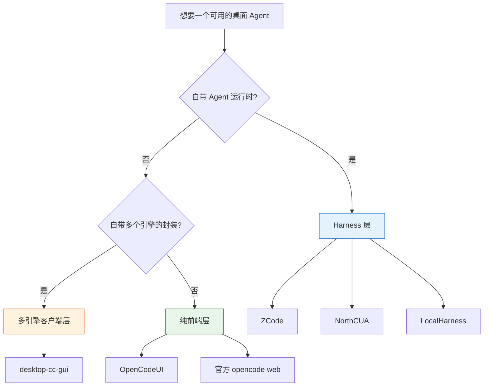

# 开源 Agent harness 与轻量客户端：先分清你要哪一层

> 核对时间：2026-11-05。仓库存在性、星数、语言、许可证用 `gh api repos/<owner>/<repo>` 实取（**已验证**）。
> 对话里提到但本次**未能定位公开仓库**的项目，统一放在第 4 节，不写特性。

## 一句话

"开源桌面 agent 工具"混着三种东西：**自带运行时的 harness**、**只做多引擎外壳的客户端**、**只管界面的前端**。装错层的典型症状是：想要"能跑的 agent"，结果下到一个没有模型的壳。



## 1. Harness 层（自带 agent 运行时）

| 项目 | 星数 | 语言 | 定位（仓库描述） |
|---|---:|---|---|
| `zai-org/ZCode` | 8,474 | TypeScript | Z.ai 的 coding agent harness；桌面（Electron）+ Web + TUI 共享同一后端；Apache-2.0 |
| `beipo-ai/NorthCUA` | 45 | Python | 开源 Desktop/Web agent harness，强调长程记忆、在线评估、可恢复批次 |
| `ahwurm/localharness` | 58 | Python | 面向**本地 LLM** 的编码 agent harness，自带事件流、日志、性能数据 |

ZCode 的已知细节（来自仓库 README 与公开报道，**已验证于公开材料**）：

- 开源时间 2026-09-20，Apache-2.0，pnpm monorepo，Node 24.14 / pnpm 10.33（版本以 `mise.toml` 为准）。
- 三种入口共享后端：`zcode`（TUI）、`zcode --web`、`pnpm dev:desktop`。
- **没有一行命令安装脚本**：`install.sh` 是你自建发行包时生成的，主流玩法是从源码构建。
- 有 hook 机制（工具调用前后可拦截/改写）；这一点是它区别于"纯 chat loop"的关键。

## 2. 多引擎客户端层（不提供模型，管多个 CLI）

| 项目 | 星数 | 语言 | 定位 |
|---|---:|---|---|
| `zhukunpenglinyutong/desktop-cc-gui` | 4,568 | TypeScript (Tauri) | 把 Claude Code、Codex、Gemini、OpenCode 等多个引擎放进一个 GUI |

判据：你已经装了多个 CLI、只是嫌切终端麻烦 → 这一层。它不解决"agent 怎么工作"，只解决"界面统一"。

## 3. 纯前端层（只管 OpenCode 的界面）

| 项目 | 星数 | 语言 | 备注 |
|---|---:|---|---|
| `lehhair/OpenCodeUI` | 576 | TypeScript | 仓库只给了一个 Pages 地址作描述；功能边界需自己看 README |
| 官方 `opencode web` | — | — | 零安装，功能基础，随 CLI 分发 |

判据：嫌 OpenChamber 重、又不想换引擎 → 这一层。注意这类前端**读的是同一个本地会话存储**，所以"轻"的代价通常是少功能（多 agent 编排、审批面板等）。

## 4. 未核实项（不写特性）

以下名称来自对话转述，本次用 GitHub 检索未定位到可确认的仓库，**不要直接引用其能力描述**：

- OpenHuman、Nerve、Poseidon、Odex、CodeAlta、OpenAgentd、OAgent
- OpenVibe、Ally、enowX、T3 Code、Paseo
- Kenaz Harness、PenguinHarness、Ding Harness、Omnigent、HarnessKit、Wudbo、LongHorizon-Harness

其中 **Odex** 直接检索为空；其余多为小项目、改名或私有仓库。要用先补三件事：仓库地址、最近提交、许可证。

另有一条**半核实**：`longbkit/clisbot`（130★，TypeScript，仓库描述是 "Agentic Coding CLI & chat bot"）。对话里说它是"Daemon 架构、桌面/Web/移动/CLI 多端、支持 OpenCode/Claude Code/Codex/Pi、Git worktree 并行隔离"——这些细节**仓库描述里没有**，属未核实，别当结论用。

## 5. 选型顺序

1. 先问"我要不要它自带运行时"。要 → 第 1 节；不要 → 第 2/3 节。
2. 再看"模型从哪来"。harness 通常要你自己配端点或订阅；本地模型优先看 `localharness` 这类明确面向本地的。
3. 最后看"隔离"。需要沙箱/审批/hook 拦截的，确认目标项目**在 Windows 原生是否支持**；很多方案的沙箱只做了 macOS/Linux。

## 6. 验证方式（只读）

```bash
gh api repos/<owner>/<repo> --jq '"\(.stargazers_count) ★ | \(.language) | \(.pushed_at) | \(.license.spdx_id)"'
gh api repos/<owner>/<repo>/contents/README.md -H "Accept: application/vnd.github.raw" | head -60
```

三个数字就能过滤掉大部分噪音：**最近推送时间**（死没死）、**许可证**（能不能用）、**星数**（有没有人真的在跑）。
