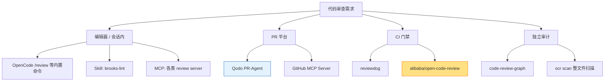

# 代码审查工具谱系：先分清"审查发生在哪一层"

> 核对时间：2026-11-05。星数与元信息用 `gh api repos/<owner>/<repo>` 实取（**已验证**）；未取到的项目一律标 **未核实**，不写特性。
> 星数只反映热度，不代表适合你的场景；一天内可能变，引用前重取。

## 一句话

同样是"AI 代码审查"，**编辑器里点一下**、**PR 上自动跑**、**CI 里卡门禁**、**会话里让 agent 自查**是四件不同的事。选型第一步不是比 star，是确认审查发生在哪一层。



## 1. 实测清单

| 项目 | 星数 | 语言 | 定位 | 形态 |
|---|---:|---|---|---|
| `alibaba/open-code-review` | 49,421 | Go | 确定性流水线 + LLM Agent 的混合审查 CLI；读 Git diff，输出行级评论；另有 `ocr scan` 做整文件审计 | CLI + npm 包 + GitHub Actions |
| `tirth8205/code-review-graph` | 32,587 | Python | 本地优先的代码智能图，给 MCP / CLI 提供"只读相关文件"的上下文缩减 | MCP / CLI |
| `github/github-mcp-server` | 34,227 | Go | GitHub 官方 MCP；PR、issue、代码检索等能力通过 MCP 暴露 | MCP Server |
| `qodo-ai/pr-agent` | 14,604 | Python | PR 自动审查，支持 GitHub / GitLab / Bitbucket | 服务 / Action |
| `reviewdog` | 9,719 | Go | 把各种 linter 的输出过滤后贴回 PR 评论，**本身不产审查意见** | CI 工具 |
| `hyhmrright/brooks-lint` | 1,558 | HTML/TS | 六个 Agent Skill，按软件工程经典著作的维度查架构、技术债、测试、修复 | Skill 包 |

补充说明：

- `alibaba/open-code-review` 采用 Apache-2.0；官方 README 称其为阿里内部审查助手的开源版，强调 precision/F1 与 token 成本，**recall 更低是明确取舍**——它宁少报不多报。是否接受这个取舍取决于你是"怕漏"还是"怕吵"。
- `reviewdog` 常被误当成 AI 审查工具。它的价值是**把已有工具的输出规范化贴回 diff**，AI 与非 AI 都能接。
- `brooks-lint` 是 **Skill** 形态（给 Codex / Cursor / Copilot / OpenCode 之类宿主用），不是独立服务；它依赖宿主提供模型与文件访问。

## 2. 仅有名称、未定位仓库的项目

2026-11-05 用 `gh search repos` 检索。结论分三类，二三类不能当同一类用。

### 找到且可用（星数已核对）

| 项目 | 仓库 | 星数 | 实际是什么 |
|---|---|---:|---|
| opencode-power-pack | `waybarrios/opencode-power-pack` | 550 | 55 个 skill，支持 Codex / OpenCode 1.18.7 与 2.x / Pi；README 称 v0.5.0 起带 opt-in 沙箱（macOS Seatbelt、Linux Bubblewrap，四个最小权限 profile，fail-closed） |
| jev-review | `devagrawal09/jev-review` | 696 | 分阶段审查工作流 + 本地 dashboard；另有同名 MCP 插件 `NiazMorshed2007/jev-review`（248★），**两者不是同一个项目** |

`opencode-power-pack` 的两点限制（README 原文口径）：沙箱只承诺**命令及其子进程**被 shell 隔离，"自动宿主路由与整机隔离尚未声称"；原生隔离只提 macOS / Linux，**Windows 未提**——按"未提即不支持"推断，属**推测**。

### 存在但极小（可安装，不构成方案）

| 项目 | 仓库 | 星数 | 备注 |
|---|---|---:|---|
| local-pr-reviewer | `nartc/local-pr-reviewer` | 3 | tmux 里跑本地 PR 审查 |
| copilot-second-opinion | `Adamkadaban/copilot-second-opinion` | 1 | OpenCode skill + MCP，驱动 GitHub Copilot 的 PR 审查循环 |
| create-code-reviewer | `kokorolx/create-code-reviewer` | 0 | 生成审查 skill 的 skill |

这类项目的价值是**读它的提示词结构**，不是直接上生产。0–3 星意味着几乎没有外部用户踩过坑。

### 仍未定位到同名仓库

- `ai-code-review-mcp`（检索只返回 `code-review-graph`、`jev-review` 等近似项）
- `code-review-agent-skill`（只有 `win4r/agent-skills-code-review-router` 等近似名）
- Endor Labs MCP（厂商产品，GitHub 上没有对应开源仓库）

**判据**：名字被反复转述，不等于仓库存在。采用前必须补三件事——仓库地址、最近推送时间、许可证；缺一项就不应写进方案。

## 3. 选型判据

按顺序问四个问题：

1. **审查结果要落到哪？** 只要自己看 → 会话内 / 编辑器；要留痕给团队 → PR 评论；要卡合并 → CI 门禁。
2. **要不要行级定位？** 要 → 选能输出 `文件:行` 的工具（`open-code-review`、PR-Agent、reviewdog 链路）；不要 → 纯文本报告即可。
3. **误报和漏报哪个更贵？** 团队被噪音烦到不看评论 → 选偏 precision 的；线上事故代价高 → 选偏 recall 的，或叠加规则引擎。
4. **模型从哪来？** 大多数工具只要一个 OpenAI/Anthropic 兼容端点；本地模型方案要单独确认上下文长度与工具调用能力。

一个务实组合：

- **日常**：宿主内置审查命令（见 `review-commands/`），零安装。
- **PR 门禁**：`reviewdog` 接 linter + `open-code-review` 做 LLM 层，避免纯 LLM 审查的不稳定性。
- **安全/依赖**：单独上 SCA 类工具，别指望代码审查模型替代。

## 4. 验证方式（只读）

```bash
gh api repos/<owner>/<repo> --jq '"\(.stargazers_count) ★ | \(.language) | \(.pushed_at) | \(.license.spdx_id)"'
gh api repos/<owner>/<repo>/contents/README.md -H "Accept: application/vnd.github.raw" | head -40
```

看三件事：**最近推送时间**（是否还活着）、**许可证**（能否商用）、**README 是否给出可复现的安装与端点要求**。
