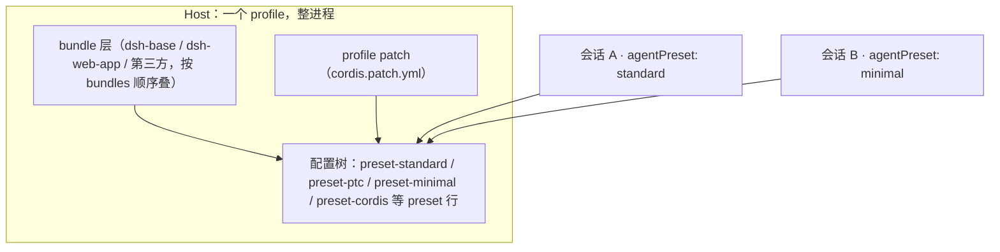
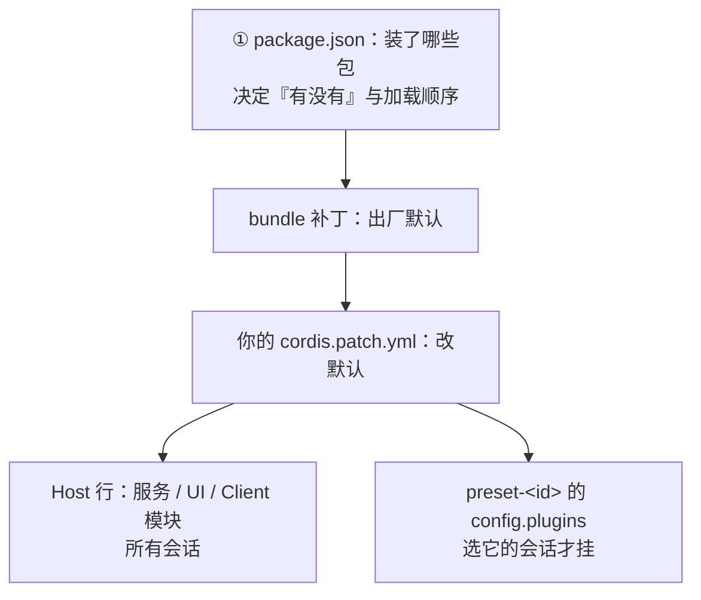
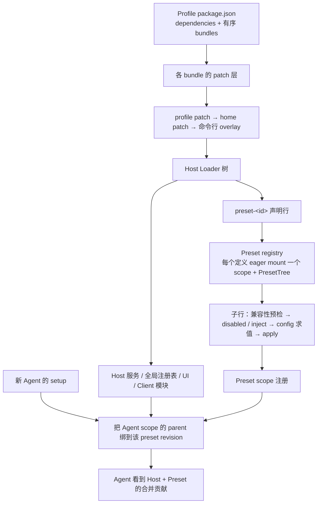

# DSH 的 Profile 与预设：进程级宿主 vs 会话级 agent

> 核对：2026-11-21。依据：本轮只读复核（两个 profile 的 `package.json`、会话头解帧、`127.0.0.1` 探针、`dsh plugin --help`、`app.asar` 内 `install-spec.ts` / `dsh-web-app/presets/*.patch.yml` / CLI 的 `rejectElectronProfile` 源码）＋ 上一轮会话内的实读结论。未标注＝本轮实测；**源码级**＝读打包源码或包内文档得出、未实跑；**推理**＝由事实推出、无直接证据。DSH 走 nightly，预设行与包名会漂移，本篇有效窗口约一个 rc 周期。
>
> 2026-11-26 补：按挂载位置的三类插件、两种「加插件」与完整注入链路。依据 `0.2.2-rc.5` 安装目录内 `@deepseek-ai/dsh-agent-preset` 的 README 与 `skills/dsh-doc/references/{compositions,ui-plugin,composition-reference}.md`、`dsh-web-app/README.zh.md` 与 `presets/*.patch.yml`，以及 `dsh-app-boot`、`dsh-agent-preset-registry`、`cordis-plugin-loader`、`dsh-api-session-controller`、`dsh-subagent` 的包内源码；**文档级/源码级**，未改配置、未实跑新会话。

## 一句话

**Profile 管「这台机器上跑的是哪个宿主」，预设管「这个会话里是哪个 agent」。** 预设不是独立文件，是 profile 配置树里的一行（`preset-<id>`）。

## 对照表

| 维度 | Profile | 预设（Agent preset） |
|---|---|---|
| 层级 | **Host 级**：整进程 | **Agent 级**：每个会话 |
| 位置 | `~/.dsh/profiles/<name>/` | 配置树里一行 `preset-<id>`（`@deepseek-ai/dsh-agent-preset`）；随包默认由 `dsh-web-app` 提供 |
| 数量 | 一次启动用一个；同机可以有多个目录 | 同一进程内多套并存，会话各自记录用哪套 |
| 决定 | 能加载哪些宿主服务：界面形态（web/headless/acp/sdk）、模型路由、会话持久化、沙箱、持久终端、插件管理 | 该会话的插件行：persona、AGENTS.md 加载、工具面、skill 根与 skill 工具、压缩组、plan 组、委派组 |
| 生效 | 进程级：改完要重启/重载 | Agent 创建时绑定；blank session 首轮前可重绑，已开始 turn 则锁定 |
| 修改 | 改 `package.json` / `cordis.patch.yml`，或用插件页安装 | 只能走 patch 层：bundle 补丁 `insert`，或 profile patch 按 `id` 覆盖整份 `config.plugins` |



## 按挂载位置分的三类插件（2026-11-26 补）

| 类别 | 行落在哪 | 谁决定用不用 | 干什么 | 边界 |
|---|---|---|---|---|
| **Host / profile 级** | profile 配置树（bundle 补丁 + 你的 patch） | profile 启动/重载，所有会话共享 | 共享服务、模型路由、会话持久化、工具执行器、UI 的 Host 行 | 改动通常要重启或 HMR |
| **preset 子插件（Agent 级）** | `preset-<id>` 行的 `config.plugins` | 会话选中的预设 | persona、prompt 片段、限定作用域的工具、策略 | 只引用可解析包，不装包；已有 Agent 保留绑定时的 revision |
| **Client 模块（浏览器面）** | bundle 的 `dsh.client`（`platform` / `immediately` / `inject` + `./client` 导出） | 随那条 Host 行加载，浏览器按 slot 注册 | UI 装饰、页面、菜单 | 不是第四种挂载位置，是 Host 行派生出的浏览器执行面；preset 管不到 |

### 一句话比喻：Profile 管「装不装、怎么配」，Preset 管「用不用」

> **Profile 决定它有没有被安装、以及如何配置；Preset 决定它是否被启用。**

拆成三句：

1. **Profile 管进料**：包在不在、哪些补丁层参与叠加、默认配置长什么样。
2. **Preset 管取用**：这个 Agent 从可用物料里取哪几样、带什么参数挂上去。
3. **但不是所有物料都归 Preset 取用**：Host 类插件只认 Profile，Preset 无权置喙。

| 行属于哪棵树 | 谁能决定它启用/禁用 | 谁能改它的配置 | Preset 能不能干预 |
|---|---|---|---|
| **Host 行** | Profile | Profile（补丁层，`config` 整段替换） | **不能** |
| **Preset 子行** | 该预设声明 | 该预设声明（覆盖时整段替换 `plugins`） | 能 |
| **Client 模块** | 随所属 Host 行 | 所属 Host 行 | 不能 |

### 「池子」的准确含义，以及三处需要收紧的地方

「Profile 给 Preset 一个池子，Preset 决定池子里哪些被启用」这个直觉方向是对的，但要收紧三点，否则会踩坑：

| 说法 | 收紧后 | 为什么 |
|---|---|---|
| 「Preset 启用某个插件包」 | Preset 挂载的是**某一行的挂载点**，不是包本身 | 包没有「启用」状态；同一个包能在两棵树里各挂一行，跑出两个实例 |
| 「池子里的都能挑」 | Preset 只能挑**已在解析表里**的包，且依赖要能满足 | 声明不安装包、也不扩池；挑到池外的东西 → 整份预设挂载失败 |
| 「普通 Bundle 也归 Preset 选」 | Bundle 是**补丁容器**，参不参与叠加由 Profile 决定 | Preset 能做的只是引用它带来的包，或覆盖某个预设声明 |

所以更准确的一句是：**Profile 负责「备料 + 出厂默认装配 + 划定可用池边界」，Preset 负责「在这桌点哪几样」。**

### 判断一个插件该归谁管

| 判据 | 归 Profile | 归 Preset |
|---|---|---|
| 不同会话需要不同表现吗 | 否 | **是** |
| 有没有别的 Host 行依赖它（服务被上层消费） | **是** | 否 |
| 浏览器端要不要它 | **是** | 否 |
| 名字需要在全进程唯一吗 | **是** | 否 |

只要有一条命中「归 Profile」，就应该放 Host 树；四条都不命中，才考虑放预设子行。放错的表现：放 Host 想按会话区分 → 改不动；放 Preset 想全局共享 → 域外看不见，或直接挂载失败。

**源码级依据**：Preset 子行在挂载时被单独组建成一棵新的 EntryTree（`dsh-agent-preset-registry/src/mount.ts` 的 `mountPreset`），而 Profile 的补丁只作用于 Host 那棵树的 entry 列表（`dsh-app-boot/src/profile.ts` 的 `composeEntries` 对空根调 `applyEntryPatches`）。两棵树各自维护 id，所以互相禁用不了。



### 两种「加插件」别混

| 说法 | 实际动作 | 落点 |
|---|---|---|
| 装插件 | 让包能被解析、bundle 参与合成 | `package.json` 的 `dependencies` / `dsh.profile.bundles`，详见[插件体系与安装](插件体系与安装.md) §1、§4 |
| 加行（全局） | patch 的 `insert` 追加一条 Host row | ② 用户 patch 或某个 bundle 自带的 ④ |
| 加行（按会话） | 写进某预设的 `config.plugins` | `preset-<id>` 行；包必须在当前 profile 运行时解析表中可见，否则激活失败 |

preset 里写了某个包，但当前 profile 的**运行时解析表**看不到它（既非随 DSH 提供，也不是 profile 或已选 bundle 的依赖）→ 那一行导入失败，声明留在名录里并带诊断；preset 声明本身不会安装包（**源码级**：`dsh-app-boot/src/profile.ts` 的运行时解析、`dsh-agent-preset-registry/src/mount.ts` 的导入审计）。

## 注入链路：Profile 装配 Host，Preset 装配 Agent 子树

> **源码级**：以下链路依据 `0.2.2-rc.5` 打包源码逐段核对；本机没有 `cordis_inspect_*` 工具，未启动新会话做 A/B 实跑。

### 先分清六种“注入”

| 说法 | 实际含义 | 主要由谁决定 |
|---|---|---|
| **包解析注入** | 让 `name` 能 import 到；来自安装包、profile 依赖或已选 bundle 的依赖闭包 | Profile |
| **配置合成注入** | bundle patch、profile patch、home patch、命令行 overlay 叠成最终 entry 树 | Profile；preset 声明本身也是这棵 Host 树里的一行 |
| **Cordis 依赖注入** | row 的 `inject` 与插件类的 `static inject` 要求服务先可用；`ctx.get()` 按 context/realm 查找 | Profile 提供 Host 服务；Preset 在同一 realm 内提供组内服务 |
| **作用域注册注入** | 工具、prompt section、skill、listener 等注册进 scoped registry；子 scope 看祖先，近者遮蔽远者 | Preset + Agent scope |
| **模型上下文注入** | 上述注册最终变成系统提示词、工具 schema、skill 目录或 user-role context | Host 与 Preset 共同决定，Preset 决定每个 Agent 看到哪一份 |
| **浏览器 Client 注入** | 包清单 `dsh.client` 派生的浏览器模块与 slot 注册 | Host row；Preset 管不到 |



关键点：**preset 不是每个会话各 new 一套插件树**。registry 在当前定义激活时就建好一棵共享树；选择同一 preset revision 的 Agent 绑定到同一 generation。Agent scope 负责把注册可见性与生命周期限定到单个 Agent，子 Agent 通过 `composeFrom()` 继承父 Agent 正在用的那一版。

### Profile 对插件的六种影响

1. **决定包是否存在、能否解析。** preset 的 `plugins` 只是引用，不会装包；当前 profile 的运行时解析表必须能看到它。
2. **决定 Host 行。** bundle patch 与用户 patch 合成出进程级服务、UI、模型路由、会话存储、沙箱等 row；它们通常整进程共享。
3. **决定 preset 声明本身。** `preset-standard` 也是 Host 树的一行，所以 bundle 顺序、profile patch、home patch、`--patch` 都能改它。
4. **决定默认层与覆盖优先级。** 后层赢；覆盖已有 row 时 `config` 整段替换，preset 的整个 `config.plugins` 也会被整段换掉。
5. **决定 Host 服务是否就绪。** preset 子行可以消费 Host 服务；Host 提供者晚到时，子行保持 pending，provider 就绪后自行激活。
6. **决定浏览器面。** Client 模块随 Host row 的包元数据加载，不随会话 preset 切换。

### Preset 对插件的六种影响

1. **决定这个 Agent 挂哪些子行。** persona、工具、skill 发现、prompt section、plan/compaction/delegation 组都在 `config.plugins`。
2. **决定子行的条件与参数。** `disabled: !!js ...` 在挂载判定时按 entry context 求值；`config` 里的 `!!js ...` 在依赖注入就绪后按该插件 context 求值。
3. **决定注册可见范围。** 子插件通过 preset scope 注册，Agent 再作为子 scope 读取；同名注册近者遮蔽远者。
4. **决定模型可见面。** 同一个 Host 可以提供工具/prompt 注册表，但每个 Agent 只看到自己 scope chain 选中的工具、提示词段和 skill。
5. **决定组内服务 realm。** preset 里若要提供服务，提供方与消费方必须同处一个 `cordis:group` 的 `isolate` realm；未隔离而泄漏到 Host root realm 会让整个 preset 挂载失败。
6. **决定 revision 绑定时机。** 新 Agent 使用当前定义；定义更新后旧 Agent 与其子 Agent 保留旧 revision，最后一个引用释放才 dispose。

### `inject`、`scope`、`isolate` 不是一回事

| 机制 | 管什么 | 不管什么 |
|---|---|---|
| `inject` | 依赖服务必须先可用；row 级与插件类级注入共同决定 fiber 的依赖 | 不会安装包，也不会把服务复制进 preset |
| `scope` | 注册可见性、事件可见性、生命周期；子 scope 继承祖先层 | 不是任意 Cordis service 的隔离，也不是安全沙箱 |
| `isolate` | 给指定服务名换 service-instance realm；`true` 是 entry 本地 realm，字符串是共享 label | 不改变 contribution scope，不阻止恶意 Host 代码 |
| `EntryGroup.key` | 让 AgentPreset / `cordis:group` 作为 tree carrier，保留子行 `!!js` 到子插件加载时再求值 | 本身不创建 isolate realm |

**Preset 不是安全沙箱**：YAML 与插件代码都能执行 Host 代码；scope/isolate 解决的是可见性与服务实例问题，不是权限边界。

### 同一个 `id` 出现在 Host 与 Preset，不是同一行

Web 层刻意把 `tool-bash`、`tool-pwsh`、`tool-fs`、`tool-skill` 等 **Host row** 设为 `disabled: true`，再由各 preset 的子行挂载。因此：

```yaml
# 只禁用 Host 树里的 tool-bash
- id: tool-bash
  disabled: true
```

**不会**禁用 `preset-standard.config.plugins` 里那个 `id: tool-bash`。两棵树各自维护 entry，id 只在所在树内定位。要改 standard 的工具面，必须覆盖 `preset-standard` 的完整 `config`（尤其完整 `plugins`），或新建/修改 preset 声明。

### 失败会落在哪一层

| 故障 | 结果 |
|---|---|
| Host 可选 row 导入/激活失败 | 记录警告，其他 Host 行继续；required row 失败可终止启动 |
| profile / home patch 格式错误 | 启动失败；运行期 HMR 拒绝坏 patch，保留原配置 |
| preset 子行包解析不到 | 该 preset 的 mount 失败，名录显示诊断；新 Agent 不能绑定它 |
| preset 子行激活失败 | 同上；不会自动安装缺失依赖 |
| preset 服务泄漏到 root realm | mount 直接失败：`Preset services require isolate realms` |
| preset 子行等待 Host 服务 | 先保持 mounted/pending；Host Loader settle 后重新审计，provider 出现即可激活 |
| preset 定义更新 | 旧 revision 留给已有 Agent/子 Agent；新 Agent 用新定义；进程重启不保留旧实现 |
| 已开始首轮会话想换 preset | `agent-preset/locked`；只有尚未开始 turn 的 blank session 可重新选择 |

## 包含关系：抽掉一层，四个预设一起消失

- 2026-11-26 复核：本机 `desktop` 的 profile patch 有 431 行、**0 条 `- id: preset-`**。四个内置预设的定义在 `app.asar` 的 `dsh-web-app/presets/*.patch.yml`，由 `dsh-web-app` 这层 bundle 的 patch `insert` 进来。
- 所以 `dsh.profile.bundles` 里去掉 `@deepseek-ai/dsh-web-app`，四个预设一起消失；`agent-preset-registry` 的 `default: standard` 就指向一个不存在的预设。
- 反方向不成立：预设里配什么，都不会给 profile 多装一个依赖、多选一个 bundle，也不会新建 profile 目录。

## 边界推论：预设只能「用」宿主，不能「提供」宿主级服务

包内装载器文档（**源码级**，asar 内实读）两段原话：

> `isolate` maps service names to `true` or a realm label; a preset plugin that provides a service isolates the provider and all consumers together.

> A preset service provider and its consumers must share one `cordis:group` isolation realm. Entry-local isolation does not propagate through the Agent registration scope: ordinary Context lookup outside the group, including `agent.ctx`, still selects the Host realm.

含义与用法：

- 预设里挂一个**提供服务**的插件，组外的普通 Context 查找（含 `agent.ctx`）仍指向 Host realm，看不到它。要让它们互相看见，必须把提供方和消费方一起放进同一个 `cordis:group`，用 `isolate: { <服务名>: true }` 圈成一个 realm。
- 想给**整个宿主**加一个服务（所有会话都能用），落点是 bundle/plugin，不是预设。
- 内置预设自己就是这么用的：`standard` 里 plan、compaction、delegation 各是一个 `cordis:group`，分别 `isolate` 了 `planMode`、`compaction` + `toolResultPruner`、`workflowEngine`。

顺带一条推论（**推理**）：**profile 是故障与信任的边界**。profile 里装坏的 bundle 可能拖垮整个进程；预设配坏通常只让该定义不可用，其余模式照常。所以「想隔离风险」调的是 profile，「想切行为」调的是预设——日常旋钮是预设，不是 profile。

## 为什么没有「会话中途换个智能体」这个动作

能换的只有旋钮，不是任意热插拔。预设的插件树在 Agent 创建时绑定；注册表包内 README 的原话是「现有 Agent 保留已经使用的组合」，KV Cache 一节写的是「已有 Agent 保留插件和提示词，新 Agent 从当前定义构建前缀」（**文档级**）。所以通常「换个 preset」= 新建或恢复一个 Agent；尚未开始首轮 turn 的 blank session 是例外，可以重绑。

会话内允许的三类变化都不重建组合：

| 操作 | 实际改了什么 | 边界 |
|---|---|---|
| `/plan` | 追加 `plan:policy` 提示词段落（order 50），并按条件把 `exit_plan_mode` 纳入工具声明 | 只加不减，工具面不缩小；退出计划态后指引段落消失 |
| 切模型（`AgentModel.select({ provider, model, reasoningEffort? })`） | 从**下一个尚未开始准备的步骤**起换路由 | 不查默认值、不继承旧强度；只换请求目标 |
| `/permission` | 把沙箱模式与审批策略两个 knob 捆绑成具名预设 | 执行策略，不碰提示词与工具 |

注意「不重建组合」不等于「不动前缀」：`/plan` 追加的是一段系统提示词，切模型会换 provider 的缓存。真正的分界是这些操作都不涉及工具集与人格的重新装配。压缩时的遮蔽边界与前缀失效点见[压缩：遮蔽边界与缓存代价](压缩-遮蔽边界与缓存代价.md)。

## Profile 的两个字段

### `dependencies`：有没有这段代码

四种 spec（**源码级**：`dsh-plugin-manager/src/install-spec.ts` 把它归为 `registry` / `path` / `tarball` / `git` 四类）：

| 写法 | 例 | 本机 |
|---|---|---|
| npm 版本范围 | `^1.2.3` | 有 |
| 本地目录 | `link:<路径>`（pnpm 的 `path` 形态） | 有 |
| tgz | `file:<路径>.tgz` | 有 |
| Git 固定提交 | `git+https://<host>/<owner>/<repo>.git#<commit>` | 本轮无实例 |

`dsh plugin --profile <name> add <spec>` 的帮助原文是 *"forwarding the remaining arguments to pnpm in the profile directory"*，所以 spec 形态就是 pnpm 的形态，不需要另记一套语法。

### `dsh.profile.bundles`：按什么顺序叠哪几层

- 元素是包名、数组有序、后面的赢；**它不负责加载**，只让该 bundle 自带的 patch 参与合成。
- 启动时每一项要过四道关（能解析、有 `dsh.bundle`、平台匹配、engines 兼容），关关都在同一处跳过并写 stderr。完整流程与「谁在改这个字段」见[插件体系与安装](插件体系与安装.md)。

### 两者可以不对应

| deps | bundles | 含义 | 本机实例 |
|---|---|---|---|
| 有 | 有 | 正常第三方 bundle | `dsh-summary-command`、`dsh-opencode-go` |
| 有 | 无 | 装了、没激活 | `dsh-agent-enhancer`、`dsh-sidebar-search` |
| 无 | 有 | 随安装自带，实体在 `app.asar` | 11 个 `@deepseek-ai/*` |
| 无 | 无 | 没装也没选；包卸了但 patch 行还在时也是这一格 | 孤儿行 |

完整的加载顺序（空根 → 各 bundle patch → profile patch → home patch → `--patch`）与「整段替换 `config`」语义见[配置分层与目录](配置分层与目录.md)，本篇不重复。

## 会话存储不绑 profile，但恢复要同名预设

- 会话根由 `session-persistence-jsonl` 的 `root: !!js dshHomePath('sessions')` 固定（**源码级**，asar 内实读），**与 profile 无关**；`storages/` 同理。所有 profile 共用同一个会话库。
- 解一帧会话头（本轮实测，取本工作区最新会话）：

  ```json
  {"type":"session","version":4,"id":"session-…","createdAt":1795044275699,
   "cwd":"<工作区>","isSeeded":false,"delegationDepth":0,"agentPreset":"standard"}
  ```

  字段里**没有 profile**（`parentSession`、`origin` 是按需出现，本例就没有）。
- 三条结论：

  1. **存储同一份**：换 profile 不会换一个会话库，文件也不会被搬走。
  2. **列表按 cwd 分组**：换工作目录就换一簇；cwd 对不上任何已登记工作区的会话落「未分组」。
  3. **恢复要求该 `agentPreset` 在新 profile 里仍有定义**，缺失就拒绝恢复。切 profile 后「某些会话打不开」通常不是文件丢了，而是那个预设没在新 profile 里。

- 纠偏（**推理**）：`agentPreset` 存的是**名字**，不是装配内容。同名预设在两个 profile 里可以装得不一样，恢复出来的会话会按新 profile 的同名预设跑工具面与人格。

## 想改一件事，落在哪一层

| 想改 | 落点 |
|---|---|
| 换界面形态 / 沙箱 / 模型路由 / 会话持久化 | profile |
| 装插件、加 bundle | profile 的 `package.json`；bundle 还要进 `dsh.profile.bundles`，普通插件可靠 row 加载而不进 bundles |
| 换某个模式的人格 | 该预设的 `persona` 行 |
| 工具面（多一个、关一个） | 该预设的 `config.plugins` |
| skill 目录 | 该预设的 `skill-filesystem` 行（`customSkillDirs`） |
| 让极简模式也读 AGENTS.md | 给 `minimal` 预增设 `agent-instructions` 行 |
| 全局规则 | `~/.dsh/AGENTS.md`，不属任何一层配置（见[工作区、会话与指令链](工作区-会话与指令链.md)） |

人格与 `agent-instructions` 的具体字段、四个预设的差异见[预设：persona 与 agent-instructions 挂在哪](预设-人格与指令挂载.md)。

## 源码锚点（0.2.2-rc.5）

| 包内文件 | 核对点 |
|---|---|
| `@deepseek-ai/dsh-app-boot/src/profile.ts` | bundle/profile patch 合成、安装锚点与 profile 锚点、运行时解析 |
| `@deepseek-ai/dsh-app-boot/src/compatibility-preflight.ts` | Host 与 preset 子行在 import 前做兼容性准入 |
| `@deepseek-ai/dsh-agent-preset/src/index.ts` | `EntryGroup.key` 保留子行表达式；声明注册给 registry |
| `@deepseek-ai/dsh-agent-preset-registry/src/index.ts` | eager mount、revision retain、Agent/子 Agent 绑定、select 锁 |
| `@deepseek-ai/dsh-agent-preset-registry/src/mount.ts` | PresetTree、pending/failed 审计、root-realm 服务泄漏拒绝 |
| `@deepseek-ai/cordis-plugin-loader/src/index.ts` | `internal/config` 插值时机、row `inject` 解析 |
| `@deepseek-ai/cordis-plugin-loader/src/config/{entry,isolate,utils}.ts` | `disabled` 求值、realm、`!!js` 递归求值 |
| `@deepseek-ai/dsh-api-session-controller/src/agent.ts` | 新/恢复会话在 Agent setup 中调用 `presets.mount()` |
| `@deepseek-ai/dsh-subagent/src/child-agent.ts` | 子 Agent 用 `composeFrom()` 继承父级 exact revision |
| `@deepseek-ai/dsh-web-app/cordis.patch.yml` | Host 行禁用、preset 子行启用的实际分层 |

## 本机快照（2026-11-21）

| 项 | 值 |
|---|---|
| profile 目录 | `desktop`、`web` |
| `desktop` | 13 个 deps / 22 个 bundles / patch 465 行 |
| `web` | 0 deps / 2 bundles（`dsh-base`、`dsh-web-app`）/ patch 7 行 |
| 默认预设 | `default: standard`、`selectedDefault: standard` |
| profile patch 里的 preset 行 | 0（定义在 `dsh-web-app`） |
| 四个内置预设的子行数 | standard 33、ptc 34、minimal 12、cordis 33（本轮数 `- id:`） |
| `minimal` 的差异 | 无 `agent-instructions`、无 `skill-filesystem` → 不读 AGENTS.md、不挂 skill |

计数随插件装卸漂移（更早快照是 18 bundles / 357 行），引用前重读 manifest，别把旧数字当事实。

## 未核实项

- 另外三个预设（`ptc` / `minimal` / `cordis`）本轮只核对了子行数与两个关键行，没有逐行比对工具差异。
- 「同名预设在两个 profile 里装得不一样、恢复后按新 profile 跑」是推理，未做跨 profile 恢复实验。
- `headless` / `acp` / `sdk` 等无 GUI profile 的实际界面与宿主服务差异未实跑。
- `--patch` overlay 与 profile 里 `preset-<id>` 覆盖的叠加边界未单独实测。
- 完整注入链路为源码级；未启动两个新会话对比 Host/preset 工具面，也未用 `cordis_inspect_*` 查看实时 mounted tree。
- preset revision 更新时旧 Agent 保留旧树、新 Agent 使用新树的行为未在本机做时间顺序 A/B；进程重启后按当前同名定义恢复也未实跑。
- Client 模块注入只核对了包元数据与文档，未做浏览器 slot 注册实测。

相关：[配置分层与目录](配置分层与目录.md) · [预设：persona 与 agent-instructions 挂在哪](预设-人格与指令挂载.md) · [插件体系与安装](插件体系与安装.md) · [工作区、会话与指令链](工作区-会话与指令链.md) · [压缩：遮蔽边界与缓存代价](压缩-遮蔽边界与缓存代价.md) · [运行环境：Desktop 还是浏览器 Web](运行环境-Desktop还是浏览器Web.md)
