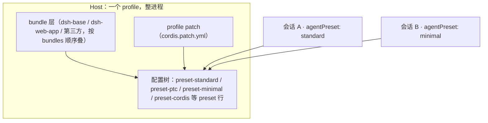

# DSH 的 Profile 与预设：进程级宿主 vs 会话级 agent

> 核对：2026-11-21。依据：本轮只读复核（两个 profile 的 `package.json`、会话头解帧、`127.0.0.1` 探针、`dsh plugin --help`、`app.asar` 内 `install-spec.ts` / `dsh-web-app/presets/*.patch.yml` / CLI 的 `rejectElectronProfile` 源码）＋ 上一轮会话内的实读结论。未标注＝本轮实测；**源码级**＝读打包源码或包内文档得出、未实跑；**推理**＝由事实推出、无直接证据。DSH 走 nightly，预设行与包名会漂移，本篇有效窗口约一个 rc 周期。

## 一句话

**Profile 管「这台机器上跑的是哪个宿主」，预设管「这个会话里是哪个 agent」。** 预设不是独立文件，是 profile 配置树里的一行（`preset-<id>`）。

## 对照表

| 维度 | Profile | 预设（Agent preset） |
|---|---|---|
| 层级 | **Host 级**：整进程 | **Agent 级**：每个会话 |
| 位置 | `~/.dsh/profiles/<name>/` | 配置树里一行 `preset-<id>`（`@deepseek-ai/dsh-agent-preset`）；随包默认由 `dsh-web-app` 提供 |
| 数量 | 一次启动用一个；同机可以有多个目录 | 同一进程内多套并存，会话各自记录用哪套 |
| 决定 | 能加载哪些宿主服务：界面形态（web/headless/acp/sdk）、模型路由、会话持久化、沙箱、持久终端、插件管理 | 该会话的插件行：persona、AGENTS.md 加载、工具面、skill 根与 skill 工具、压缩组、plan 组、委派组 |
| 生效 | 进程级：改完要重启/重载 | 会话级：新建会话时定死，只影响之后的 agent |
| 修改 | 改 `package.json` / `cordis.patch.yml`，或用插件页安装 | 只能走 patch 层：bundle 补丁 `insert`，或 profile patch 按 `id` 覆盖整份 `config.plugins` |



## 包含关系：抽掉一层，四个预设一起消失

- 本机 `desktop` 的 profile patch 有 465 行、**0 条 `- id: preset-`**（本轮实测）。四个内置预设的定义在 `app.asar` 的 `dsh-web-app/presets/*.patch.yml`，由 `dsh-web-app` 这层 bundle 的 patch `insert` 进来。
- 所以 `dsh.profile.bundles` 里去掉 `@deepseek-ai/dsh-web-app`，四个预设一起消失；`agent-preset-registry` 的 `default: standard` 就指向一个不存在的预设。
- 反方向不成立：预设里配什么，都不会给 profile 多装一个依赖、多选一个 bundle，也不会新建 profile 目录。

## 边界推论：预设只能「用」宿主，不能「提供」宿主级服务

包内装载器文档（**源码级**，asar 内实读）两段原话：

> `isolate` maps service names to `true` or a realm label; a preset plugin that provides a service isolates the provider and all consumers together.

> A preset service provider and its consumers must share one `cordis:group` isolation realm. Entry-local isolation does not propagate through the Agent registration scope: ordinary Context lookup outside the group, including `agent.ctx`, still selects the Host realm.

含义与用法：

- 预设里挂一个**提供服务**的插件，组外的普通 Context 查找（含 `agent.ctx`）仍指向 Host realm，看不到它。要让它们互相看见，必须把提供方和消费方一起放进同一个 `cordis:group`，用 `isolate: { <服务名>: true }` 圈成一个 realm。
- 想给**整个宿主**加一个服务（所有会话都能用），落点是 bundle/plugin，不是预设。
- 内置预设自己就是这么用的：`standard` 里 plan、compaction、delegation 各是一个 `cordis:group`，分别 `isolate` 了 `planMode`、`compaction` + `toolResultPruner`、`workflowEngine`。

顺带一条推论（**推理**）：**profile 是故障与信任的边界**。profile 里装坏的 bundle 会拖垮整个进程；预设配坏只坏那一个会话模式，其余模式照常。所以「想隔离风险」调的是 profile，「想切行为」调的是预设——日常旋钮是预设，不是 profile。

## Profile 的两个字段

### `dependencies`：有没有这段代码

四种 spec（**源码级**：`dsh-plugin-manager/src/install-spec.ts` 把它归为 `registry` / `path` / `tarball` / `git` 四类）：

| 写法 | 例 | 本机 |
|---|---|---|
| npm 版本范围 | `^1.2.3` | 有 |
| 本地目录 | `link:<路径>`（pnpm 的 `path` 形态） | 有 |
| tgz | `file:<路径>.tgz` | 有 |
| Git 固定提交 | `git+https://<host>/<owner>/<repo>.git#<commit>` | 本轮无实例 |

`dsh plugin --profile <name> add <spec>` 的帮助原文是 *"forwarding the remaining arguments to pnpm in the profile directory"*，所以 spec 形态就是 pnpm 的形态，不需要另记一套语法。

### `dsh.profile.bundles`：按什么顺序叠哪几层

- 元素是包名、数组有序、后面的赢；**它不负责加载**，只让该 bundle 自带的 patch 参与合成。
- 启动时每一项要过四道关（能解析、有 `dsh.bundle`、平台匹配、engines 兼容），关关都在同一处跳过并写 stderr。完整流程与「谁在改这个字段」见[插件体系与安装](插件体系与安装.md)。

### 两者可以不对应

| deps | bundles | 含义 | 本机实例 |
|---|---|---|---|
| 有 | 有 | 正常第三方 bundle | `dsh-summary-command`、`dsh-opencode-go` |
| 有 | 无 | 装了、没激活 | `dsh-agent-enhancer`、`dsh-sidebar-search` |
| 无 | 有 | 随安装自带，实体在 `app.asar` | 11 个 `@deepseek-ai/*` |
| 无 | 无 | 没装也没选；包卸了但 patch 行还在时也是这一格 | 孤儿行 |

完整的加载顺序（空根 → 各 bundle patch → profile patch → home patch → `--patch`）与「整段替换 `config`」语义见[配置分层与目录](配置分层与目录.md)，本篇不重复。

## 会话存储不绑 profile，但恢复要同名预设

- 会话根由 `session-persistence-jsonl` 的 `root: !!js dshHomePath('sessions')` 固定（**源码级**，asar 内实读），**与 profile 无关**；`storages/` 同理。所有 profile 共用同一个会话库。
- 解一帧会话头（本轮实测，取本工作区最新会话）：

  ```json
  {"type":"session","version":4,"id":"session-…","createdAt":1795044275699,
   "cwd":"<工作区>","isSeeded":false,"delegationDepth":0,"agentPreset":"standard"}
  ```

  字段里**没有 profile**（`parentSession`、`origin` 是按需出现，本例就没有）。
- 三条结论：

  1. **存储同一份**：换 profile 不会换一个会话库，文件也不会被搬走。
  2. **列表按 cwd 分组**：换工作目录就换一簇；cwd 对不上任何已登记工作区的会话落「未分组」。
  3. **恢复要求该 `agentPreset` 在新 profile 里仍有定义**，缺失就拒绝恢复。切 profile 后「某些会话打不开」通常不是文件丢了，而是那个预设没在新 profile 里。

- 纠偏（**推理**）：`agentPreset` 存的是**名字**，不是装配内容。同名预设在两个 profile 里可以装得不一样，恢复出来的会话会按新 profile 的同名预设跑工具面与人格。

## 想改一件事，落在哪一层

| 想改 | 落点 |
|---|---|
| 换界面形态 / 沙箱 / 模型路由 / 会话持久化 | profile |
| 装插件、加 bundle | profile 的 `package.json`（`dependencies` 与 `bundles` 成对） |
| 换某个模式的人格 | 该预设的 `persona` 行 |
| 工具面（多一个、关一个） | 该预设的 `config.plugins` |
| skill 目录 | 该预设的 `skill-filesystem` 行（`customSkillDirs`） |
| 让极简模式也读 AGENTS.md | 给 `minimal` 预增设 `agent-instructions` 行 |
| 全局规则 | `~/.dsh/AGENTS.md`，不属任何一层配置（见[工作区、会话与指令链](工作区-会话与指令链.md)） |

人格与 `agent-instructions` 的具体字段、四个预设的差异见[预设：persona 与 agent-instructions 挂在哪](预设-人格与指令挂载.md)。

## 本机快照（2026-11-21）

| 项 | 值 |
|---|---|
| profile 目录 | `desktop`、`web` |
| `desktop` | 13 个 deps / 22 个 bundles / patch 465 行 |
| `web` | 0 deps / 2 bundles（`dsh-base`、`dsh-web-app`）/ patch 7 行 |
| 默认预设 | `default: standard`、`selectedDefault: standard` |
| profile patch 里的 preset 行 | 0（定义在 `dsh-web-app`） |
| 四个内置预设的子行数 | standard 33、ptc 34、minimal 12、cordis 33（本轮数 `- id:`） |
| `minimal` 的差异 | 无 `agent-instructions`、无 `skill-filesystem` → 不读 AGENTS.md、不挂 skill |

计数随插件装卸漂移（更早快照是 18 bundles / 357 行），引用前重读 manifest，别把旧数字当事实。

## 未核实项

- 另外三个预设（`ptc` / `minimal` / `cordis`）本轮只核对了子行数与两个关键行，没有逐行比对工具差异。
- 「同名预设在两个 profile 里装得不一样、恢复后按新 profile 跑」是推理，未做跨 profile 恢复实验。
- `headless` / `acp` / `sdk` 等无 GUI profile 的实际界面与宿主服务差异未实跑。
- `--patch` overlay 与 profile 里 `preset-<id>` 覆盖的叠加边界未单独实测。

相关：[配置分层与目录](配置分层与目录.md) · [预设：persona 与 agent-instructions 挂在哪](预设-人格与指令挂载.md) · [插件体系与安装](插件体系与安装.md) · [工作区、会话与指令链](工作区-会话与指令链.md) · [运行环境：Desktop 还是浏览器 Web](运行环境-Desktop还是浏览器Web.md)
