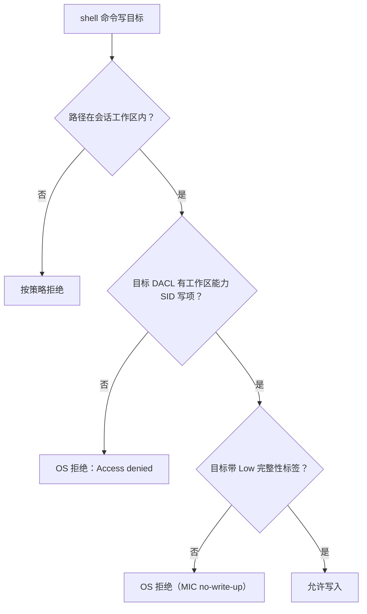

# DSH Windows「工作区内修改」：已有子目录不可写（能力项与 Low 标签缺失）

> 核对：2026-11-13。依据：本机实测（DSH 0.2.2-rc.1 nightly，Windows 11）＋打包产物源码（`dsh-sandbox-windows-acl`、`dsh-sandbox-local`、`dsh-fs-sandbox`、`dsh-pwsh-sandbox`）＋上游讨论口径（`deepseek-ai/deepseek-harness` 讨论 #11154、#12435）。成因的完整历史（首次供给为何漏掉这些子目录）未还原，相关段落标**推测**。DSH 为 nightly，包内实现会漂移。

## 结论

「工作区内修改」（`workspace-write`）**不是**「工作区内任意路径都能写」。同一个工作区里，文件工具能写、shell 命令（`git`、脚本）却可能被拒——因为两者走的是两套强制：

| 写入方 | 强制位置 | 判定依据 |
|---|---|---|
| `write` / `edit` / `patch` / `delete`（文件工具） | `dsh-fs-sandbox` 在**可信代码**里做规范化 + 包含检查 | 目标规范化后位于工作区根（或临时根）之内即放行；读不受限 |
| `pwsh` / `bash`（含 `git`） | `dsh-sandbox-local` → Windows ACL runner 用**受限令牌真实执行** | 目标对象在 Windows 权限上必须有「工作区能力 SID 的写权限项」+「Low 完整性标签」 |

shell 侧为什么需要这两样（**源码级**）：

- 不受限的 spawn 被禁止，子进程令牌是 **write-restricted + Low 完整性**（`S-1-16-4096`）。write-restricted 令牌的第二次访问检查只认 restricting SID 列表里的授权，所以目标 DACL 必须有工作区能力 SID（`S-1-4-…`，由规范工作区路径确定性派生）的写项。
- Low 完整性令牌只能写 Low 标签的对象（no-write-up），所以目标还必须带 `Mandatory Label\Low Mandatory Level`。

## 判定分流



两条都满足才写得进去。缺任意一条，报错都是同一句 `Access to the path ... is denied` / `[sandbox: file access denied under workspace-write mode]`，**不告诉你缺的是哪一条**——这是「已授权却写不进去」观感的来源。

## 症状（本机，已验证）

- 工作区根：能写；会话期间新建的子目录：能写（创建时从根继承能力项与标签）。
- **已存在**的子目录（如 `.git`、`knowledge/`、`evals/`）：shell 写入一律被拒；`git add`/`commit` 全部失败（要写 `.git/index`、`.git/index.lock`）。
- 同一批路径用文件工具 `write`/`edit` 写：成功。
- 同模式下 `git push` 报 `schannel: AcquireCredentialsHandle failed: SEC_E_NO_CREDENTIALS`；切「完全权限」后立即成功。这是同一个受限令牌的症状，不是网络问题。

`icacls` 对照（占位符换成实际路径）：

```text
<workspace>                Mandatory Label\Low Mandatory Level:(OI)(CI)(NW)
                           S-1-4-<id>:(OI)(CI)(W,D,DC)          ← 能力项
<workspace>\<existing>     （无 Mandatory Label 行，无 S-1-4 行）
```

## 只读自查

```powershell
# 1) 受限 shell 的令牌完整性（应显示 Low）
whoami /groups | Select-String 'S-1-16'

# 2) 根与可疑子目录的 DACL/标签（标签只在 icacls 输出里；Get-Acl 默认不显示标签）
icacls <workspace>
icacls <workspace>\<existing-subdir>

# 3) 探测写（会创建再删除一个空文件）
New-Item -ItemType File <workspace>\<existing-subdir>\probe.txt
```

注意：`whoami /groups` **不显示** restricting 能力 SID，但根可写说明它在被评估；别据此判断「令牌没有能力 SID」。

## 为什么会这样（源码级 + 推测）

供给发生在工作区根上，一次写入三样（`dsh-sandbox-windows-acl` 的 `grantWrite`）：

```js
setNamedSecurityInfoW(path, 1 /* SE_FILE_OBJECT */,
  20 /* DACL_SECURITY_INFORMATION | LABEL_SECURITY_INFORMATION */,
  null, null, newAcl, labelAcl);
// newAcl   = 能力 SID 允许项 + Everyone FILE_DELETE_CHILD 拒绝
// labelAcl = 可继承的 Low mandatory label ACE
```

要点：

- **幂等短路**：根上能力项/拒绝/标签三者都精确存在时，整次调用直接跳过。源码注释说明理由——否则会重新全树传播，大工作区要几分钟。
- **每 server 生命周期、每工作区只供给一次**（`dsh-sandbox-local` 的缓存，之后 O(1) 复用）。→ 首次没覆盖到的子目录，后续启动不会重试。
- **标签在 SACL 里，写它需要对象上的 `WRITE_OWNER`**；所有者隐式权限只有 `READ_CONTROL`/`WRITE_DAC`。所以一个只有继承 `Modify`、没有显式完全控制项的子目录，在根级传播时可能既拿不到标签、也拿不到能力项。

实测佐证（**已验证**）：用随包的 `diagnose-windows-sandbox-acl` 技能在 `.git` 上跑一次——它判定 `PRECONDITION`（缺 `WRITE_OWNER`）、补上当前用户完全控制项并验证通过；重写 DACL 后 `.git` **能力项随继承出现，Low 标签没有出现**，原始 confined 写入仍被拒。→ 「DACL 传播」与「标签传播」不是同一件事；这也解释了为什么「目录是复制/移动进来的」单独解释不了本机现象。

为什么本机这些子目录首次没被供给，现有记录还原不出确定时序（可能是首次供给时它们的 ACL/所有者状态不满足标签写入前提，也可能是更早版本的供给行为差异）——**推测**，不影响上面可复用的判定与绕行方案。

## 官方诊断技能的边界

`diagnose-windows-sandbox-acl`（随包内置）只做三件事：给链路上缺 `WRITE_DAC`/`WRITE_OWNER` 的目录补当前用户完全控制项、移除外部 AppContainer 包 ACE、备份并验证。它**不写 Low 标签，也不补能力项**。所以：

- 判定 `PRECONDITION` → 补完全控制 → 验证通过 → 技能让你重试原操作；
- 原操作仍失败（标签还缺）→ 没有下一手可用；此时只能切「完全权限」并把问题报给上游。

## 绕行与修复现状

- **临时**：需要 shell 写仓库（`git` 提交、脚本写子目录）时把会话切到「完全权限」（`danger-full-access`）；文件工具不受影响，日常改文件仍可用「工作区内修改」。
- **持久**：上游已有多篇同现象讨论（`deepseek-ai/deepseek-harness` 讨论 #11154、#12435；本机补充证据已回帖在 #11154）。修复方向是供给时校验/修复子目录、提供手动重新供给入口，而不是把「根上条目齐全」当作整个工作区已就绪。
- 手工给子目录补 Low 标签属于系统权限改动，超出内置诊断脚本范围，需自行评估风险与备份。

## 未核实项

- 本机这几个子目录首次供给被漏掉的确切成因（时序/当时 ACL）未还原。
- 标签写入所需的最小权限组合未逐项实验（只验证了「缺 `WRITE_OWNER` 时标签没被写入」）。
- 其他 Windows 版本、其他 DSH 版本上的表现可能不同；本文以本机 0.2.2-rc.1 为准。
- 上游讨论编号与内容可能更新，引用时以仓库内为准。

相关：[权限、沙箱与提权](权限-沙箱与提权.md) · [配置分层与目录](配置分层与目录.md)
