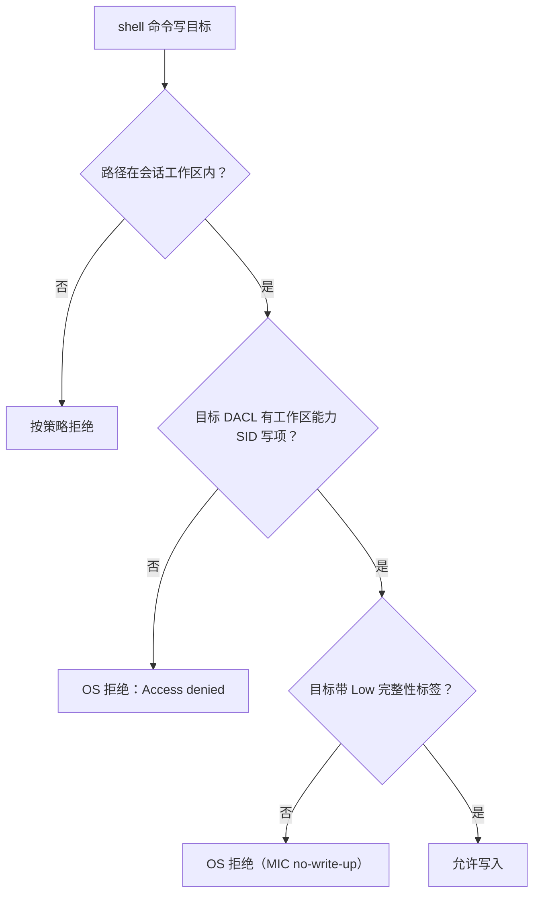

# DSH Windows「工作区内修改」：已有子目录不可写（能力项与 Low 标签缺失）

> 核对：2026-11-13，2026-11-25 追加整树修复实测。依据：本机实测（DSH 0.2.2-rc.1 nightly，Windows 11）＋打包产物源码（`dsh-sandbox-windows-acl`、`dsh-sandbox-local`、`dsh-fs-sandbox`、`dsh-pwsh-sandbox`）＋上游讨论口径（`deepseek-ai/deepseek-harness` 讨论 #423、#7504、#8383、#8421、#9559、#9903、#10463、#11154）。成因的完整历史（首次供给为何漏掉这些子目录）未还原，相关段落标**推测**。DSH 为 nightly，包内实现会漂移。

## 结论

「工作区内修改」（`workspace-write`）**不是**「工作区内任意路径都能写」。同一个工作区里，文件工具能写、shell 命令（`git`、脚本）却可能被拒——因为两者走的是两套强制：

| 写入方 | 强制位置 | 判定依据 |
|---|---|---|
| `write` / `edit` / `patch` / `delete`（文件工具） | `dsh-fs-sandbox` 在**可信代码**里做规范化 + 包含检查 | 目标规范化后位于工作区根（或临时根）之内即放行；读不受限 |
| `pwsh` / `bash`（含 `git`） | `dsh-sandbox-local` → Windows ACL runner 用**受限令牌真实执行** | 目标对象在 Windows 权限上必须有「工作区能力 SID 的写权限项」+「Low 完整性标签」 |

shell 侧为什么需要这两样（**源码级**）：

- 不受限的 spawn 被禁止，子进程令牌是 **write-restricted + Low 完整性**（`S-1-16-4096`）。write-restricted 令牌的第二次访问检查只认 restricting SID 列表里的授权，所以目标 DACL 必须有工作区能力 SID（`S-1-4-…`，由规范工作区路径确定性派生）的写项。
- Low 完整性令牌只能写 Low 标签的对象（no-write-up），所以目标还必须带 `Mandatory Label\Low Mandatory Level`。

## 判定分流



两条都满足才写得进去。缺任意一条，报错都是同一句 `Access to the path ... is denied` / `[sandbox: file access denied under workspace-write mode]`，**不告诉你缺的是哪一条**——这是「已授权却写不进去」观感的来源。

## 症状（本机，已验证）

- 工作区根：能写；会话期间新建的子目录：能写（创建时从根继承能力项与标签）。
- **已存在**的子目录（如 `.git`、`knowledge/`、`evals/`）：shell 写入一律被拒；`git add`/`commit` 全部失败（要写 `.git/index`、`.git/index.lock`）。
- 同一批路径用文件工具 `write`/`edit` 写：成功。
- 同模式下 `git push` 报 `schannel: AcquireCredentialsHandle failed: SEC_E_NO_CREDENTIALS`；切「完全权限」后立即成功。这是同一个受限令牌的症状，不是网络问题。

`icacls` 对照（占位符换成实际路径）：

```text
<workspace>                Mandatory Label\Low Mandatory Level:(OI)(CI)(NW)
                           S-1-4-<id>:(OI)(CI)(W,D,DC)          ← 能力项
<workspace>\<existing>     （无 Mandatory Label 行，无 S-1-4 行）
```

## 只读自查

```powershell
# 1) 受限 shell 的令牌完整性（应显示 Low）
whoami /groups | Select-String 'S-1-16'

# 2) 根与可疑子目录的 DACL/标签（标签只在 icacls 输出里；Get-Acl 默认不显示标签）
icacls <workspace>
icacls <workspace>\<existing-subdir>

# 3) 探测写（会创建再删除一个空文件）
New-Item -ItemType File <workspace>\<existing-subdir>\probe.txt
```

注意：`whoami /groups` **不显示** restricting 能力 SID，但根可写说明它在被评估；别据此判断「令牌没有能力 SID」。

## 为什么会这样（源码级 + 推测）

供给发生在工作区根上，一次写入三样（`dsh-sandbox-windows-acl` 的 `grantWrite`）：

```js
setNamedSecurityInfoW(path, 1 /* SE_FILE_OBJECT */,
  20 /* DACL_SECURITY_INFORMATION | LABEL_SECURITY_INFORMATION */,
  null, null, newAcl, labelAcl);
// newAcl   = 能力 SID 允许项 + Everyone FILE_DELETE_CHILD 拒绝
// labelAcl = 可继承的 Low mandatory label ACE
```

要点：

- **幂等短路**：根上能力项/拒绝/标签三者都精确存在时，整次调用直接跳过。源码注释说明理由——否则会重新全树传播，大工作区要几分钟。
- **每 server 生命周期、每工作区只供给一次**（`dsh-sandbox-local` 的缓存，之后 O(1) 复用）。→ 首次没覆盖到的子目录，后续启动不会重试。
- **标签在 SACL 里，写它需要对象上的 `WRITE_OWNER`**；所有者隐式权限只有 `READ_CONTROL`/`WRITE_DAC`。所以一个只有继承 `Modify`、没有显式完全控制项的子目录，在根级传播时可能既拿不到标签、也拿不到能力项。

实测佐证（**已验证**）：用随包的 `diagnose-windows-sandbox-acl` 技能在 `.git` 上跑一次——它判定 `PRECONDITION`（缺 `WRITE_OWNER`）、补上当前用户完全控制项并验证通过；重写 DACL 后 `.git` **能力项随继承出现，Low 标签没有出现**，原始 confined 写入仍被拒。→ 「DACL 传播」与「标签传播」不是同一件事；这也解释了为什么「目录是复制/移动进来的」单独解释不了本机现象。

为什么本机这些子目录首次没被供给，现有记录还原不出确定时序（可能是首次供给时它们的 ACL/所有者状态不满足标签写入前提，也可能是更早版本的供给行为差异）——**推测**，不影响上面可复用的判定与绕行方案。

## 官方诊断技能的边界

`diagnose-windows-sandbox-acl`（随包内置）只做三件事：给链路上缺 `WRITE_DAC`/`WRITE_OWNER` 的目录补当前用户完全控制项、移除外部 AppContainer 包 ACE、备份并验证。它**不写 Low 标签，也不补能力项**。所以：

- 判定 `PRECONDITION` → 补完全控制 → 验证通过 → 技能让你重试原操作；
- 原操作仍失败（标签还缺）→ 没有下一手可用；此时只能切「完全权限」并把问题报给上游。
- **判定还取决于指哪一层**（**已验证**，本机两次实跑）：指工作区根 → `NOT_THIS_CLASS`（根上 `WRITE_DAC`/`WRITE_OWNER` 都齐、子树扫描只找外来包 ACE，于是 `FIXED=0`、`visited=321`、`nextAction: stop`）；指 `<workspace>/.git` → `PRECONDITION`。两种判定都到不了缺失的标签，但根级那次的输出最容易被误读成「整个工作区已检查完毕、没问题」。

## 本机当前状态（2026-11-26 实测）

| 子目录 | 能力 SID `S-1-4-…(W,D,DC)` | `Mandatory Label\Low` | 受限 shell 写 | 文件工具写 |
|---|---|---|---|---|
| 根 | 有 | 有 | 可 | 可 |
| `knowledge`、`.git`、`.opencode`、`.workbuddy`、`.agents` | 有 | 有 | 可 | 可 |
| `evals`、`.openchamber` | 无 | 无 | **被拒** | 可 |

要点（**已验证**，本机实跑）：

- 2026-11-25 那次「整树补标签」实际是**按目录逐个跑的**，只覆盖 `.git` / `knowledge` / `.opencode` / `.workbuddy` 四个目录，`evals` 与 `.openchamber` 至今没有能力项也没有 Low 标签 → 受限 shell 写这两个目录一律 `Access denied`。
- 因此「老目录 = 不可写」只是默认状态，不是判据：同为 10 月的老目录，`knowledge` 今天可写、`evals` 今天不可写。判据仍是那两条 ACE。
- 不对称再次复现：`evals` 里文件工具 `write` 成功、受限 shell 写失败——文件工具在可信代码里做路径包含检查，不受 ACL 约束。
- 用受限 shell 在 `evals` 里留下的文件，之后**连删都做不了**（受限令牌在 `evals` 上没有任何授权项）；清理需提权执行一次 `Remove-Item`。
- `.agents`（2026-11-25 23:44 创建）能力项与标签均为继承而来，与「会话/修复后新建的目录」同一条路径。

## 绕行与修复现状

**临时绕行**：需要 shell 写仓库（`git` 提交、脚本写子目录）时把会话切到「完全权限」（`danger-full-access`）；文件工具不受影响，日常改文件仍可用「工作区内修改」。

**整树补标签（已验证，本机跑通）**：分两步，顺序不能换。先让当前用户拿到可继承的完全控制（写 SACL 需要 `WRITE_OWNER`），再打标签——只做第二步会在目录上全部失败。

```powershell
# 1) 授权必须带 (OI)(CI) 继承，否则子目录拿不到 WRITE_OWNER
icacls "<dir>" /grant "<user>:(OI)(CI)F" /T /C
# 2) 再整树打 Low 标签
icacls "<dir>" /setintegritylevel "(OI)(CI)Low" /T /C
```

实测的失败/成功对照（**已验证**）：

```text
# 只做第二步（缺 WRITE_OWNER）
<ws>\.git         Successfully processed 862 files; Failed processing 270 files
<ws>\knowledge    Successfully processed 110 files; Failed processing  34 files
→ 所有失败行都是目录，文件全成功

# 先授权再打标签
.git 1132 / 0、knowledge 144 / 0、.opencode 6 / 0、.workbuddy 5 / 0
→ 受限 shell 下四个目录均可写；git add / git rm --cached / git branch / git branch -D / git fetch 全部 exit 0
```

「文件成功、目录失败」这个分裂可以当作缺 `WRITE_OWNER` 的现场判据。

**改之前要核对的边界**（社区总结 + 本机核对）：

| 边界 | 本机情况 |
|---|---|
| 整树重打标签后，本机**任何** Low 完整性进程都能写这棵树 | 成立，与根目录原有暴露面同级 |
| `/T` 会跟进 junction / 重解析点，可能静默写出工作区 | 已递归扫描：0 个重解析点，未外溢 |
| 根上 `Everyone` 的 `FILE_DELETE_CHILD` 拒绝项不能删，否则打开跨工作区删除洞 | 未触碰，原样保留 |
| `icacls` 无法命名派生的能力 SID（`ERROR_NONE_MAPPED` 1332），能力项只能靠一次 DACL 重写触发重算 | 第一步的 `/grant` 正好完成了这次重写 |

**上游状态**：多篇重复报告（#423 最早，8 月；Low 标签层 9-19 引入后集中爆发），根因定位到 `packages/sandbox/sandbox-windows-acl/src/acl.ts` 的 `grantWrite` 幂等短路只校验根对象；维护方口径是「没有可指向的受支持修复命令」，核心修复需把跳过判据改成树感知、或增加一次跳过重解析点的后代遍历。修复方向不是把「根上条目齐全」当成整个工作区已就绪。

**第三方诊断插件**（`@argszero/cordis-plugin-sandbox-grant-advisor`，源码级评审，未安装）：只提示、不修（README 明写不改 ACL、不提权、不写文件、不联网、无安装脚本；静态审查确认 `lib/` 无网络、无子进程、无环境变量读取）。结论 **WARN**，三条理由：

- 随包 `tools/` 带三个会真实改写沙箱 DACL 的仪器脚本（默认不跑、`lib/` 不引用，但误跑会放宽受限 token 的默认 DACL）；
- 会把 `icacls /grant`、`/setowner`、`/setintegritylevel` 这类命令作为建议文本注入模型上下文，模型可能真的执行；
- npm 最新 `0.27.0` 的 peer 范围是 `<0.2.0`，与本机 0.2.2 不兼容，强装要开 version exemption；git 主线 `0.27.2` 才声明 `>=0.2.1-alpha.2 <0.3.0`。

另外它识别「根可写、子目录不可写」这族时用正则提取命令里的路径字面量，**路径含空格即截断并静默放弃**（`lib/signature.js`），所以本机这种带空格的 `<workspace>` 路径它连提示都不会给。结论：它替代不了修复，本机修好后也没有可观察收益。

## 为什么漏掉的子目录一直修不好（2026-11-26 追加验证）

三个层次，缺一不可：

1. **受限 shell 要写成功，目标上必须同时有两条**：能力 SID 的写项 `S-1-4-…:(OI)(CI)(W,D,DC)`（令牌是 write-restricted，第二次访问检查只认 restricting SID）和可继承的 `Mandatory Label\Low`（令牌完整性 Low，no-write-up）。缺任一条，报错都是同一句 `Access denied`，不区分缺哪条。
2. **供给只发生在工作区根，且会短路**：上游 `grantWrite`（`packages/sandbox/sandbox-windows-acl/src/acl.ts`）只对传入的路径做一次安全描述符更新，不显式遍历后代；根上三项（能力项 / `Everyone` 拒绝项 / Low 标签）精确齐全时**整次跳过**（源码注释：避免大工作区全树传播耗时）。→ 重启 DSH、重开会话都不会重修后代；一次漏掉就永久漏掉。
3. **本机 `evals` / `.openchamber` 从未被供给过**：SDDL 是干净的继承默认 DACL（`Protected=False`、`Rules=0`、无显式 owner SID），连里面的文件都没有能力项；而 `.git` / `knowledge` 的文件上有 `(I)(W,D,DC)` 和 Low 标签。结合 2026-11-25 那次是逐目录修的四个目录，结论是**那次修复没覆盖这两个目录**，不是 Windows 继承机制失效。

排除掉的错误解释（**已验证**，本机受控实验）：

- ✗「Windows 不会把父目录 ACL 传播给已存在的子目录」：`icacls /grant` 和 `Set-Acl`（只改父、不遍历）两条路都实测把新增的可继承 ACE 和 Low 标签传播给了事先存在的子目录，连 `/inheritance:r` 保护过的除外。父改子继承是有效的。
- ✗「这些目录被保护了继承」：`evals` / `.openchamber` 的 `AreAccessRulesProtected=False`、`AreAccessRulesCanonical=True`。

另一个实测坑：能力项的掩码 `0x110156`（`W,D,DC`）**不含 `WRITE_DAC`/`WRITE_OWNER`**，所以受限 shell 里连 `icacls /grant` 都直接 `Access is denied`——自己修不了自己的 ACL，这是修复必须提权执行的直接原因。

## 未核实项

- 本机 `evals` / `.openchamber` 在最初供给时究竟为什么没拿到继承项（时序还是当时 ACL 状态），现有记录无法还原；但「之后没被任何一次修复覆盖」是确定的。
- 缺 `WRITE_OWNER` 时**文件能打上标签、目录不能**，机制上未解释清（两者都走同一条 `icacls`，现象可复现，原因未定）。
- 标签修复的最小权限组合只验证了「可继承 FullControl」这一路；社区配方用的是单项 `(WO)`，未逐项对比。
- 其他 Windows 版本、其他 DSH 版本上的表现可能不同；本文以本机 0.2.2-rc.1 为准。
- 上游讨论编号与内容可能更新，引用时以仓库内为准。

相关：[权限、沙箱与提权](权限-沙箱与提权.md) · [配置分层与目录](配置分层与目录.md)
