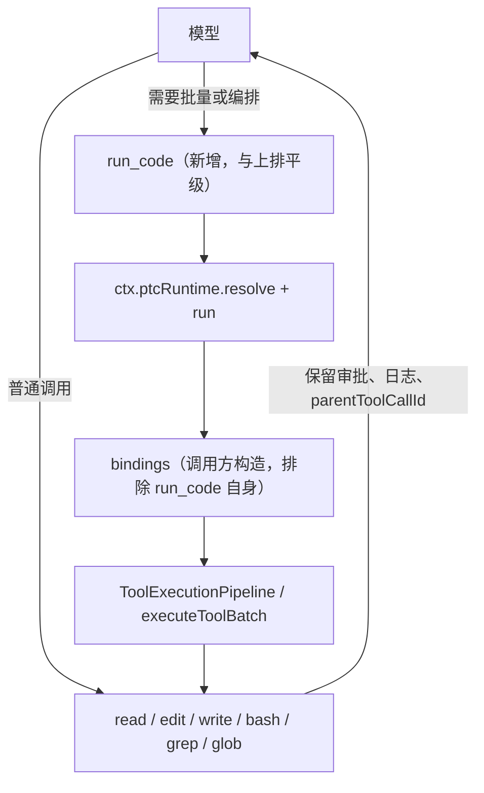

# DSH 的 run_code 双通道：把「直调还是写脚本」从 preset 挪到工具层

> 核对：2026-11-08。依据 DSH 官方升级指南 `docs/upgrade-guide/v0.2.1-rc.2/tool-executor-plugins/`、`@deepseek-ai/dsh-ptc-runtime` 的包文档与相关包 README。**本机未装 DSH（`dsh` 不在 PATH），方案本身没有落地验证**，除标注外均属源码/文档级结论；标 **推测** 的需实跑确认。

## 一句话

DSH 的 PTC（programmatic tool calling）被绑死在 preset 上，而 preset 建会话时定死、**会话中不可切换**；正确解法不是再挂一个 executor（executor 排他，只能挂一个），而是在 `dsh-tools` 里**多注册一个普通工具** `run_code`，内部用 `ctx.ptcRuntime` 执行、用 `ToolExecutionPipeline` 派发嵌套调用。

## 问题：决策放在了不可逆的时点

四个内置 preset：`standard`、`ptc`、`minimal`、`cordis`。

| 层级 | 该管什么 | 该定在哪 | DSH 实际 |
|---|---|---|---|
| 会话级 | 身份、权限边界 | 建会话时定死 | 正确 |
| 轮次级 | 这一轮哪些工具可见 | 应该动态 | **缺这一层** |
| 调用级 | 直调还是写脚本 | 模型自选 | **被上提到了会话级** |

后果：在 `standard` 里跑到一半才发现「这事得批量」，只能二选一——继续一轮轮硬啃，或重开会话把上下文全丢。

**判据：不可预测的决策，不能放在不可逆的时点。**

## 三个决定性事实

1. **executor 排他。** 官方原文 `Mount one native or PTC executor in the intended deployment or preset scope`。执行模式已从 `dsh-tools` 的配置拆成两个互斥插件 `@deepseek-ai/dsh-tool-executor-native` / `@deepseek-ai/dsh-tool-executor-ptc`，切 PTC 的官方 patch 就是两行 `disabled: true/false`。→ 想靠「同时挂两个 executor」实现双通道，此路不通。
2. **`ptcRuntime` 是独立 service。** `@deepseek-ai/dsh-ptc-runtime` 注册为 `ctx.ptcRuntime`，文档自述 `the runtime has no knowledge of tools or sessions`：只接 `program`、`bindings`（具名异步函数）、执行选项，返回结果/日志/结构化错误。**bindings 由调用方构造，因此「谁拥有 bindings，谁就决定脚本里能调什么」。**
3. **嵌套调用必须走 pipeline。** 原文 `Complete calls, including single calls, use batches`。`ToolExecutionPipeline` / `executeToolBatch` 从 `@deepseek-ai/dsh-tools/pipeline` 导入。**直调工具函数 = 绕过审批、绕过日志、没有 `parentToolCallId`**——脚本里 20 个删除会静默执行，这是全案唯一会出事故的坑。

## 方案结构

executor 是呈现层，只能有一个；工具注册（`dsh-tools`）是共享的，可以很多个。所以`run_code` 与 `read` / `edit` / `bash` 平级出现在工具目录里，native executor 把它当普通工具声明出去，其余工具照常直连。



零件清单全部由官方提供，不用自己实现：执行程序（`ctx.ptcRuntime`，后端 `dsh-ptc-runtime-node`）、TypeScript SDK 渲染（`dsh-tool-executor-ptc` 的 PTC SDK renderers）、嵌套派发（`dsh-tools/pipeline`）、结构化错误（`CodeRunFailedError`）、派发日志（`PtcDispatchLog`）。**runtime、Node 后端、TS 编译、sandbox policy、pipeline、renderer 都已存在，要写的只是接线。**

## 落地顺序（顺序本身就是风险控制）

1. **Step 0（最小探针）**：写一个只执行 `return 1 + 1` 的 `ping` 工具，确认 `ctx.ptcRuntime` 在 native executor 下能解析、能跑。**这是全案唯一的技术风险点**——若该 service 被 PTC executor 私有化，方案全部作废。别写完几百行再验。
2. **Step 1**：只接 `read` 一个 binding，验三件事——审批是否仍触发、会话里是否出现 `parentToolCallId`、失败能否回到模型。缺一即方案需重设计。
3. **Step 2**：全量 binding + SDK 渲染进 description + 输出上限/超时 + 把 `run_code` 自己排除出 bindings（防递归）。

## 五个必踩的坑

| 坑 | 事实与对策 |
|---|---|
| MCP 工具名不是合法 JS 标识符 | `mcp__github__list-issues`、`context7.resolve-library-id` 带 `-` 和 `.`。两种规则选一并固定：扁平化（非法字符转 `_`，参考 Pi）或命名空间（`tools.github.list_issues()`，参考 OpenCode）。description 里必须给完整映射表，否则模型拼错名字 |
| 不走 pipeline | 见上文事实 3，唯一会出事故的坑 |
| 输出无上限 | runtime 只负责执行不管呈现。自行实现「超 N token 保留头尾 + 全文写临时文件 + 返回路径」，参考默认 10,000 token |
| `run_code` 出现在自己 bindings 里 | 模型可递归调用自己，Pi 明确禁止 |
| 只解决「能编排」不解决「该编排」 | MCP 越多，模型越容易在直调与脚本间摇摆。description 写死触发条件（批量 >10 个对象、结果可能超 2,000 行、需并发、循环内要做判断）+ 负向条件（单次调用不要用）。依据：Anthropic 公开数据，一两步顺序调用上程序化调用反而贵约 8% |

## 为什么不直接用社区的 `dsh-ptc-router`

它能按任务在 PTC 与 native 间路由、支持运行中切换，解决了「不用重开会话」，但对「大量 MCP + 频繁编排」不够：

| 维度 | `dsh-ptc-router` | `run_code` 常驻 |
|---|---|---|
| 大量 MCP 的上下文成本 | 不省（native 形态全量声明） | 可省 |
| 切换成本 | 每次切换触发全量 re-prefill | 零 |
| 编排时机 | 靠关键词启发式猜 | 模型随时 |
| 形态 | 二选一切换 | 双通道并存 |

切换代价的量级说明：上下文分两层——消息历史（transcript）与推理缓存（KV cache）。router 切换保留前者但使后者失效，代价是整段上下文重新 prefill，约等于「当前长度 × prefill 单价」，会话越长越贵。

## 代价与边界

- 上下文成本：多一个工具声明，约两三百 token/轮，**永久支付**。
- 选择质量：双通道意味着模型每轮都要选，选错概率上升。
- 可观测性：混用时用户难以分辨「这轮是脚本还是一轮轮跑的」。
- 审批一致性：直调弹 N 次框、脚本弹 1 次框，用户心智模型会被打乱。
- 与 workflow 的语义关系需明确（PTC 预设原本禁用 workflow）。
- 维护负债：接口基于 rc 版本，内核每次升级需重测。

## 验证方法（**未在本机执行**，仅列命令）

```bash
# 查看当前 profile 挂了哪些执行器行；--dump-config 打印完整组装树，其中任意条目都可被 patch 替换
dsh web --dump-config | grep -A4 -E "tool-executor|ptc"
# 装机基线，用于对照自己改了什么
dsh web --dump-default-config | grep tool-executor
# 临时挂载自己的 patch，不落盘
dsh web --patch ./my-run-code.yml
```

功能验收：同一会话里先直调 `read` 读一个文件，再用 `run_code` 批量处理多个文件，确认两条路径都通、且脚本内的嵌套调用在会话记录里可见。

## 给模型下这个任务时的两个提醒

- 它很可能第一轮就想「改 executor」（那看起来才是正规做法）。跑偏就把约束第一条单独再发一遍：executor 只能挂一个，要的是加法不是替换。
- 探针那一步别让它跳过。它常觉得「这么简单不用验」，直接写完整版，然后在第 300 行发现 `ctx.ptcRuntime` 拿不到。

相关：同目录 [插件生态与原生短板](插件生态-原生短板与包名核实.md)。
