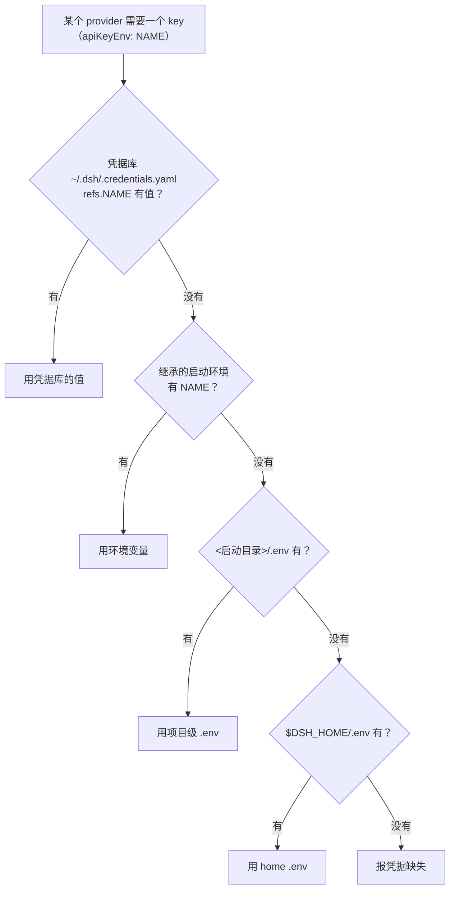

# DSH 凭据体系与聊天里的密钥打码

> 核对：2026-11-12。依据：2026-11-09～11-11 的会话实测（凭据解析、UI 三态、secret-mask 源码核对）与源码阅读；本轮复核了 `~/.dsh/.credentials.yaml` 的存在与解析层级未被改动。DSH 为 nightly 预发布，字段名与打码规则会漂移。

## 解析优先级



结论：**`apiKeyEnv: SOME_NAME` 只是「引用名」**，先按同名去凭据库找，找不到才回落到环境变量 / `.env`；不需要为它 `export` 环境变量（**源码级**：`resolve()` 实现）。

## `.credentials.yaml` 的结构与性质

```yaml
version: 1
refs:                                   # env 式凭据引用（provider 的 apiKeyEnv 指向这里）
  <NAME>: <key>
records:                                # OAuth 式授权（浏览器会话、账号登录）
```

| 性质 | 结论 | 证据 |
|---|---|---|
| 存储形式 | **明文 YAML，无加密**（`0600` 权限校验仅 POSIX，Win32 跳过） | **已验证** |
| 位置 | `~/.dsh/`，不在 OneDrive 等同步目录下 | **已验证** |
| 同步/导出/云备份 | 没有。只有原子写 + 文件锁 + 属主可读校验 | **源码级** |
| 跨机器 | **完全不复现**——新机器上是空的，key 要重填 | **已验证** |
| 本机好处 | ①重装/升级 DSH 不丢（用户数据与安装目录分离）；②清掉同名环境变量也不失效（文件层优先） | **源码级** |
| 坑 | **凭据库会永久遮蔽环境变量**：两边都放且只轮换了环境变量 → 旧 key 仍赢 → 莫名 401 | **推测**（逻辑推断） |

**换机器的实际做法**：拷 `.credentials.yaml`（明文，别走网盘/微信/git）；或继续用 Windows 用户环境变量（`setx NAME "..."` 一次，跨机器、跨工具链通用）；或在新机器「设置 → 模型」里重填。**同一个 provider 只保留一个来源。**

## 环境变量层

- Windows 用户级变量写在注册表 `HKCU\Environment`（`setx NAME "value"` 或「系统属性 → 环境变量」），**只对新启动的进程可见**。
- 机器级变量走 `HKLM`；本机实测**没有任何 key 放在机器级**。
- 查用户级变量（只读）：

  ```powershell
  reg query HKCU\Environment /v <NAME>
  Get-ChildItem Env: | Where-Object Name -eq '<NAME>'
  ```

## 界面三态判别表（可复用于任何 provider）

| 界面显示 | 含义 | 密钥实际在哪 |
|---|---|---|
| 绿色「已检测到环境变量」 | 没有已保存凭据，但 DSH 主进程启动环境里有该变量 | 环境变量（`HKCU\Environment` 等），DSH 不持有值 |
| 输入框留空、无环境变量提示 | 已有保存凭据（只写式，不回显） | `.credentials.yaml` 的 `refs:` |
| 「未检测到」 | 既无保存凭据、也无环境变量 | 无 |

**为什么 UI 不回显**：源码注释写明「键入的密钥经 `credentials.set` 以**只写**方式存入……「应用」成功后会发出本地状态消息，且**绝不回显任何机密内容**」。前端只拿到状态对象（如 `savedCredential = detected?.[1]?.source === "file"`），密钥值从不返回浏览器。相关字段：`keyFallbackDetected`、`keyFallbackUnchecked`、`keyFallbackMissing`、`detectedRef`、`missingRefs`（**源码级**）。

**同一页还有另一套显示**：提供商行首的绿/红/无圆点只看该行 profile 是否登记了具名引用 `apiKeyEnv` 且该引用是否已确认配置，不是上面这张编辑卡片内的检测态；无点不代表缺 key 或不可用，详见[模型设置的状态圆点](模型设置的状态圆点.md)。

查看/修改：直接文本编辑器打开 `.credentials.yaml`（明文）；或在 UI 重新输入保存（覆盖同名引用）。DSH 带跨进程文件锁与热加载，外部编辑会即时生效（❓是否对所有 provider 即时生效未逐项验证）。

## 取证案例：一个 key 到底从哪来（方法可复用）

用户问「你怎么自动读到我的 key 的？我不记得存过」。排查顺序：

1. **不是 DSH 保存的**：pi-ai 对这类 provider 的认证逻辑是 `envApiKeyAuth()`——先看已保存凭据，没有就逐个查环境变量：

   ```js
   resolve: async ({ ctx, credential }) => {
       if (credential?.key) return { ...source: "stored credential" };
       for (const envVar of envVars) {
           const value = await ctx.env(envVar);
           if (value) return { auth: { apiKey: value }, source: envVar };
       }
   }
   ```

2. **确认在 Windows 用户级环境变量里**：`reg query HKCU\Environment /v <NAME>` 可自查；`.credentials.yaml` 里没有对应条目（所以 UI 显示「已检测到环境变量」而不是「已保存」）。
3. **时间线**：`HKCU\Environment` 最后一次写入时间与 `~/.dsh` 首次创建时间接近；该键里可能同时有多个 key。注册表只能给「最后一次写入」时间，无法定位到具体值。
4. **DSH 源码里没有任何写用户环境变量的代码**，机器上也没装相关软件 → 最可能是某次按教程/脚本跑过 `setx`。
5. **工具进程看不到它是刻意的隔离**（见[权限、沙箱与提权](权限-沙箱与提权.md)）。

风险提示：若删掉该变量，对应路由会变「未检测到」，除非届时在 Models 页面把密钥存进 DSH。

## 聊天里的 API Key 打码：内置 `secret-mask`，只改显示不改数据

**结论**：不是插件，是 Web 界面内置客户端模块 **`@deepseek-ai/dsh-client-ui-secret-mask`**，随 Web bundle 默认挂载、无需开启（**源码级 + 会话实测**）。

- 实现：在「已发送的用户消息」渲染层注册名为 `secret` 的凭据匹配器 + 渲染器。
- 可识别格式：`sk-`（至少含一个数字）/`AIza…`、`ghp_`/`gho_`/`ghs_`/`github_pat_`/`glpat-`/`npm_`/`hf_`、`AKIA`/`ASIA`/`LTAI`/`AKID`、`xoxb-`/`sk_live_`/`rk_test_`/`whsec_`、`eyJ…`（JWT）、`-----BEGIN … PRIVATE KEY-----`（只保留 BEGIN/END 两行）、连接串里的密码（全遮挡）。
- 打码算法：常量 `VISIBLE_PREFIX = 8`——**保留前 8 个字符，其余每个字符显示为一个 `*`**。
- **只改显示，不改数据**：消息原文、复制出来的内容、发给模型的输入都保留原始字符，**模型依然能看到完整 Key**。
- 可切换：每段遮挡值末尾有小眼睛控件；每次新挂载从遮挡态开始。
- 性能：线性时间匹配（字面量交替正则定位起点 + 粘性字符类匹配无回溯 + 按文本记忆位置）。

**已知边界**：只遮挡「已发送的用户文本」（消息气泡、插话、排队消息、`/goal` 输入）；会话标题、轮次预览、搜索摘要、工具卡片、助手回复、**还没发送的输入框**都按原文显示；`API_KEY=xxxx` 这种带名字的赋值不遮挡；无公开格式的凭据（密码、验证码）不遮挡。

⚠️ **安全提醒**：遮挡只是视觉的，原始 Key 仍在会话记录和模型上下文里。它防的是「旁人偷瞄/截图泄露」，**不能**理解为「Key 已安全隐藏」。真实 Key 若已发进对话，稳妥做法是去服务商后台轮换。

相关：[模型与 Provider](模型与provider配置.md) · [权限、沙箱与提权](权限-沙箱与提权.md)
