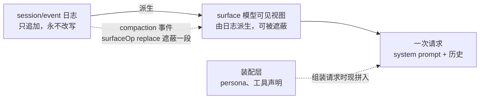

# DSH 压缩：遮蔽边界、入口限制与缓存代价

> 核对：2026-11-24。依据：本机安装包 `0.2.2-rc.5` 内 `@deepseek-ai/dsh-compaction`、`dsh-compaction-basic`、`dsh-compaction-tool-result-pruner`、`dsh-command-compact`、`dsh-agent-preset-registry` 的包内 README 与 `src/`，`dsh/docs/subsystems/compaction.zh.md`、`dsh/docs/agent-lifecycle.zh.md`。证据以**文档级**（包内 README 与子系统文档）为主，标注处为**源码级**（解包读 `src/`）。未在本机实跑压缩并核对 provider 的 cache 命中（没有用量指标），见文末「未核实项」。DSH 走 nightly，阈值默认值与事件名会漂移。

## 一句话

压缩不删历史，只追加一条「遮蔽」记录：日志里原文还在，模型可见的视图里被换成摘要。代价不在 token 账，而在**前缀缓存**——每压一次，从被替换的第一个 token 起，之后的内容都要重新 prefill。

## 三层：日志 → 视图 → 请求

- **日志是事实**：压缩追加 `compaction/start`、`compaction/summary`、`compaction/end` 三个**仅写入日志**的事件，它们不进入 surface；摘要本身承载在一条新的 `user/message` 上，带 `surfaceOp: { op: 'replace', startSeq, endSeq }`——这是压缩唯一的 surface 变更。
- **surface 是视图**：`compaction/summary` 里的 `shadowedRange` 是首尾 **surface 位置**（不是 seq 数值区间），`shadowedSeqs` 才是被遮蔽节点的权威清单。被遮蔽的原文仍在日志里，可回放、可审计，只是不再出现在模型看到的序列里。
- **请求是投影**：persona、工具声明这类「组装时现拼」的东西本来就不在历史里，所以压缩碰不到它们。

## 范围与阈值

设上下文窗口 `W`、生效请求输出上限 `O`、余量 `B`。

| 字段 | 默认 | 含义 |
|---|---|---|
| `thresholdRatio` | `0.8` | 触发阈值 = `floor(min(W × 0.8, W − O − B))` |
| `headroomTokens` | `65536` | `B`，输出预留之外的额外压力余量 |
| `retainRatio` | `0.16` | 逐字保留的近期历史 = `(W − O)` 的 16% |
| `retainTokens` | — | 绝对预算形态，与 `retainRatio` 互斥，必须低于阈值 |
| `maxTokens` | 跟随余量 | 摘要输出上限，含提供方计入的推理 token |
| `compactionRetries` | `1` | 压力仍高于阈值时的额外尝试次数 |
| `maxOverflowRetries` | `1` | 溢出恢复的重试上限，`0` 只关恢复 |
| `auto` | `true` | 关掉只剩手动 `/compact` |

一条关键约束：**每个被选范围都从「第一个不是 `system/message` 的 surface 节点」开始**，所以位于节点 0 的系统提示词永不被遮蔽。历史上的 `system/message`（历史内提示词更新追加的）算普通历史，可以被遮蔽。

配置错误在加载时快速失败：未知字段、同时给 `retainRatio` 与 `retainTokens`、保留比例不小于阈值比例、非正 token 数。默认 65536 的余量放不进同等或更小的窗口，小窗口模型必须在 `modelPolicies` 里给该路由单独的 `headroomTokens`。

## 四个入口，各自的轮次边界

| 入口 | 触发点 | 对轮次的要求 | 失败后的行为 |
|---|---|---|---|
| 自动压力压缩 | `agent/pre-step`（步与步之间）；另在 `agent/request` 按切换后的目标复检 | 同一轮里还有下一步 | 只警告一次并继续本轮，不清空已完成的剪枝/摘要 |
| 溢出恢复 | `agent/request-error`，仅 `CONTEXT_WINDOW_EXCEEDED` | 仍在打开的那一步内重试 | 绕过阈值与保留策略做一次最大平衡头部缩减；只有 surface replacement generation 前进才授权重试 |
| `compactNow()`（`/compact`） | 空闲，记录独立 `turn: null` 标记对 | **必须空闲** | 忙时直接返回 `busy`，不排队 |
| `compactRegion(start, end)` | 编程接口，按 surface 位置取闭区间 | **必须有 open turn**，没有就抛 `no open turn` | — |

`/compact` 为什么只认空闲，三条理由都在代码与文案里：

1. **快照会失效**：正在组装的这一步已经按当前视图准备好了请求，中途替换等于换掉依据。
2. **工具配对会被切断**：边界必须过 `toolPairingBalancedBefore/After`（**源码级**：`dsh-compaction/src/tool-pairing.ts`），这两个函数会拒绝缺失的 seq 与「有结果无调用」的遗留结果。mid-turn 的切点无法保证落在配对边界上。
3. **摘要会过期**：选完范围到最后替换之间历史可能变了，那时报的是 `The history selected for compaction changed before it could be replaced.`，整次尝试作废并记入日志。

一句话：**一致性是主因，省 token 是副产品。**

## 压缩之后，三样东西的命运不同

| 物 | 在哪一层 | 压缩后 |
|---|---|---|
| persona | 系统提示词，每次请求重新组装 | 不受影响，也不会重复 |
| `AGENTS.md` 基线 | 普通 `user` 消息，通常还是最老的一条 | 被摘要替换；下一个 `pre-step` 发现可见基线不见了就重新加载并注入**逐字原文** |
| 只在聊天里说过的约定 | 普通 `user` 消息 | 只剩摘要里的转述，不会自动恢复 |

前两行的机制细节见[预设：persona 与 agent-instructions 挂在哪](预设-人格与指令挂载.md)与[工作区、会话与指令链](工作区-会话与指令链.md)的「压缩会吞掉基线」一节。第三行是压缩真正的脆弱点：**文件里的约定能重建，口头约定不能。**

代价是短期内出现两份：摘要里转述一份、重新注入的原文一份，token 重新计入。

## 缓存账

- **摘要调用是复用热前缀，不是先砸缓存再压**：它把节点 0 的 `system/message`（系统提示词）、上次已路由请求的工具声明、以及被遮蔽区域的消息逐字回放，最后才追加压缩指令。因此只有尾随指令与摘要输出未缓存。
- **真正失效发生在替换之后**：从第一个被替换的历史 token 起不可复用；该范围之前未改动的请求前缀（系统提示词、工具声明）仍然命中。
- 所以「压缩省 token」与「压缩付一次 prefill」并存：省的是后续每一步的输入长度，付的是断裂点之后那段的重算。
- 真正浪费的模式是**频繁压缩**：每压一次打断一次前缀连续性，再重新 prefill 一遍。压缩阈值调低、或反复手动 `/compact`，都会放大这笔开销。
- 两类操作会主动放弃这次复用：把摘要器路由到另一个 provider／model；压缩非头部范围。

## 先剪枝，再摘要

挂载 `dsh-compaction-tool-result-pruner` 后，压缩触发条件满足时会先修剪超大工具结果（不发起模型调用），有可能直接落到阈值以内，从而**完全省掉摘要请求**。低于压力的对话不会被触碰。

## 未核实项

- 缓存结论全部来自包内 README 的「KV Cache 影响」两节与 `docs/subsystems/compaction.zh.md`，没有用 provider 的 cache hit 指标实测；「失效点 = 第一个被替换的 token」是文档口径。
- 「下一个 `pre-step` 重注 AGENTS.md」按 `dsh-agent-instructions` 源码与 README（源码级），未实跑一次压缩观察注入时序。
- `shadowedRange` 的「surface 位置跨度」与 `shadowedSeqs` 的对应关系只在文档层核对，没有解帧一条真实的 `compaction/summary` 事件对照。
- `/compact` 的忙时文案与排队行为未逐条实跑。
- 阈值/保留比的最佳取值没有语料支撑；包内开发备注也写明这两个默认值是固定值、没有「理想值」指引。

相关：[工作区、会话与指令链](工作区-会话与指令链.md) · [预设：persona 与 agent-instructions 挂在哪](预设-人格与指令挂载.md) · [Profile 与预设的两层边界](Profile与预设-两层边界.md)
