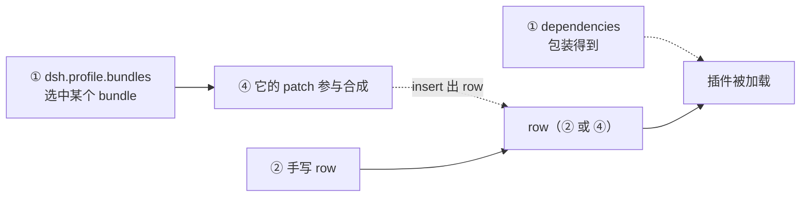
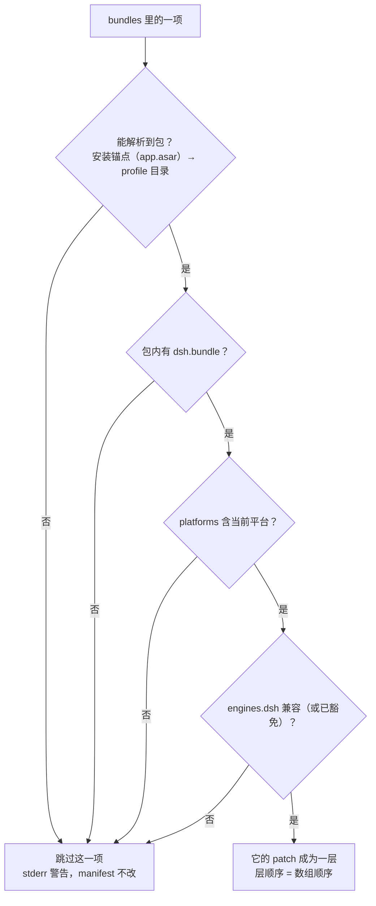
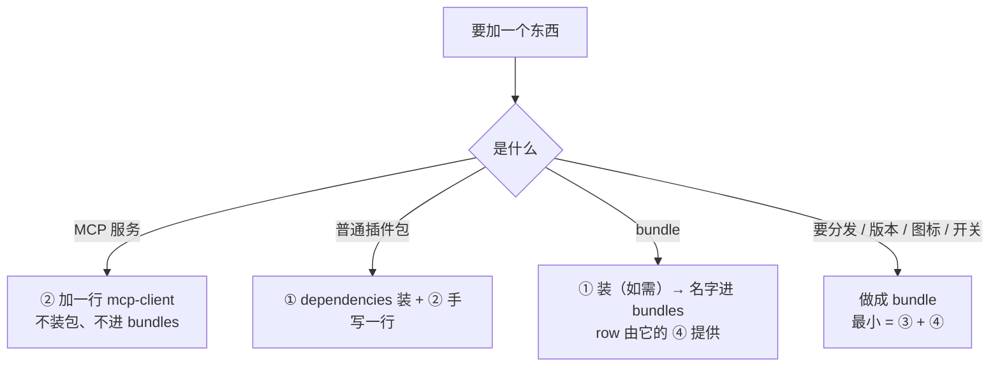

# DSH 插件体系：三份清单与「装 / 选 / 挂」

> **适用**：DSH `0.2.2-rc.3`（nightly 预发布，插件 API 与生态都会漂移；本篇有效窗口约一个 rc 周期）。
>
> **核对**：2026-11-19 首版，2026-11-21 复核。**依据**：本机 profile 实读（`package.json`、`cordis.patch.yml`、`node_modules` 逐个指针）＋ `0.2.2-rc.3` 打包源码（`dsh-app-boot` 的 `applyPatches` / `loadProfileDirectory`、`dsh-official-bundles`、`plugin-manager` 的 `reconcile` / `selectBundle`）＋ 面板审计日志 `operations.jsonl`。
>
> **证据标注**：未标注＝本机实测；**源码级**＝读打包代码得出、未实跑；**推测**＝无直接证据。

---

## 一分钟读懂

三个事实决定了这个体系的一切：

1. **插件能跑起来的充要条件是「包装得到 + 有一行 row」**，`bundles` 只是 row 的来源之一，不是加载开关。
2. **三类文件各管一件事**，互不替代：profile 的 `package.json` 管装谁 + 选谁；包内的 `package.json` 声明入口和「我能不能被选」；patch 文件是 row 唯一住的地方。
3. **面板状态、安装状态、实际加载是三件不同的事**，对齐它们要看三个文件，不能只看一个。

| 你看到的症状 | 先看哪里 |
|---|---|
| 面板显示已启用，但功能没出现 | ② 里有没有对应 row、是不是 `disabled` |
| 选了 bundle，重启后名字又不见了 | `RETIRED_BUNDLES` 静默剔除，或 `reconcile` 因依赖被删而移除 |
| 卸载了插件，界面里还残留着它的设置 | ② 的行没被清（孤儿行），`reconcile` 不管 patch |
| 改了参数，一半回了默认 | patch 对 `config` 是**整段替换**，没抄全的键就回默认 |
| 面板里点不动那个开关 | 面板会先校验并直接拒绝（`not-bundle` / `incompatible-version` / `management-required`） |

---

## 术语与记号

| 术语 | 含义 |
|---|---|
| **profile** | 一套独立的配置与依赖组合（本机只有 `desktop`），目录在 `~/.dsh/profiles/<name>/` |
| **patch 层** | 一份 `cordis.patch.yml` 或 `--patch` 文件，按顺序叠加到根配置上 |
| **bundle** | 包内 `package.json` 带 `dsh.bundle.patch` 的包，可被选进 profile 的 `bundles` |
| **plugin** | 被某条 row 指向、真正实例化的包 |
| **row（entry）** | 配置树里的一行：`id` + `name` + `config`。**挂载点，不是插件** |
| **装 / 选 / 挂** | 包能被解析 / bundle 被选进列表 / 有 row 指向它。三件事相互独立 |

正文用编号指代五份文件，后文不再重复展开：

| 记号 | 文件 |
|---|---|
| **①** | `profiles/<profile>/package.json`——profile 清单 |
| **②** | `profiles/<profile>/cordis.patch.yml`——用户层 patch |
| **③** | `node_modules/<包>/package.json`——bundle 侧清单 |
| **④** | `node_modules/<包>/cordis.patch.yml`——包自带 patch |
| **⑤** | `node_modules/<被挂插件>/package.json`——插件侧清单（无指针） |

---

## 1 心智模型

### 1.1 装 → 选 → 挂



| 层 | 负责 | 落点 | 失败时的样子 |
|---|---|---|---|
| **装** | 包能被 `import` 解析到 | ① 的 `dependencies`（或随 DSH 自带） | 行还在但加载报解析失败；link 目标被删时连 `package.json` 都读不到 |
| **选** | bundle 自带的 patch 层参与合成 | ① 的 `dsh.profile.bundles`（有序） | 包在、行没有 → 不加载；名字被跳过时只在 stderr 留一句警告 |
| **挂** | 插件真正被实例化 | 一条 row，写在 ② 或某个被选中的 ④ 里 | 没 row 就不加载，与包在不在无关 |

> 记住这个不对称：**`bundles` 决定「加不加入层叠」，row 决定「加不加载」**。两者可以各自成立，也可以各自独立失败。

### 1.2 patch 层叠与热生效

同一行只要在任一层出现即生效，同 `id` 由**后层覆盖前层**，`config` 是整段替换：

1. `app.asar` 内自带 bundle 的 patch（只读）
2. 你装的 bundle 的 ④
3. profile 的 ②（用户层，最后叠，优先级最高）
4. `--patch` 指定的文件（临时覆盖，不落盘）

② 改完由 HMR 热生效，两轮核对都**无需重启**。层间顺序、home patch 与「整段替换」的完整语义见[配置分层与目录](配置分层与目录.md)。

---

## 2 三份清单

### 2.1 三个 `package.json` 的角色

「三个」指**角色**，不是三个文件：合一时 ③ 兼任两职，只有壳 bundle 才会拆成 ③ 和 ⑤。

| 角色 | 负责 | 本机实例 |
|---|---|---|
| **profile 清单** | 装谁 + 选谁 | `profiles/desktop/package.json`（`name: "dsh-profile-desktop"`） |
| **bundle 清单** | 声明「我能被选」，带自己的默认 patch | `@deepseek-ai/dsh-experimental-badge-skill-bundle` |
| **插件清单** | 只声明入口与 peer；被别人 insert 才加载 | `@deepseek-ai/dsh-skill-badge` |

```text
形态 A —— 插件 + bundle 合一：一个包、一份 package.json
profiles/<profile>/
├─ package.json                 ① profile 清单：装谁 + 选谁
├─ cordis.patch.yml             ② 用户层 patch：row 写这里
└─ node_modules/<包>/
   ├─ package.json              ③ 兼任 bundle 与插件清单（有 dsh.bundle.patch）
   └─ cordis.patch.yml          ④ 它自带的默认层：被选进 ① 才读

形态 B —— 壳 bundle 挂别人的插件：两个包、两份 package.json
profiles/<profile>/
├─ package.json                 ①
├─ cordis.patch.yml             ②
└─ node_modules/
   ├─ <壳 bundle>/
   │  ├─ package.json           ③ 有 dsh.bundle.patch；dependencies 里带着被挂插件
   │  └─ cordis.patch.yml       ④ 只 insert 一行，name 指向被挂插件
   └─ <被挂插件>/
      └─ package.json           ⑤ 无指针，只有 main / exports / peerDependencies
```

判断某份清单属于哪种角色，只看一个字段：**有没有 `dsh.bundle.patch`**。有 → 可以被选；没有 → 只能被别人 insert（或被 ② 手写一行）才加载。

| 文件 | 谁写 | 内容 | 本机实测 |
|---|---|---|---|
| ① | Electron / 面板（可手改） | 只有 `dependencies` + `dsh.profile.bundles`，**没有 row** | 13 项依赖 / 22 个 bundle |
| ② | 你（设置页会写回） | row 的 `id` / `name` / `config`、`insert`、`disabled` | 467 行 / 24 条 row |
| ③（bundle 侧） | 插件作者 | 入口 + `dsh.engines.dsh` + `dsh.bundle.patch` + `dsh.client` + `peerDependencies` | 11 个第三方包全带指针 |
| ④ | 插件作者 | 该 bundle 的默认层：insert 自己的行或覆盖别人的行 | 11 个文件全部存在 |
| ⑤（插件侧） | 插件作者 | 只有入口与 peer，**无 `dsh.bundle`** | 官方 badge 的被挂方 |

### 2.2 两份同名的 `cordis.patch.yml`

| | ② 用户层 | ④ 包内 |
|---|---|---|
| 谁写 | 你 / 设置页 | 插件作者 |
| 何时读 | 每次都读 | 仅当该 bundle 被选进 `bundles` |
| 优先级 | 高（后叠） | 低（多层里位置由 `bundles` 顺序决定） |
| 放什么 | 你的定制、MCP、UI 偏好 | 插件自己的默认行与默认参数 |

两者同名但**不是一层**。同 `id` 时 ② 覆盖 ④；「这条配置到底谁设的」必须两边都看。

**最关键的一条语义**：patch 对 `config` 是**整段替换**，不是深合并。写 `config` 就替换整个值——改一个字段必须把同层其它字段一起抄全，否则回默认；不写 `config` 则完全不动它。

### 2.3 bundle 的两种形态与一行判定

bundle 除了指针，还可在 ③ 里声明 `dsh.client`（Client 行怎么注入、`platform` / `immediately` / `inject`），以及 `inject` 与 `isolate` 等宿主侧能力。

- **插件 + bundle 合一**：③ 带指针，④ 挂自己（本机 11 个第三方插件全是这一种）。本地开发用 `"link:<path>"` 直接装，不必发 npm。
- **壳 bundle**：③ 带指针，④ 挂别人的插件（官方 badge：壳 `dsh-experimental-badge-skill-bundle` 的 `dependencies` 指向 `@deepseek-ai/dsh-skill-badge`，它自己的 ④ 只有 `- insert: [{id: skill-badge, name: '@deepseek-ai/dsh-skill-badge'}]`）。

判定只看指针，不看目录里躺了什么：

```powershell
(Get-Content '<profile>\node_modules\<包名>\package.json' -Raw | ConvertFrom-Json).dsh.bundle.patch
```

**光在包里放一个 yml 不算 bundle。**`dsh.bundle.patch` 可以是单个路径，也可以是路径数组（**源码级**）。

---

## 3 row：插件体系的原子单位

### 3.1 定义与字段

**一条 row = 用哪个包（`name`）、以什么身份（`id`）、带什么参数（`config`）挂上去**；也可以是一个 `group`，把子行装进 `config`。

| 键 | 作用 | 细节（**源码级**：`applyPatches`） |
|---|---|---|
| `id` | 这一行的身份 | 覆盖靠它定位；**insert 的行必须有 id**（运行期改动按 id 找回这一行）；同一棵树里唯一 |
| `name` | 包名（import specifier） | 覆盖时写 `name` 是**一致性校验**：与目标不一致就警告并跳过，**不是改名** |
| `config` | 传给插件的参数 | 写了哪些键替换哪些；写了 `config` 就整段替换这个值 |
| `disabled` | 不实例化这一行 | 运行期状态是 `disabled`；包与 config 都还在 |
| `group` | 这一行是分组 | 配 `config: [...]` 装子行（嵌套行） |

### 3.2 两种写法

```yaml
# 写法一：insert —— 追加新行（本机 9 条 MCP 行都是这样来的）
- insert:
    - id: mcp-qcc-company
      name: '@deepseek-ai/dsh-mcp-client'
      config:
        serverName: qcc-company
        transport: streamable-http
        url: '<MCP 服务地址>'
        headers:
          Authorization: 'Bearer <token>'   # 本机目前明文，见凭据篇

# 写法二：覆盖 —— 按 id 改已有的行（本机 15 条）
- id: ui-theme
  config:
    ...
```

| 情形 | insert | 覆盖 |
|---|---|---|
| 目标不存在 | 追加到根列表（或 `id` 指定的 group） | 警告 `patch: entry "x" not found`，跳过 |
| 没写 `id` | 允许，运行期随机生成 | 不允许：`patch: id is required for non-insert patches` |
| 写了 `name` | 就是包名 | 只做一致性校验，不匹配就跳过 |
| 写 `disabled: true` | 插入时即禁用 | 禁用已有行 |

### 3.3 一个包可以有多条 row

本机 9 条 MCP 行的 `name` **全是** `@deepseek-ai/dsh-mcp-client`，靠 `id`（`mcp-deepwiki`、`mcp-grep-app`、`mcp-qcc-company`…）和各自的 `serverName` 区分。所以 row 是挂载点，不是插件。

### 3.4 数 row 时不要数 `- id:`

② 全文出现 **55 处 `- id:`**，其中只有 **24 处是 row**（15 条顶层覆盖行 + 9 条 MCP 行）；剩下 31 处在插件参数里——`llm-pi-ai` 的 30 个模型条目、`ui-settings-account` 的 1 个 account，也写成 `- id:`，但它们是配置数据。同理 17 个顶层条目里只有 15 个是覆盖行，另 2 个是 `insert` 块。

一条 row 生效需要三个条件：`id` 在树里唯一（同 id 后层覆盖，不是两份并存）、`name` 能解析到包、`disabled` 不为 true。设置 → 插件 面板列的就是运行期真正加载的行（`auditStartupEntries` 单次最多报 256 行）。

### 3.5 五个常见误解

| 误解 | 事实 |
|---|---|
| row 写在某个 `package.json` 里 | 不在。`package.json` 只有依赖与 bundles；row 只存在于 patch 文件和运行期配置树 |
| 一条 row = 一个插件包 | 一个包可以有多条 row（9 个 MCP）；一条 row 也可以是 group |
| 覆盖时写 `name` 是改名 | 只是校验，不匹配就跳过 |
| `disabled: true` = 卸载 | 只是不实例化这一行，包、config、行本身都在 |
| 删了行就是卸载 | 包还在 `dependencies` / `node_modules`，重新 insert 一行即可复活 |

---

## 4 选：`dsh.profile.bundles`

### 4.1 形状与语义

```json
"dsh": {
  "profile": {
    "bundles": ["@deepseek-ai/dsh-base", "@deepseek-ai/dsh-web-app", "dsh-summary-command"]
  }
}
```

- 元素是**包名**，不是路径、不是 row 的 `id`。
- 数组**有序**，顺序就是 patch 层叠顺序，**后面的赢**。
- **它不负责加载**，只负责「这个 bundle 自带的 patch 参不参与合成」。
- 新建 profile 的默认值只有一条 `@deepseek-ai/dsh-base`（**源码级**：`DEFAULT_PROFILE_BUNDLES`），可理解为「最少一条」。

### 4.2 启动时每一项都要过四道关



**源码级**（`loadProfileDirectory`）：四条都在同一个 `try` 里，任一失败就 `skippedBundles.push(...)`。要分清两种失败：

- **跳过一项**：只影响这一项，其余照常启动，stderr 打 `dsh: skipping profile bundle "<包名>": <原因>`，manifest **一个字节都不改**。
- **启动失败**：profile 的 `package.json` 读不了或不是 JSON 对象，这才是硬错。

### 4.3 谁在改这个字段

| 改动者 | 实际行为 |
|---|---|
| 面板 / `plugin_manager` 勾选 | **启用：不在列表就追加到末尾，已在列表则位置不变；禁用：`filter` 掉，`dependencies` 保留**（**源码级**：`selectBundle`）。启用前先校验：非 bundle → `not-bundle`、平台不符、engines 不兼容 → `incompatible-version`、想禁用的是插件管理器自己 → `management-required` |
| 面板安装新依赖 | 声明了 `dsh.bundle` → 自动追加；没声明 → 警告 `installed as a plain dependency, not a profile layer`，不入列 |
| 卸载依赖之后 | 下次对账时，已不在 `dependencies` 的名字被**自动移除**（**源码级**：`reconcile`） |
| DSH 启动时 | `RETIRED_BUNDLES`（当前 `…experimental-schedule-bundle`、`…experimental-agent-team-profile`）被**静默剔除并写回 manifest** |
| 你手改 | 允许。写回统一 2 空格缩进 + 结尾换行，权限 `0600` |

**手改与面板的关键差别**：面板在写盘**之前**就拒绝不合格项；手改不校验，只会在**启动时**被跳过。所以「面板里点不动」和「手改后没生效」是两种不同的失败。

### 4.4 只读校验

```powershell
$pd = "$env:USERPROFILE\.dsh\profiles\<profile>"
$m  = Get-Content "$pd\package.json" -Raw | ConvertFrom-Json
$m.dsh.profile.bundles                        # 选了谁（有序）
$m.dependencies.PSObject.Properties.Name      # 装了谁
$m.dsh.profile.bundles | ForEach-Object {
  $pj = "$pd\node_modules\$_\package.json"
  if (-not (Test-Path $pj)) { "$_`t<不在 profile，可能在 app.asar>" ; return }
  if ((Get-Content $pj -Raw | ConvertFrom-Json).dsh.bundle) { "$_`tbundle" }
  else { "$_`t非 bundle → 启动时会被跳过" }
}
```

### 4.5 四个误判

| 误判 | 事实 |
|---|---|
| 「写进 `bundles` 就会加载」 | 只让它的 patch 参与合成；没有 row 照样不加载 |
| 「非 bundle 名写进 `bundles` 是白写」 | 启动时**跳过并在 stderr 报** `declares no dsh.bundle`，manifest 保持原样 |
| 「`bundles` 里有名字就一定跑」 | 解析不到包（如 link 悬空）、平台不符、engines 不符都会被跳过，名字仍留在 manifest |
| 「内置 bundle 也得先装」 | 不用：解析先看**安装锚点**（`app.asar`）再看 profile 目录 |

---

## 5 装：`dependencies` × `bundles`

| deps | bundles | 含义 |
|---|---|---|
| 有 | 有 | 第三方 bundle 的正常形态（`dsh-summary-command`、`dsh-session-delete-cascade`） |
| 有 | 无 | 已装未启用（`dsh-agent-enhancer`）；或靠 ② 手写 row 活着 |
| 无 | 有 | 随 DSH 自带的 bundle（11 个 `@deepseek-ai/*`，实体在 `app.asar`） |
| 无 | 无 | 没装、也没参与；**包卸了但 ② 的行还在**时也是这一格（孤儿行） |

本机五类真实状态（2026-11-21）：

| 包 | ③ 有指针 | ① deps | ① bundles | ② 有 row | 结果 |
|---|---|---|---|---|---|
| `dsh-summary-command` | 是 | 是 | 是 | 无 | 行由 ④ `insert` 提供 → 生效 |
| `dsh-agent-enhancer` | 是 | 是 | 否 | 无 | 已装未启用 |
| `dsh-sidebar-search` | — | 是（junction 悬空） | 否 | 无 | 装都没成立：`package.json` 解析不到 |
| `dsh-claude-style` | 是（旧包） | **已卸载** | 否 | 有 | 孤儿行：行还在，包已不在 |
| 9 条 MCP | 随 DSH 自带 | 不涉及 | 不涉及 | 有 | 只动 ② 即生效 |

配套规则：

- **关 bundle = 从 `bundles` 摘名，保留 `dependency`**，包还在 `node_modules`。
- 重新启用会**追加到末尾**（**源码级**：`selectBundle`），它的层变成最后叠加——优先级和之前不同。
- 非 bundle 名写进 `bundles` 会在启动时被跳过并报 `declares no dsh.bundle`，manifest 不改。
- 只留依赖、实体却没了（link 目标被删）= 装这一层断了，别对着 `dependencies` 数「装了几个」。

---

## 6 挂：row 从哪来

根配置 `cordis.yml` 永远是空数组 `[]`（文件头写着 "Edit cordis.patch.yml, not this file"），所有 row 都由层叠产生：bundle 的 ④ `insert` → profile 的 ② → home patch → `--patch`。

同一插件**只从一处出 row**：

| 例子（2026-11-21） | row 从哪来 | deps / bundles |
|---|---|---|
| `dsh-summary-command`（插件 + bundle） | 它自己的 ④ | 有 / 有 |
| 9 条 MCP（含 `qcc-company`） | ② 的 `insert` | 不涉及 / 不涉及 |
| `dsh-agent-enhancer` | 无 | 有 / 无 |
| `dsh-claude-style` | ② 手写（包已卸载） | 无 / 无（孤儿行） |

**不要做的事**：既选 bundle、又在 ② 抄同一行 → 同一插件出现两次加载尝试。`id` 相同时后层覆盖（往往把你抄全的 `config` 冲成 ④ 的裸行）；`id` 不同而 `serverName` 相同时才会撞名失败。**要定制就二选一**：选 bundle 后在 ② 只写覆盖项（`config` 整段抄全），或不选 bundle、完全靠 ② 手写。

---

## 7 MCP：唯一「只动 ②」的分支

- 一行 = `name: '@deepseek-ai/dsh-mcp-client'` + `config.serverName` / `transport` / `url`（URL 型）或 `command` / `args` / `env`（本地进程型）；另有 `toolCallTimeoutMs`、`startupTimeoutMs`、`failOnStartupError`、`reconnect.*`。
- `serverName` 决定工具前缀 `mcp__<serverName>__<tool>`，同作用域内必须唯一（**已验证**：本会话工具名即 `mcp__qcc-company__get_company_by_query`）。
- **不装包、不进 `bundles`**：`@deepseek-ai/dsh-mcp-client` 随 DSH 自带，profile 的 `node_modules` 里没有它（**已验证**）。
- 多家可塞进同一个 `insert` 列表；后追加的常写成文件末尾独立一块，两种写法等价（本机前 8 家一块、`qcc-company` 单独一块）。
- 明文凭据风险（**已验证**）：某行的 `headers.Authorization` 直接写 `'Bearer <token>'`，而 ② 是明文 YAML。替代写法 `expandTemplates: true` + `'Bearer ${credential:<REF>}'`，见[凭据体系与密钥打码](凭据体系与密钥打码.md)；本机尚未改。
- Claude / Cursor 的 `mcpServers` JSON 不能直贴，字段要逐条换算（**推测**，未实测）。

---

## 8 决策树：要加一个东西



---

## 9 排查手册

| 症状 | 检查点 | 结论 / 修法 |
|---|---|---|
| 面板已启用，功能没出现 | ② 有无该 row；`disabled` 是否 true | 补 row 或去掉 `disabled`；面板开关只动 `bundles` |
| 写了 row 不加载 | `name` 能否解析；`id` 是否与别的行冲突；`name` 与目标不一致 | 解析不到 → 装包；id 冲突 → 后层覆盖，只剩一条 |
| 面板开关点不动 | 返回的 `ManagementFailure` | `not-bundle` / `incompatible-version` / `management-required` 都被前置拒绝 |
| 勾选后重启，名字消失 | `RETIRED_BUNDLES`；`dependencies` 是否还在 | 官方剔除或 `reconcile` 移除；保留依赖即可恢复 |
| 卸载后残留设置 | ② 的行 | `reconcile` 不清 patch；手动删行或 `disabled: true` |
| 改参数一半回默认 | 是否只写了目标键 | `config` 整段替换，必须整段抄全 |
| 状态与面板不一致 | `package.json` + ② + `operations.jsonl` | 三者分开看：装、选、挂各是各的 |

---

## 10 管理面与生态

### 10.1 三个入口（互不依赖）

| 入口 | 载体 | 归属 |
|---|---|---|
| 侧边栏插件面板 | `@deepseek-ai/dsh-client-ui-plugin-manager`（内置，官方描述 *"installs, enables, disables, retries, and composes installed plugin packages"*） | DSH 自带，关不掉 |
| Agent 工具 `plugin_manager` | `@deepseek-ai/dsh-plugin-manager/tools`（*"shared by dsh CLI, Web and agent tools"*，按预设按会话提供） | 可选工具插件 |
| 命令行 | `dsh plugin --profile <name> <pnpm args…>`（参数透传给 pnpm） | DSH 自带 |

关掉 `plugin_manager` 只让模型失去「对话里改插件」的能力，侧边栏面板不受影响；面板是内置的，没有「卸载」一说。

`plugin_manager` 可列清单（`limit` / `offset` 分页）、启停（对整个 profile 生效）、安装、卸载、版本校验。⚠️ 变更需要完整文件权限或用户批准；「从不询问」策略下会被自动拒绝，查看清单不受影响。

### 10.2 安装 / 启停 / 卸载

| 想做的事 | 桌面版做法 | 配置文件 / CLI |
|---|---|---|
| 查看清单 | 面板 / 设置 → 插件 | 读 ① 的 `bundles` + `dependencies` |
| 安装 | 设置 → 插件 → 添加插件 → 安装 → **完全退出重开** | 写 `dependencies`（本地用 `link:`）+ 进 `bundles`；**桌面 profile 不能用 `dsh plugin`** |
| 启用 / 禁用 | 面板开关 | `bundles` 增删，或条目的 `disabled: true` |
| 卸载 | 面板卸载 | 从 `dependencies` + `bundles` 移除后重装依赖 |

桌面 profile 用 CLI 会被拒：

```text
profile "desktop" is managed exclusively by the Electron application
```

### 10.3 版本兼容的两道检查

1. **包声明层**：③ 的 `dsh.engines.dsh` 与 `peerDependencies`。
2. **运行时层**：`plugin_manager` 安装/激活时校验，不满足直接拒绝。

「满足 engines」只说明不会因版本被拒，**不代表私有 API 稳定**——有的删除插件用了 `sessionPersistence.tracker.writers` 等内部接口，DSH 升级后可能退化（靠 feature-detect + fail-soft 兜底，最坏是残留日志/幽灵行）。

### 10.4 安装前的两道闸

1. 带 install/build 脚本的包会进 `pendingBuilds`，批准前不要勾选；桌面端 install-gate 不完整，预审只能靠离线审查（见[插件安全评审方法论](插件安全评审方法论.md)）。
2. 装完**完全退出重开**，再到 设置 → 插件 核对实际挂载条目。

---

## 11 本机快照与标本

### 11.1 2026-11-21 快照

- `bundles` **22 个**：11 个随 DSH 自带（`dsh-base`、`dsh-web-app`、`dsh-experimental-auto-review`、`dsh-personalized-recommendations`、`dsh-experimental-inspector-profile`、`dsh-experimental-cot-translation-bundle`、`dsh-experimental-badge-skill-bundle`、`dsh-experimental-plugin-market-bundle`、`dsh-experimental-session-search`、`dsh-experimental-forge-bundle`、`dsh-experimental-terminal-bundle`）+ 11 个第三方/本地（`dsh-summary-command`、`dsh-session-delete-cascade`、`@liustack/modsearch`、`dsh-opencode-go`、`dsh-windows-notify`、`@local/dsh-style-switcher`、`dsh-files-show-hidden`、`dsh-btw`、`dsh-large-text-paste`、`dsh-collapse-long-user-messages`、`@dsh-local/view-*`）。
- `dependencies` **13 项**，2 项不在 `bundles`：`dsh-agent-enhancer`（已装未启用）、`dsh-sidebar-search`（junction 悬空）。
- ② **467 行 / 17 个顶层条目 / 24 条 row**（15 覆盖 + 9 MCP）。
- 与 11-12 快照（18 个 bundle）相比少的四个名字：`experimental-agent-team-profile` 是被 `RETIRED_BUNDLES` 静默剔除；`experimental-session-titles-bundle`（11-17 16:37）、`dsh-agent-enhancer`（11-12 14:24）、`dsh-sidebar-search`（11-16 14:42）都是面板手动取消（`operations.jsonl` 的 `reason:"bundle"`、`enabled:false`）。新增八个都是安装后自动追加到末尾的。

### 11.2 标本：`dsh-claude-style`

11-19 时它是「装了、没被选、靠 ② 的行活着」的教科书案例。审计日志（同一 `runId`）：

| 时间（11-10） | 记录 | 含义 |
|---|---|---|
| 14:09:22 | `reason:"install"`,`enabled:false`,`version:"0.20.2"` | 装进 `dependencies` |
| 14:09:26 | `reason:"bundle"`,`enabled:true` | 勾选进 `bundles` |
| 14:22:20 | `reason:"bundle"`,`enabled:false` | **取消勾选**，13 分钟后 |

「装了但没选」是**主动取消**，不是安装失败。取消后皮肤照常生效，原因有两条：

- **挂**由 ② 的行决定，`bundles` 只决定 ④ 参不参与合成；④ 里那条同 id 的裸行从未被读。
- 客户端注入信息在 ③ 的 `dsh.client`（`platform` / `inject` / `immediately`），加载时从包里读，不依赖 ④。

到 11-21 再核对：包已从 `dependencies` 和 `node_modules` 消失，**② 的行仍留着**。`reconcile` 只清 `bundles`，不动 ②——「卸载插件后残留一行配置」是正常现象。孤儿行加载时是被跳过还是报错，本轮没取到证据（无日志，也未复现）。

三个可复用结论：面板的 bundle 开关动不了 ② 的行；卸载依赖也不清 ② 的行；反过来，删了 ② 的行又把 bundle 勾上，插件会以 ④ 的裸行按**默认参数**启动，之前那套设置（存在 ② 的 `config` 里）全部丢失。

### 11.3 壳 bundle 实例

`@deepseek-ai/dsh-experimental-badge-skill-bundle`：③ 有指针，`dependencies` 指向 `@deepseek-ai/dsh-skill-badge`，④ 只有三行 insert；被挂的 `@deepseek-ai/dsh-skill-badge` 是纯插件（⑤），无任何 bundle 字段。它随 DSH 自带，所以「被挂插件不必单独选、也不必单独装」。

---

## 附录

### A 本地 link 插件的实现要点（可当模板）

**侧栏正文搜索**：`main: index.js` + `exports ./client`；`dsh.engines.dsh: ">=0.2.2-rc.1"`；`dsh.bundle.patch`；`dsh.client` 声明 `platform: web`、`immediately: true`、注入 session 与 workspace 两个 UI 包。它的 ④ 做两件事：insert 自己的行；把 `session-query-sqlite` 的 `config` 整块改成 `path: ':memory:'` + `openAt: first-search`（注释原文 "A patch replaces the targeted row's whole `config`"）。效果是 GUI 侧可跨工作区搜正文，模型侧仍受 cwd 限制（见[工作区与会话](工作区-会话与指令链.md)）。

**`/summary` 交接摘要**：`index.js` 92 行，`inject: ["commands"]`，用 `ctx.commands.register` 注册 `/summary [topic]`。通过 `invocation.agent.followup(message)` 把「一条可见请求行 + 隐藏摘要指令」投进当前会话（空闲立即唤醒、运行中排队）。**不压缩、不改历史**，产物是一条额外 assistant 消息；带附件返回用法错误。

### B 会话删除插件生态

| 包 | 月下载 | 特点 |
|---|---|---|
| `@linxin666/dsh-session-archive` | ~97k | 集中清单、批量归档/恢复、**物理删除（含家族级联）**、自动清理（无公开仓库，谨慎） |
| `@xrn1997/dsh-session-delete` | ~5.2k | 删除 = 移入**回收站**，另设彻底删除 |
| `dsh-session-delete-cascade` | ~2.3k | 侧栏 `⋯` 删除；**血缘级联**删子代理；清日志/投影缓存/索引；运行中拒绝删除 |
| `@hualiong/dsh-session-delete` | ~2.2k | 原生菜单 + 确认弹窗；先停运行任务；广播 `api-session/removed`；可选 `session_delete` 工具 |
| `dsh-session-delete`（另一实现） | ~1.8k | 单条删除 + 归档全部；**客户端 DOM 注入菜单**（官方未开该 Slot），改版易失效 |
| `@kangyishuai/dsh-session-delete` | ~1.7k | 默认回收站、删除前 plan、审计日志、残留清单 |
| 其余若干 | 0.2k–1.1k | 回收站/彻底删二选一 + 路径校验 |

品类极早期（多数 Star 个位数）。选型：要「先回收站再彻底删」选回收站型；要「原生菜单 + 级联 + 运行中保护」选 `dsh-session-delete-cascade`；**优先走官方 Slot，DOM 注入型改版易坏**。

### C 复核命令

```powershell
$pd = "$env:USERPROFILE\.dsh\profiles\<profile>"
$m  = Get-Content "$pd\package.json" -Raw | ConvertFrom-Json

# ① 选谁、装谁
$m.dsh.profile.bundles
$m.dependencies.PSObject.Properties.Name

# ② 顶层条目数（row 数量另算，别数 `- id:`）
(Select-String -Path "$pd\cordis.patch.yml" -Pattern '^- ').Count

# 每个 bundle 是否真有指针
$m.dsh.profile.bundles | ForEach-Object {
  $pj = "$pd\node_modules\$_\package.json"
  if (Test-Path $pj) {
    $b = (Get-Content $pj -Raw | ConvertFrom-Json).dsh.bundle
    "{0,-44} {1}" -f $_, $(if ($b) { 'bundle' } else { '非 bundle（启动时会被跳过）' })
  } else { "{0,-44} 不在 profile（可能在 app.asar）" -f $_ }
}

# 版本与归档体积
Get-Content '<安装目录>\resources\version'
(Get-Item '<安装目录>\resources\app.asar').Length
```

---

相关：[配置分层与目录](配置分层与目录.md) · [插件生态：原生短板与包名核实](插件生态-原生短板与包名核实.md) · [插件安全评审方法论](插件安全评审方法论.md) · [凭据体系与密钥打码](凭据体系与密钥打码.md) · [工作区、会话与指令链](工作区-会话与指令链.md)
