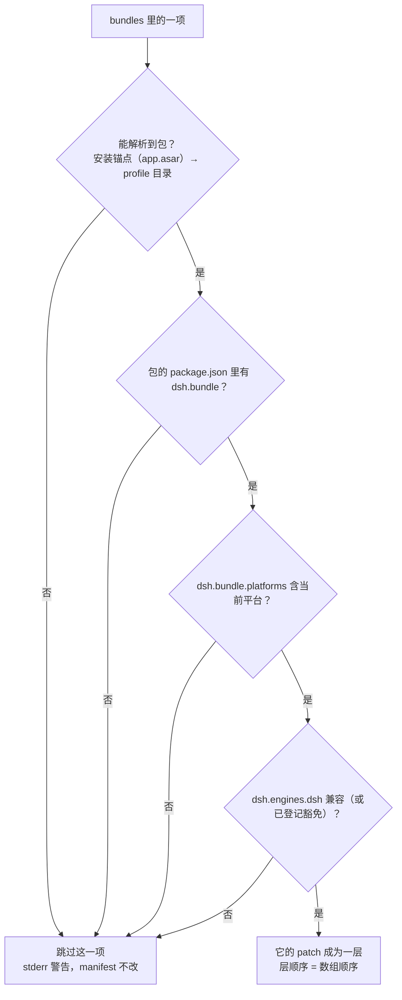
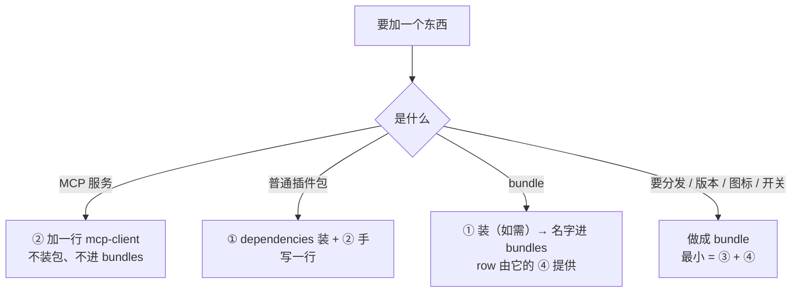

# DSH 插件体系：三个 `package.json` 角色、装/选/挂三层与管理入口

> 核对：2026-11-19 首版、2026-11-21 复核。依据：原会话对 profile 的实测（插件启停/安装、本地 link 插件、删除插件生态扫描）；11-19 实读 `profiles/desktop` 的 `package.json`、`cordis.patch.yml`、`node_modules` 下每个包的 `dsh.bundle.patch` 指针逐条复核；11-21 补读 `0.2.2-rc.3` 打包源码（`dsh-app-boot` 的 `loadProfileDirectory`、`dsh-official-bundles` 的 `RETIRED_BUNDLES` / `DEFAULT_PROFILE_BUNDLES`、`plugin-manager` 的 `reconcile` / `selectBundle`）并复核壳 bundle 形态（`dsh-experimental-badge-skill-bundle` + `dsh-skill-badge`），后者标**源码级**。DSH 为 nightly 预发布，插件 API 与生态都会漂移。

## 先把对象认清：三个 `package.json` 角色，两份同名 `cordis.patch.yml`

先说清数目：**「三个」指角色，不是三个文件**。同一个插件，`node_modules` 里可能只有一份 `package.json`（插件与 bundle 合一），也可能有两份（壳 bundle 挂别人的插件）。三种角色是：

| 角色 | 负责 | 本机实例（`0.2.2-rc.3` 实读） |
|---|---|---|
| **profile 清单** | 装谁 + 选谁 | `profiles/<profile>/package.json`（`name: "dsh-profile-desktop"`） |
| **bundle 清单** | 声明「我能被选」，带自己的默认 patch | `@deepseek-ai/dsh-experimental-badge-skill-bundle` |
| **插件清单** | 只声明入口与 peer；被别人 insert 才加载 | `@deepseek-ai/dsh-skill-badge` |

两种形态决定你能看到几个文件：

```text
形态 A —— 插件 + bundle 合一：一个包、一份 package.json
profiles/<profile>/
├─ package.json                 ① profile 清单：装谁 + 选谁
├─ cordis.patch.yml             ② 用户层 patch：row 写这里（后叠，优先级最高）
└─ node_modules/<包>/
   ├─ package.json              ③ 兼任 bundle 清单与插件清单：有 dsh.bundle.patch，也有 main/exports
   └─ cordis.patch.yml          ④ 包自带 patch：仅当 ③ 有 dsh.bundle.patch 指针

形态 B —— 壳 bundle 挂别人的插件：两个包、两份 package.json
profiles/<profile>/
├─ package.json                 ①
├─ cordis.patch.yml             ②
└─ node_modules/
   ├─ dsh-experimental-badge-skill-bundle/
   │  ├─ package.json           ③ 壳：有 dsh.bundle.patch；dependencies 里带着被挂插件
   │  └─ cordis.patch.yml       ④ 只 insert 一行，name 指向被挂插件
   └─ dsh-skill-badge/
      └─ package.json           ⑤ 被挂插件：无指针，只有 main / exports / peerDependencies
```

判断某份 `package.json` 属于哪种角色，只看一个字段：有没有 `dsh.bundle.patch`。有 → 它是 bundle，可以被选进 `bundles`；没有 → 它只能被别人 insert（或被 ② 手写一行）才加载。

| 文件 | 谁写 | 一份管什么 | 本机实测 |
|---|---|---|---|
| ① `profiles/<profile>/package.json` | Electron / 插件面板（也可手改） | 只有两段：`dependencies`（**装**谁：版本号、`link:`、`file:` tarball）+ `dsh.profile.bundles`（**选**谁，**有序**）。**完全没有 row** | 13 项依赖 / 22 个 bundle |
| ② `profiles/<profile>/cordis.patch.yml` | 你（设置页也会写回这里） | **挂**：`id` / `name` / `config` 行、`insert` 列表、`disabled: true` | 467 行，13 个顶层条目 |
| ③ `node_modules/<包>/package.json`（bundle 侧） | 插件作者 | 入口（`main` / `exports` / `icon` / `files`）+ `dsh.engines.dsh` + **`dsh.bundle.patch`（有它才是 bundle）** + `dsh.client`（Client 行怎么注入）+ `peerDependencies` | 11 个第三方包全带指针 |
| ④ `node_modules/<包>/cordis.patch.yml` | 插件作者 | 该 bundle 的「默认层」：insert 自己的行，或覆盖别人的行。**只有被选进 ① 才读** | 11 个文件全部存在 |
| ⑤ `node_modules/<被挂插件>/package.json`（插件侧） | 插件作者 | 只有入口与 peer：`main` / `exports` / `icon` / `peerDependencies`，**没有 `dsh.bundle`** | 官方 badge 的被挂方 `@deepseek-ai/dsh-skill-badge` |

### 三个最容易混的地方

1. **② 和 ④ 同名，但不是一层**。都叫 `cordis.patch.yml`，一在 profile 根、一在包内；同 `id` 时后叠的 ② 覆盖前面的 ④，`config` 是整段替换。排查「这条配置到底谁设的」时必须两边都看（见[配置分层与目录](配置分层与目录.md)）。
2. **「三个 `package.json`」只在壳形态里是三个文件**。插件+bundle 合一时 ③ 兼任两职，`node_modules` 里只有一份（本机 11 个第三方插件全是这样）；壳形态才有 ③ 和 ⑤ 两个包——官方 badge 就是：壳 `dsh-experimental-badge-skill-bundle` 有指针、`dependencies` 里带着 `@deepseek-ai/dsh-skill-badge`，它自己的 ④ 只有 `- insert: [{id: skill-badge, name: '@deepseek-ai/dsh-skill-badge'}]` 三行；被挂的 `dsh-skill-badge` 没有任何 bundle 字段。
3. **① 的 `dependencies` 只管装，不管生效**。装了包但没进 `bundles`、② 里也没人写行，就永远不加载；反过来，内置 bundle 的实体在 `app.asar` 里，根本不进 profile 的 `node_modules`。

### 本机真实例子（2026-11-21 复核，四种状态）

| 包 | ③ 有指针 | ① `dependencies` | ① `bundles` | ② 有 row | 结果 |
|---|---|---|---|---|---|
| `dsh-summary-command` | 是 | 是 | 是 | 无 | 行由它自己的 ④ `insert` 提供 → 生效 |
| `dsh-agent-enhancer` | 是 | 是 | 否 | 无 | 已装未启用 |
| `dsh-sidebar-search` | — | 是（junction 悬空） | 否 | 无 | **连「装」都没成立**：`node_modules` 里只剩指向已不存在目录的 junction，`package.json` 解析不到 |
| `dsh-claude-style` | 是（旧包） | **已卸载** | 否 | 有（`ui-skin-claude-style`） | **孤儿行**：行还在，包已不在 `node_modules` |

### 标本：`dsh-claude-style` 的完整轨迹

11-19 复核时它还在，状态是「装了、没被选、靠 ② 的行活着」，能当「面板状态 ≠ 实际加载」的标准标本。审计日志 `%APPDATA%\@deepseek-ai\dsh-desktop\plugin-operations\operations.jsonl`（同一 `runId`）：

| 时间（本机 11-10） | 记录 | 含义 |
|---|---|---|
| 14:09:22 | `reason:"install"`,`enabled:false`,`version:"0.20.2"` | 装进 `dependencies`，此时**没**选进 bundle |
| 14:09:26 | `reason:"bundle"`,`enabled:true` | 勾选进 `bundles` |
| 14:22:20 | `reason:"bundle"`,`enabled:false` | **取消勾选**，13 分钟后 |

所以「装了但没选」是**主动取消**的结果，不是安装失败。取消后皮肤照常生效，原因有两个：

- **挂**由 ② 的 row 决定，`bundles` 只决定 ④ 要不要参与合成；④ 里那条同 id 的裸行从来没被读，也不需要被读。
- 客户端注入信息在 ③ 的 `dsh.client`（`platform` / `inject` / `immediately`），是**加载时从包里读**的，不依赖 ④。

到 11-21 再核对：它已从 `dependencies` 和 `node_modules` 里消失，**② 的那行仍留着**。`reconcile` 只清 `bundles`，不动 ②——所以「卸载插件后还残留一行配置」是正常现象，不是故障。孤儿行在加载时是被静默跳过还是报错，本轮没取到证据（无对应日志，也未故意复现）。

三个可复用的结论：

- **面板的 bundle 开关动不了 ② 的行**。要停用只能删行或 `disabled: true`。
- **卸载依赖也不会清 ② 的行**，会留下指向空包的孤儿行。
- 反过来也有坑：删了 ② 的行、又把 bundle 勾上，插件会以 ④ 的裸行按**默认参数**启动，之前那套设置（品牌、布局、音效等十余项，都存在 ② 的 `config` 里）全部丢失。

这类「面板状态」「安装状态」「实际加载」三者不一致的情况，只读一个文件看不出来，要 `package.json` + `cordis.patch.yml` + `operations.jsonl` 一起看。

## 装 / 选 / 挂：插件跑起来是三件事

| 层 | 负责 | 落在哪 |
|---|---|---|
| **装** | 包能被 `import` 解析到 | ① 的 `dependencies`（或随 DSH 自带） |
| **选** | 某个 bundle 的 patch 层参与合成 | ① 的 `dsh.profile.bundles`（有序） |
| **挂** | 插件真正被加载 | 一条 row，写在 ② 或某个被选中的 ④ 里 |

**插件运行的充要条件 = 包装得到 + 有一行 row。** `bundles` 只是 row 的来源之一：bundle 的 patch 可以 insert 新行、也可以覆盖别人的行，但「被选中」和「被加载」是两回事。

## `dsh.profile.bundles`：这个字段到底决定什么

profile 的 `package.json` 里就这一段（本机节选）：

```json
"dsh": {
  "profile": {
    "bundles": [
      "@deepseek-ai/dsh-base",
      "@deepseek-ai/dsh-web-app",
      "dsh-summary-command",
      "@liustack/modsearch"
    ]
  }
}
```

- 元素是**包名**，不是路径、不是 row 的 `id`。
- 数组**有序**，顺序就是 patch 层叠加顺序，**后面的赢**。
- **它不负责「加载插件」**，只负责「这个 bundle 自带的 patch 参不参与合成」。加载由 row 决定。
- 同一个 bundle 的 `dsh.bundle.patch` 可以是**一个路径，也可以是路径数组**（**源码级**：`dsh-app-boot` 里对 `dsh.bundle.patch` 同时接受 `string` 与 `string[]`）。
- 新建 profile 的默认值只有一条 `@deepseek-ai/dsh-base`（**源码级**：`dsh-official-bundles` 的 `DEFAULT_PROFILE_BUNDLES`），可以理解为「最少一条」的集合。

### 启动时每一项都要过四道关



（**源码级**：`dsh-app-boot` 的 `loadProfileDirectory`，四条都在同一个 `try` 里，任一失败就 `skippedBundles.push(...)`。）

要分清两种失败：

- **跳过一项**：只影响这一项，其余 bundle 照常起，stderr 打 `dsh: skipping profile bundle "<包名>": <原因>`，**manifest 一个字节都不改**。
- **启动失败**：profile 的 `package.json` 读不了、不是 JSON 对象——这才是硬错。

### 谁在改这个字段

| 改动者 | 实际行为 |
|---|---|
| 侧边栏面板 / `plugin_manager` 勾选 | **启用：不在列表就追加到末尾，已在列表则位置不变（no-op）；禁用：`filter` 掉，`dependencies` 保留**（**源码级**：`selectBundle`）。启用前还会先校验：不是 bundle → `not-bundle`、平台不符、engines 不兼容 → `incompatible-version`、想禁用的是插件管理器自己 → `management-required` |
| 面板安装新依赖 | 新依赖声明了 `dsh.bundle` → 自动追加进 `bundles`；没声明 → 只警告 `installed as a plain dependency, not a profile layer`，**不入列** |
| 卸载依赖之后 | 下次对账时，已不在 `dependencies` 里的名字会被**自动从 `bundles` 移除**（**源码级**：`plugin-manager` 的 `reconcile`） |
| DSH 启动时 | `RETIRED_BUNDLES` 里的名字会被**静默剔除并写回 manifest**（当前两条：`@deepseek-ai/dsh-experimental-schedule-bundle`、`@deepseek-ai/dsh-experimental-agent-team-profile`）——「我没动它，它怎么少了」八成是这个 |
| 你手改 | 允许。写回统一成 2 空格缩进 + 结尾换行，文件权限 `0600` |

**手改和面板的关键差别**：面板在写 manifest **之前**就拒绝不合格的项（返回上面那几个 `ManagementFailure`）；手改写进去的项不校验，只会在**启动时**被跳过（stderr 警告，manifest 不改）。所以「面板里点不动」和「手改后没生效」是两种不同的失败。

### 只读校验

```powershell
$pd = "$env:USERPROFILE\.dsh\profiles\<profile>"
$m  = Get-Content "$pd\package.json" -Raw | ConvertFrom-Json
$m.dsh.profile.bundles                        # 选了谁（有序）
$m.dependencies.PSObject.Properties.Name      # 装了谁
$m.dsh.profile.bundles | ForEach-Object {
  $pj = "$pd\node_modules\$_\package.json"
  if (-not (Test-Path $pj)) { "$_`t<不在 profile，可能在 app.asar>" ; return }
  $b = (Get-Content $pj -Raw | ConvertFrom-Json).dsh.bundle
  if ($b) { "$_`tbundle" } else { "$_`t非 bundle → 启动时会被跳过" }
}
```

### 四个常见误判 → 事实

| 误判 | 事实 |
|---|---|
| 「写进 `bundles` 就会加载」 | 只让它的 patch 参与合成；没有 row 照样不加载 |
| 「非 bundle 名写进 `bundles` 是白写」 | 不是白写：启动时**跳过并在 stderr 报** `declares no dsh.bundle`，manifest 保持原样 |
| 「`bundles` 里有名字就一定跑」 | 解析不到包（如 link 悬空）、平台不符、engines 不符都会被跳过，名字仍留在 manifest 里 |
| 「内置 bundle 也得先装」 | 不用：解析先看**安装锚点**（`app.asar`）再看 profile 目录，profile 的 `node_modules` 里本来就没有 `@deepseek-ai/dsh-base` |

## 两个概念：bundle、plugin

| 概念 | 是什么 | 例子 |
|---|---|---|
| **bundle** | ③ 里带 `dsh.bundle.patch` 的包，可含 Host 行、Client 行、`inject` 与 `isolate`；被加进 ① 的 `dsh.profile.bundles` 后参与配置层叠 | `@deepseek-ai/dsh-base`、`dsh-summary-command` |
| **plugin** | 被加载的现实单位：一条 row 指向的包 | `@deepseek-ai/dsh-skill-badge`、`@deepseek-ai/dsh-mcp-client` |

bundle 的 ③ 长这样（本地 link 插件实测）：

```json
{
  "dsh": {
    "engines": { "dsh": ">=0.2.2-rc.1" },
    "bundle": { "patch": "./cordis.patch.yml" },
    "client": { "platform": "web", "immediately": true,
                "inject": ["@deepseek-ai/dsh-client-ui-session",
                           "@deepseek-ai/dsh-client-ui-workspace"] }
  },
  "peerDependencies": { "react": "^18.2.0" }
}
```

它的 ④ 只有几行——insert 自己那一行，**不带 config**：

```yaml
# Insert this bundle's single Host row.
- insert:
    - id: summary-command
      name: 'dsh-summary-command'
```

`@liustack/modsearch` 的 ④ 同理：insert 自己的行，并把 `session-query-sqlite` 的 `config` 整块改成 `path: ':memory:'`。**bundle 自带的 patch 通常是「薄薄一层默认值」，你真正调的那堆参数在 ②。**

**关键规律**：`profile.bundles` 的**先后顺序**决定 patch 覆盖顺序（后应用的层赢）；本地开发用 `"link:<path>"` 直接装，不必发 npm。

## `dependencies` × `dsh.profile.bundles` 四种组合

| deps | bundles | 含义 |
|---|---|---|
| 有 | 有 | 第三方 bundle 的正常形态（`dsh-summary-command`、`dsh-session-delete-cascade` 等） |
| 有 | 无 | 已装未启用（`dsh-agent-enhancer`）；或靠 ② 手写 row 活着 |
| 无 | 有 | 只有随 DSH 自带的 bundle（11 个 `@deepseek-ai/*`，实体在 `app.asar`） |
| 无 | 无 | 没装、也没参与。注意它还能和第二种状态叠加：**包卸了但 ② 的行还在**（`dsh-claude-style`），此时表里两列都是「无」，加载与否取决于那行是否还指向得到包 |

配套规则（原会话实测，未复验）：

- **关 bundle = 从 `bundles` 摘掉名字，保留 `dependency`**，包还在 `node_modules` 里，随时能再开。
- 重新启用会把名字**追加到列表末尾**（**源码级**：`bundles.push`），即它的 patch 变成最后叠加——优先级和之前不一样。
- 非 bundle 名写进 `bundles`：启动时该条被跳过并在 stderr 报 `declares no dsh.bundle`，manifest 不被改写（不是静默白写，见上一节的四道关）。
- 只留依赖声明、实体却没了（link 目标被删）= 装这一层就断了，别对着 `dependencies` 数「装了几个」（本机 `dsh-sidebar-search` 即此）。

## bundle 的三种形态与一行判定

- **插件 + bundle**：③ 带指针，④ 挂自己（本机 11 个第三方插件全是这一种）。
- **壳 bundle**：③ 带指针，④ 挂的却是别人（官方 badge 壳把 `@deepseek-ai/dsh-skill-badge` 插进来，壳自己不被单独选）。
- **纯插件**：③（即上文的 ⑤ 角色）无指针，只能被别人 insert 或靠 ② 手写 row 活着——本机实例是 `@deepseek-ai/dsh-skill-badge`（躺在 `app.asar` 里、作为壳的依赖存在）。

判定只看指针，不看目录里躺了什么：

```powershell
(Get-Content '<profile>\node_modules\<包名>\package.json' -Raw | ConvertFrom-Json).dsh.bundle.patch
```

**光在包里放一个 yml 不算 bundle，没有这个指针就不算。**

## row 住在哪一层

同一行只要在任一层出现即生效，同 `id` 由后层覆盖前层，`config` 是**整段替换**（不是字段级合并）：

1. `app.asar` 内自带 bundle 的 patch（只读）
2. 你装的 bundle 的 ④
3. profile 的 ②（用户层，最后叠，优先级最高）
4. `--patch` 指定的文件（临时覆盖，不落盘）

② 改完由 HMR 热生效，本轮与上一轮都**无需重启**；层间顺序与「整段替换」的细节见[配置分层与目录](配置分层与目录.md)。

## 要加一个东西时的决策树



## 别把同一个插件挂两次

| 例子（2026-11-21 复核） | row 从哪来 | deps / bundles |
|---|---|---|
| `dsh-summary-command`（插件 + bundle） | 它自己的 ④ | 有 / 有 |
| 9 个 MCP（含 `qcc-company`） | ② 的 `insert` 列表 | 不涉及 / 不涉及 |
| `dsh-agent-enhancer` | 无 | 有 / 无（已装未启用） |
| `dsh-claude-style` | ② 手写（包已卸载，行还在） | 无 / 无（孤儿行） |

**不要做的事**：既把包选进 `bundles`、又在 ② 抄同一行 → 同一插件出现两次加载尝试；`id` 相同时后层覆盖（往往把你手写的那份完整 `config` 冲成 ④ 里的裸行），`id` 不同而 `serverName` 相同时才会撞名失败。**要定制就二选一**：选 bundle、然后在 ② 只写覆盖项（记得 `config` 整段抄全）；或者不选 bundle、完全靠 ② 手写。

## MCP 服务：一个服务一行，不需要装包

- 一行 = `name: '@deepseek-ai/dsh-mcp-client'` + `config.serverName` / `transport` / `url`（URL 型）或 `command`/`args`/`env`（本地进程型）；另有 `toolCallTimeoutMs`、`startupTimeoutMs`、`failOnStartupError`、`reconnect.*`。
- `serverName` 决定工具前缀 `mcp__<serverName>__<tool>`，同作用域内必须唯一（**已验证**：本会话工具名即 `mcp__qcc-company__get_company_by_query`）。
- **不装包、不进 `bundles`**：`@deepseek-ai/dsh-mcp-client` 随 DSH 自带，profile 的 `node_modules` 里没有它（**已验证**），所以 MCP 是决策树里唯一「只动 ②」的分支。
- 多家 MCP 可以塞进同一个 `- insert:` 列表；后来追加的常被写成文件末尾独立的一块 insert，两种写法等价（本机前 8 家在行 360 起的 insert，`qcc-company` 单独在行 447）。
- 明文凭据风险（**已验证**）：`qcc-company` 那行的 `headers.Authorization` 直接写 `'Bearer <token>'`，而 ② 是明文 YAML。要避免明文可用 `expandTemplates: true` + `'Bearer ${credential:<REF>}'`，写法与优先级见[凭据体系与密钥打码](凭据体系与密钥打码.md)；本机尚未改。
- Claude/Cursor 的 `mcpServers` JSON 不能直接贴进来，字段要逐条换算（**推测**，未实测）。

## 插件管理的三个入口（互不依赖）

| 入口 | 载体 | 归属 |
|---|---|---|
| 侧边栏插件面板 | `@deepseek-ai/dsh-client-ui-plugin-manager`（内置包，官方描述 *"the sidebar Plugins panel installs, enables, disables, retries, and composes installed plugin packages"*） | DSH 自带，始终存在、关不掉 |
| Agent 工具 `plugin_manager` | `@deepseek-ai/dsh-plugin-manager/tools`（官方描述 *"shared by dsh CLI, Web and agent tools"* 的对话版入口，按预设按会话提供） | 可选工具插件 |
| 命令行 | `dsh plugin --profile <name> <pnpm args…>`（只是把参数透传给 pnpm） | DSH 自带 |

**互不依赖**：关掉 `plugin_manager` 只是模型失去「对话里改插件」的能力，侧边栏面板完全不受影响；侧边栏面板是内置的，也没有「卸载」一说。

`plugin_manager` 能做：列清单（支持 `limit`/`offset` 分页）、启用/禁用（**对整个 profile 所有会话生效**）、安装、卸载、版本兼容校验。⚠️ 实际变更需要完整文件权限或用户批准；在「从不询问」策略下会被自动拒绝，查看清单不受影响。

## 安装 / 启停 / 卸载路径

| 想做的事 | 桌面版正确做法 | 配置文件 / CLI |
|---|---|---|
| 查看清单 | 侧边栏插件面板 / 设置 → 插件 | 读 ① 的 `dsh.profile.bundles` + `dependencies` |
| 安装 | **设置 → 插件 → 添加插件**，输包名 → 安装 → **完全退出重开 App** | 写 `dependencies`（本地用 `link:`）+ 加入 `bundles`；**桌面 profile 不能用 `dsh plugin` CLI** |
| 启用/禁用 | 面板开关 | `bundles` 增删，或 ②/④ 条目 `disabled: true` |
| 卸载 | 面板卸载 | 从 `dependencies` + `bundles` 移除后重装依赖 |

**桌面 profile 用 CLI 会被拒**，原文：

```text
profile "desktop" is managed exclusively by the Electron application
```

## 版本兼容的两道检查

1. **包声明层**：③ 的 `dsh.engines.dsh`（如 `>=0.2.2-rc.1`）与 `peerDependencies`（如 `@deepseek-ai/dsh-commands`、`@deepseek-ai/dsh-llm`、`react ^18.2.0`）。
2. **运行时层**：`plugin_manager` 安装/激活时校验，不满足直接拒绝。

注意：**「满足 engines」只说明不会因版本被拒，不代表私有 API 稳定**——例如某删除插件用了 `sessionPersistence.tracker.writers` 等内部接口，DSH 升级后可能退化（靠 feature-detect + fail-soft 兜底，最坏是残留日志/幽灵行，不会误删别的文件）。

## 本机 profile 形态（2026-11-21 快照）

- ① 的 `bundles` 共 **22 个**：11 个随 DSH 自带（`dsh-base`、`dsh-web-app`、`dsh-experimental-auto-review`、`dsh-personalized-recommendations`、`dsh-experimental-inspector-profile`、`dsh-experimental-cot-translation-bundle`、`dsh-experimental-badge-skill-bundle`、`dsh-experimental-plugin-market-bundle`、`dsh-experimental-session-search`、`dsh-experimental-forge-bundle`、`dsh-experimental-terminal-bundle`）+ 11 个第三方/本地（`dsh-summary-command`、`dsh-session-delete-cascade`、`@liustack/modsearch`、`dsh-opencode-go`、`dsh-windows-notify`、`@local/dsh-style-switcher`、`dsh-files-show-hidden`、`dsh-btw`、`dsh-large-text-paste`、`dsh-collapse-long-user-messages`、`@dsh-local/view-*`）。
- ① 的 `dependencies` 共 **13 项**，其中 2 项不在 `bundles` 里：`dsh-agent-enhancer`（已装未启用）、`dsh-sidebar-search`（junction 悬空，实际装不上）。`dsh-claude-style` 已于 11-21 前卸载，但 ② 的 `ui-skin-claude-style` 行仍留着（孤儿行）。
- ② 共 **467 行、13 个顶层条目**，其中两处 `insert` 承载 9 个 MCP 行。
- 与 2026-11-12 快照（18 个 bundle）相比少掉的四个名字，原因分两类：`@deepseek-ai/dsh-experimental-agent-team-profile` 在 `RETIRED_BUNDLES` 里，是 **DSH 启动时静默剔除并写回 manifest** 的；`@deepseek-ai/dsh-experimental-session-titles-bundle`（11-17 16:37）、`dsh-agent-enhancer`（11-12 14:24）、`dsh-sidebar-search`（11-16 14:42）都是**面板里手动取消勾选**（`operations.jsonl` 里 `reason:"bundle"`、`enabled:false`）。新增的八个（`dsh-opencode-go`、`dsh-windows-notify`、`dsh-files-show-hidden`、`dsh-btw`、`dsh-large-text-paste`、`dsh-collapse-long-user-messages`、`@local/dsh-style-switcher`、`@dsh-local/view-*`）都是面板安装后自动追加到末尾的。

## 两个本地 link 插件的实现要点（可当模板）

**侧栏正文搜索插件**：

- `main: index.js` + `exports ./client`；`dsh.engines.dsh: ">=0.2.2-rc.1"`；`dsh.bundle.patch: "./cordis.patch.yml"`；`dsh.client` 声明 `platform: web`、`immediately: true`、注入 `dsh-client-ui-session` 与 `dsh-client-ui-workspace`。
- 它的 ④ 做两件事：insert 自己的 `sidebar-search` 行；把 `session-query-sqlite` 的 `config` **整块**改成 `path: ':memory:'` + `openAt: first-search`（注释里明写 "A patch replaces the targeted row's whole `config`"）。
- 它让 **GUI 侧**能跨工作区搜正文；模型侧仍受 cwd 限制（见[工作区与会话](工作区-会话与指令链.md)）。

**`/summary` 交接摘要命令**：

- `index.js` 92 行，`inject: ["commands"]`，用 `ctx.commands.register` 注册 `/summary [topic]` 人类命令。
- 通过 `invocation.agent.followup(message)` 把「一条可见请求行 + 隐藏摘要指令」的用户消息投进当前会话（空闲立即唤醒、运行中排队）。
- **不压缩、不改历史**，产物是一条额外的 assistant 消息，便于交接；带附件则返回用法错误。

## 会话删除插件生态（「只能归档不能删」的社区补丁）

npm 上至少十几个包，按形态分三类：

| 包 | 月下载 | 特点 |
|---|---|---|
| `@linxin666/dsh-session-archive` | ~97k | 集中清单、批量归档/恢复、**物理删除（含家族级联）**、自动归档/清理（无公开仓库，谨慎） |
| `@xrn1997/dsh-session-delete` | ~5.2k | 删除 = 移入**回收站**（可恢复），另设显式彻底删除 |
| `dsh-session-delete-cascade` | ~2.3k | 侧栏 `⋯` → 删除会话；**血缘级联**删子代理；清日志/投影缓存/搜索索引/工作区记账；**有任务在跑时拒绝删除** |
| `@hualiong/dsh-session-delete` | ~2.2k | 原生菜单项 + 确认弹窗；先停运行任务（含子代理/后台/定时提醒）；广播 `api-session/removed`；可选 `session_delete` 工具 |
| `dsh-session-delete`（另一实现） | ~1.8k | 会话行删单条 + 工作区行「归档全部/删除全部」；**客户端用 DOM 注入菜单**（官方未开该 Slot），改版易失效 |
| `@kangyishuai/dsh-session-delete` | ~1.7k | 默认进回收站、删除前 plan、审计日志、残留清单 |
| 其余若干 | 0.2k–1.1k | 多为回收站/彻底删二选一 + 路径校验 |

生态成熟度：品类极早期（多数项目 Star 数在个位数）。选型建议：要「先回收站再彻底删」选回收站型；要「原生菜单 + 级联 + 运行中保护」选 `dsh-session-delete-cascade`；**优先选走官方 Slot 的实现，DOM 注入型改版容易坏**。

## 安装前的两道闸

1. 带 install/build 脚本的包会进 `pendingBuilds`，批准前不要勾选；桌面端打包运行时里 install-gate 不完整，安装前预审只能靠离线审查（见[插件安全评审方法论](插件安全评审方法论.md)）。
2. 装完**完全退出重开**，再到 设置 → 插件 核对实际挂载条目与预期一致。

相关：[配置分层与目录](配置分层与目录.md) · [插件生态：原生短板与包名核实](插件生态-原生短板与包名核实.md) · [插件安全评审方法论](插件安全评审方法论.md)
