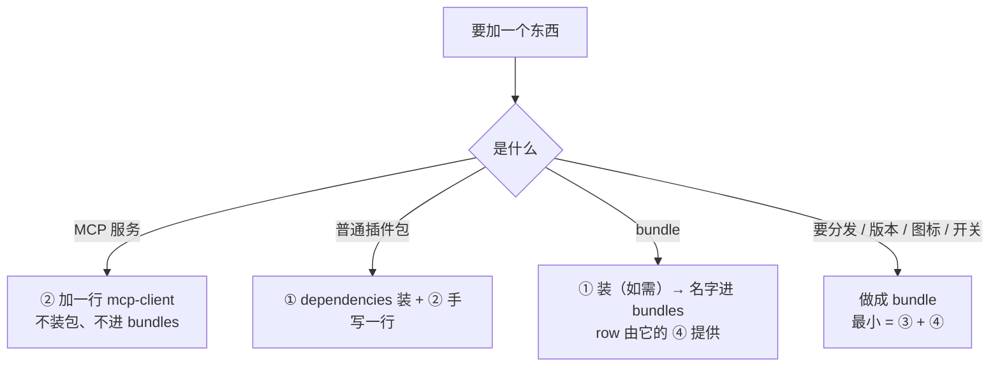

# DSH 插件体系：三份清单、装/选/挂三层与管理入口

> 核对：2026-11-19。依据：原会话对 profile 的实测（插件启停/安装、本地 link 插件、删除插件生态扫描）与源码阅读；本轮 2026-11-19 实读 `profiles/desktop` 的 `package.json`（22 个 bundle、15 项依赖）、`cordis.patch.yml`（457 行、9 个 MCP 行）、`node_modules` 下每个包的 `dsh.bundle.patch` 指针逐条复核。DSH 为 nightly 预发布，插件 API 与生态都会漂移。

## 先把对象认清：三个 `package.json`，两份 `cordis.patch.yml`

```text
profiles/<profile>/                 ← profile 根
├─ package.json                     ① profile 清单：装谁 + 选谁
├─ cordis.patch.yml                 ② 用户层 patch：row 写这里（后叠，优先级最高）
└─ node_modules/<包>/
   ├─ package.json                  ③ 包自己的清单：入口 + 是不是 bundle
   └─ cordis.patch.yml              ④ 包自带 patch：仅当 ③ 有 dsh.bundle.patch 指针
```

| 文件 | 谁写 | 一份管什么 | 本机实测 |
|---|---|---|---|
| ① `profiles/<profile>/package.json` | Electron / 插件面板（也可手改） | 只有两段：`dependencies`（**装**谁：版本号、`link:`、`file:` tarball）+ `dsh.profile.bundles`（**选**谁，**有序**）。**完全没有 row** | 15 项依赖 / 22 个 bundle |
| ② `profiles/<profile>/cordis.patch.yml` | 你（设置页也会写回这里） | **挂**：`id` / `name` / `config` 行、`insert` 列表、`disabled: true` | 457 行，13 个顶层条目 |
| ③ `node_modules/<包>/package.json` | 插件作者 | 入口（`main` / `exports` / `icon` / `files`）+ `dsh.engines.dsh` + **`dsh.bundle.patch`（有它才是 bundle）** + `dsh.client`（Client 行怎么注入）+ `peerDependencies` | 11 个第三方包全带指针 |
| ④ `node_modules/<包>/cordis.patch.yml` | 插件作者 | 该 bundle 的「默认层」：insert 自己的行，或覆盖别人的行。**只有被选进 ① 才读** | 11 个文件全部存在 |

### 三个最容易混的地方

1. **② 和 ④ 同名，但不是一层**。都叫 `cordis.patch.yml`，一在 profile 根、一在包内；同 `id` 时后叠的 ② 覆盖前面的 ④，`config` 是整段替换。排查「这条配置谁设的」时必须两边都看（见[配置分层与目录](配置分层与目录.md)）。
2. **没有第三份「插件清单」**。插件+bundle 合一的时候，③ 既是插件清单也是 bundle 清单——bundle 不是另一种包，只是 ③ 里多了一个 `dsh.bundle.patch` 指针。本机 11 个第三方 dsh 包**全部**带这个指针，「纯插件（无指针）」在本机没有实例；那种只在「壳 bundle 挂别人的插件」时才会出现两份包（壳的 ③④ + 被挂插件的 ③，被挂的不被单独选）。
3. **① 的 `dependencies` 只管装，不管生效**。装了包但没进 `bundles`、② 里也没人写行，就永远不加载；反过来，内置 bundle 的实体在 `app.asar` 里，根本不进 profile 的 `node_modules`。

### 本机真实例子（2026-11-19，四类状态各一）

| 包 | ③ 有指针 | ① `bundles` 有名字 | ② 有 row | 结果 |
|---|---|---|---|---|
| `dsh-summary-command` | 是 | 是 | 无 | 行由它自己的 ④ `insert` 提供 → 生效 |
| `dsh-claude-style` | 是 | **否** | 有（`ui-skin-claude-style`，带完整 config） | 行由 ② 手写提供 → 生效；它的 ④ 里其实也 insert 了同一个 id 的**裸行**，只是从未被读 |
| `dsh-agent-enhancer` | 是 | 否 | 无 | 不加载（已装未启用） |
| `dsh-sidebar-search` | — | 否 | 无 | **连「装」都没成立**：`node_modules` 里只剩一个指向已不存在目录的 junction，`package.json` 解析不到 |

`dsh-claude-style` 这一行最能说明问题：它同时满足「是 bundle」「装了」「没被选」「靠用户层行活着」——所以「有没有 `dsh.bundle.patch`」和「被不被选」是两个独立事实，别用前者推断后者。

## 装 / 选 / 挂：插件跑起来是三件事

| 层 | 负责 | 落在哪 |
|---|---|---|
| **装** | 包能被 `import` 解析到 | ① 的 `dependencies`（或随 DSH 自带） |
| **选** | 某个 bundle 的 patch 层参与合成 | ① 的 `dsh.profile.bundles`（有序） |
| **挂** | 插件真正被加载 | 一条 row，写在 ② 或某个被选中的 ④ 里 |

**插件运行的充要条件 = 包装得到 + 有一行 row。** `bundles` 只是 row 的来源之一：bundle 的 patch 可以 insert 新行、也可以覆盖别人的行，但「被选中」和「被加载」是两回事。

## 两个概念：bundle、plugin

| 概念 | 是什么 | 例子 |
|---|---|---|
| **bundle** | ③ 里带 `dsh.bundle.patch` 的包，可含 Host 行、Client 行、`inject` 与 `isolate`；被加进 ① 的 `dsh.profile.bundles` 后参与配置层叠 | `@deepseek-ai/dsh-base`、`dsh-summary-command` |
| **plugin** | 被加载的现实单位：一条 row 指向的包 | `@deepseek-ai/dsh-mcp-client`、`dsh-claude-style` |

bundle 的 ③ 长这样（本地 link 插件实测）：

```json
{
  "dsh": {
    "engines": { "dsh": ">=0.2.2-rc.1" },
    "bundle": { "patch": "./cordis.patch.yml" },
    "client": { "platform": "web", "immediately": true,
                "inject": ["@deepseek-ai/dsh-client-ui-session",
                           "@deepseek-ai/dsh-client-ui-workspace"] }
  },
  "peerDependencies": { "react": "^18.2.0" }
}
```

它的 ④ 只有几行——insert 自己那一行，**不带 config**：

```yaml
# Insert this bundle's single Host row.
- insert:
    - id: summary-command
      name: 'dsh-summary-command'
```

`@liustack/modsearch` 的 ④ 同理：insert 自己的行，并把 `session-query-sqlite` 的 `config` 整块改成 `path: ':memory:'`。**bundle 自带的 patch 通常是「薄薄一层默认值」，你真正调的那堆参数在 ②。**

**关键规律**：`profile.bundles` 的**先后顺序**决定 patch 覆盖顺序（后应用的层赢）；本地开发用 `"link:<path>"` 直接装，不必发 npm。

## `dependencies` × `dsh.profile.bundles` 四种组合

| deps | bundles | 含义 |
|---|---|---|
| 有 | 有 | 第三方 bundle 的正常形态（`dsh-summary-command`、`dsh-session-delete-cascade` 等） |
| 有 | 无 | 已装未启用；或靠 ② 手写 row 活着（`dsh-claude-style`） |
| 无 | 有 | 只有随 DSH 自带的 bundle（11 个 `@deepseek-ai/*`，实体在 `app.asar`） |
| 无 | 无 | 没装、也没参与 |

配套规则（原会话实测，未复验）：

- **关 bundle = 从 `bundles` 摘掉名字，保留 `dependency`**，包还在 `node_modules` 里，随时能再开。
- 重新启用会把名字**追加到列表末尾**，即它的 patch 变成最后叠加——优先级和之前不一样。
- 把非 bundle 的名字写进 `bundles` 是白写（没有 `dsh.bundle.patch` 指针就没有层可叠）。
- 只留依赖声明、实体却没了（link 目标被删）= 装这一层就断了，别对着 `dependencies` 数「装了几个」（本机 `dsh-sidebar-search` 即此）。

## bundle 的三种形态与一行判定

- **插件 + bundle**：③ 带指针，④ 挂自己（本机绝大多数）。
- **壳 bundle**：③④ 挂的是别人（官方 badge 壳把 `dsh-skill-badge` 插进来，自己不被单独选）。
- **纯插件**：③ 无指针，只能靠 ② 里手写 row（设计上存在；本机暂无实例）。

判定只看指针，不看目录里躺了什么：

```powershell
(Get-Content '<profile>\node_modules\<包名>\package.json' -Raw | ConvertFrom-Json).dsh.bundle.patch
```

**光在包里放一个 yml 不算 bundle，没有这个指针就不算。**

## row 住在哪一层

同一行只要在任一层出现即生效，同 `id` 由后层覆盖前层，`config` 是**整段替换**（不是字段级合并）：

1. `app.asar` 内自带 bundle 的 patch（只读）
2. 你装的 bundle 的 ④
3. profile 的 ②（用户层，最后叠，优先级最高）
4. `--patch` 指定的文件（临时覆盖，不落盘）

② 改完由 HMR 热生效，本轮与上一轮都**无需重启**；层间顺序与「整段替换」的细节见[配置分层与目录](配置分层与目录.md)。

## 要加一个东西时的决策树



## 别把同一个插件挂两次

| 例子（2026-11-19 本机） | row 从哪来 | deps / bundles |
|---|---|---|
| `dsh-summary-command`（插件 + bundle） | 它自己的 ④ | 有 / 有 |
| `dsh-claude-style` | ② 手写（④ 里那个裸行从未被读） | 有 / 无 |
| 9 个 MCP（含 `qcc-company`） | ② 的 `insert` 列表 | 不涉及 / 不涉及 |
| `dsh-agent-enhancer` | 无 | 有 / 无（已装未启用） |

**不要做的事**：既把包选进 `bundles`、又在 ② 抄同一行 → 同一插件出现两次加载尝试；`id` 相同时后层覆盖（往往把你手写的那份完整 `config` 冲成 ④ 里的裸行），`id` 不同而 `serverName` 相同时才会撞名失败。**要定制就二选一**：选 bundle、然后在 ② 只写覆盖项（记得 `config` 整段抄全）；或者不选 bundle、完全靠 ② 手写。

## MCP 服务：一个服务一行，不需要装包

- 一行 = `name: '@deepseek-ai/dsh-mcp-client'` + `config.serverName` / `transport` / `url`（URL 型）或 `command`/`args`/`env`（本地进程型）；另有 `toolCallTimeoutMs`、`startupTimeoutMs`、`failOnStartupError`、`reconnect.*`。
- `serverName` 决定工具前缀 `mcp__<serverName>__<tool>`，同作用域内必须唯一（**已验证**：本会话工具名即 `mcp__qcc-company__get_company_by_query`）。
- **不装包、不进 `bundles`**：`@deepseek-ai/dsh-mcp-client` 随 DSH 自带，profile 的 `node_modules` 里没有它（**已验证**），所以 MCP 是决策树里唯一「只动 ②」的分支。
- 多家 MCP 可以塞进同一个 `- insert:` 列表；后来追加的常被写成文件末尾独立的一块 insert，两种写法等价（本机前 8 家在行 360 起的 insert，`qcc-company` 单独在行 447）。
- 明文凭据风险（**已验证**）：`qcc-company` 那行的 `headers.Authorization` 直接写 `'Bearer <token>'`，而 ② 是明文 YAML。要避免明文可用 `expandTemplates: true` + `'Bearer ${credential:<REF>}'`，写法与优先级见[凭据体系与密钥打码](凭据体系与密钥打码.md)；本机尚未改。
- Claude/Cursor 的 `mcpServers` JSON 不能直接贴进来，字段要逐条换算（**推测**，未实测）。

## 插件管理的三个入口（互不依赖）

| 入口 | 载体 | 归属 |
|---|---|---|
| 侧边栏插件面板 | `@deepseek-ai/dsh-client-ui-plugin-manager`（内置包，官方描述 *"the sidebar Plugins panel installs, enables, disables, retries, and composes installed plugin packages"*） | DSH 自带，始终存在、关不掉 |
| Agent 工具 `plugin_manager` | `@deepseek-ai/dsh-plugin-manager/tools`（官方描述 *"shared by dsh CLI, Web and agent tools"* 的对话版入口，按预设按会话提供） | 可选工具插件 |
| 命令行 | `dsh plugin --profile <name> <pnpm args…>`（只是把参数透传给 pnpm） | DSH 自带 |

**互不依赖**：关掉 `plugin_manager` 只是模型失去「对话里改插件」的能力，侧边栏面板完全不受影响；侧边栏面板是内置的，也没有「卸载」一说。

`plugin_manager` 能做：列清单（支持 `limit`/`offset` 分页）、启用/禁用（**对整个 profile 所有会话生效**）、安装、卸载、版本兼容校验。⚠️ 实际变更需要完整文件权限或用户批准；在「从不询问」策略下会被自动拒绝，查看清单不受影响。

## 安装 / 启停 / 卸载路径

| 想做的事 | 桌面版正确做法 | 配置文件 / CLI |
|---|---|---|
| 查看清单 | 侧边栏插件面板 / 设置 → 插件 | 读 ① 的 `dsh.profile.bundles` + `dependencies` |
| 安装 | **设置 → 插件 → 添加插件**，输包名 → 安装 → **完全退出重开 App** | 写 `dependencies`（本地用 `link:`）+ 加入 `bundles`；**桌面 profile 不能用 `dsh plugin` CLI** |
| 启用/禁用 | 面板开关 | `bundles` 增删，或 ②/④ 条目 `disabled: true` |
| 卸载 | 面板卸载 | 从 `dependencies` + `bundles` 移除后重装依赖 |

**桌面 profile 用 CLI 会被拒**，原文：

```text
profile "desktop" is managed exclusively by the Electron application
```

## 版本兼容的两道检查

1. **包声明层**：③ 的 `dsh.engines.dsh`（如 `>=0.2.2-rc.1`）与 `peerDependencies`（如 `@deepseek-ai/dsh-commands`、`@deepseek-ai/dsh-llm`、`react ^18.2.0`）。
2. **运行时层**：`plugin_manager` 安装/激活时校验，不满足直接拒绝。

注意：**「满足 engines」只说明不会因版本被拒，不代表私有 API 稳定**——例如某删除插件用了 `sessionPersistence.tracker.writers` 等内部接口，DSH 升级后可能退化（靠 feature-detect + fail-soft 兜底，最坏是残留日志/幽灵行，不会误删别的文件）。

## 本机 profile 形态（2026-11-19 快照）

- ① 的 `bundles` 共 **22 个**：11 个随 DSH 自带（`dsh-base`、`dsh-web-app`、`dsh-experimental-auto-review`、`dsh-personalized-recommendations`、`dsh-experimental-inspector-profile`、`dsh-experimental-cot-translation-bundle`、`dsh-experimental-badge-skill-bundle`、`dsh-experimental-plugin-market-bundle`、`dsh-experimental-session-search`、`dsh-experimental-forge-bundle`、`dsh-experimental-terminal-bundle`）+ 11 个第三方/本地（`dsh-summary-command`、`dsh-session-delete-cascade`、`@liustack/modsearch`、`dsh-opencode-go`、`dsh-windows-notify`、`@local/dsh-style-switcher`、`dsh-files-show-hidden`、`dsh-btw`、`dsh-large-text-paste`、`dsh-collapse-long-user-messages`、`@dsh-local/view-*`）。
- ① 的 `dependencies` 共 15 项，其中 3 项不在 `bundles` 里：`dsh-claude-style`（靠 ② 手写行）、`dsh-agent-enhancer`（已装未启用）、`dsh-sidebar-search`（junction 悬空，实际装不上）。
- ② 共 457 行、13 个顶层条目，其中两处 `insert` 承载 9 个 MCP 行。
- 与 2026-11-12 快照（18 个 bundle）相比：`experimental-session-titles-bundle`、`experimental-agent-team-profile`、`dsh-agent-enhancer`、`dsh-sidebar-search` 已不在 `bundles` 里；新增了 `dsh-opencode-go`、`dsh-windows-notify`、`dsh-files-show-hidden`、`dsh-btw`、`dsh-large-text-paste`、`dsh-collapse-long-user-messages`、`@local/dsh-style-switcher`、`@dsh-local/view-*`。属正常时间推进，不是矛盾。

## 两个本地 link 插件的实现要点（可当模板）

**侧栏正文搜索插件**：

- `main: index.js` + `exports ./client`；`dsh.engines.dsh: ">=0.2.2-rc.1"`；`dsh.bundle.patch: "./cordis.patch.yml"`；`dsh.client` 声明 `platform: web`、`immediately: true`、注入 `dsh-client-ui-session` 与 `dsh-client-ui-workspace`。
- 它的 ④ 做两件事：insert 自己的 `sidebar-search` 行；把 `session-query-sqlite` 的 `config` **整块**改成 `path: ':memory:'` + `openAt: first-search`（注释里明写 "A patch replaces the targeted row's whole `config`"）。
- 它让 **GUI 侧**能跨工作区搜正文；模型侧仍受 cwd 限制（见[工作区与会话](工作区-会话与指令链.md)）。

**`/summary` 交接摘要命令**：

- `index.js` 92 行，`inject: ["commands"]`，用 `ctx.commands.register` 注册 `/summary [topic]` 人类命令。
- 通过 `invocation.agent.followup(message)` 把「一条可见请求行 + 隐藏摘要指令」的用户消息投进当前会话（空闲立即唤醒、运行中排队）。
- **不压缩、不改历史**，产物是一条额外的 assistant 消息，便于交接；带附件则返回用法错误。

## 会话删除插件生态（「只能归档不能删」的社区补丁）

npm 上至少十几个包，按形态分三类：

| 包 | 月下载 | 特点 |
|---|---|---|
| `@linxin666/dsh-session-archive` | ~97k | 集中清单、批量归档/恢复、**物理删除（含家族级联）**、自动归档/清理（无公开仓库，谨慎） |
| `@xrn1997/dsh-session-delete` | ~5.2k | 删除 = 移入**回收站**（可恢复），另设显式彻底删除 |
| `dsh-session-delete-cascade` | ~2.3k | 侧栏 `⋯` → 删除会话；**血缘级联**删子代理；清日志/投影缓存/搜索索引/工作区记账；**有任务在跑时拒绝删除** |
| `@hualiong/dsh-session-delete` | ~2.2k | 原生菜单项 + 确认弹窗；先停运行任务（含子代理/后台/定时提醒）；广播 `api-session/removed`；可选 `session_delete` 工具 |
| `dsh-session-delete`（另一实现） | ~1.8k | 会话行删单条 + 工作区行「归档全部/删除全部」；**客户端用 DOM 注入菜单**（官方未开该 Slot），改版易失效 |
| `@kangyishuai/dsh-session-delete` | ~1.7k | 默认进回收站、删除前 plan、审计日志、残留清单 |
| 其余若干 | 0.2k–1.1k | 多为回收站/彻底删二选一 + 路径校验 |

生态成熟度：品类极早期（多数项目 Star 数在个位数）。选型建议：要「先回收站再彻底删」选回收站型；要「原生菜单 + 级联 + 运行中保护」选 `dsh-session-delete-cascade`；**优先选走官方 Slot 的实现，DOM 注入型改版容易坏**。

## 安装前的两道闸

1. 带 install/build 脚本的包会进 `pendingBuilds`，批准前不要勾选；桌面端打包运行时里 install-gate 不完整，安装前预审只能靠离线审查（见[插件安全评审方法论](插件安全评审方法论.md)）。
2. 装完**完全退出重开**，再到 设置 → 插件 核对实际挂载条目与预期一致。

相关：[配置分层与目录](配置分层与目录.md) · [插件生态：原生短板与包名核实](插件生态-原生短板与包名核实.md) · [插件安全评审方法论](插件安全评审方法论.md)
