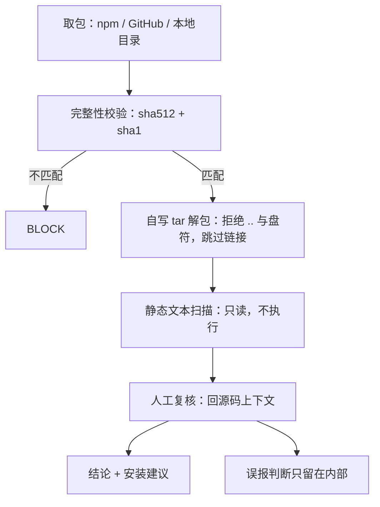

# DSH 插件安全评审：进程内权限、零执行扫描与人工终判

> 核对：2026-11-12。依据：13 个会话日志复盘（安全评审部分为 2026-11-09～11-11 的会话记录）+ 本轮静态复核（`~/.agents/skills/plugin-security-review/` 下的脚本与 SKILL.md）。DSH 为 nightly，机制会漂移；本篇按一个季度有效（至 2027-02）。标 **已验证** 的来自上述会话记录、本轮未重跑；标 **已验证（本轮）** 的是本轮读本机文件核对；**源码级** 指读脚本/打包产物得出、未运行。

## 一句话

插件是**进程内代码**：装上就等于把当前用户的全部权限交给它，文件沙箱和审批弹窗都管不住插件自己。安装前只做一件事——零执行地读一遍代码；扫描器只产证据，结论必须人给，对外只给「结论 + 安装建议」。

## 威胁模型：五条前提

| 前提 | 含义 |
|---|---|
| 插件是进程内代码，不是子进程 | 加载后与 dsh 主进程同权限。沙箱约束的是模型发起的工具调用，**管不住插件自己的 `fs`/`net`**；「装插件」本质是「运行任意代码」 |
| 静态扫描只产证据，不产结论 | 命中要回到源码上下文判断：读 env 可能是在组 `Authorization` 头；解析 `http://` 可能是在做 DNS 重绑定防护；`String.fromCharCode` 可能是在解 Unicode 表或写制表符常量 |
| 第三方「安全插件」本身也是第三方代码 | 先装一个审查插件＝把全权限再交给另一个第三方。默认路径是**一次性离线审查**，不是装插件 |
| 供应链风险可举证 | npm 上的同名包与 GitHub 上的同名项目**不是同一个项目**，直接按包名 `add` 会装到另一个来源；跨源安装要用 `github:` 明确指定 |
| 权限环境放大风险 | `danger-full-access` + 免审批时，任何装进来的插件都能直接读写文件、发网络请求且不弹窗。「先审后装」是唯一刹车 |

证据等级：第 1、5 条 **已验证**（会话中读源码与权限行为）；第 2 条 **已验证**（六次审查的误报复核）；第 3、4 条 **已验证**（会话中比对过包与仓库）。

## DSH 官方在这一块的边界

| 面 | 现状 | 证据 |
|---|---|---|
| 安装动作 | `dsh plugin --profile <name> <pnpm args…>` 只是转发给 pnpm，没有签名、没有权限声明 | 已验证 |
| manifest | `package.json` 的 `dsh` 字段只有 `manifestVersion` / `bundle` / `client` 之类，**没有权限清单**；社区在提 Discussion #1804 | 已验证（字段），文档级（提案编号） |
| 安全机制 | 全部在运行期：sandbox 文件策略、审批弹窗、权限预设、可选实验 bundle `dsh-experimental-auto-review`（对工具调用做 LLM 授权审查） | 已验证 |
| 安装期门禁 | 只有 `pendingBuilds`：带 install/build 脚本的包要显式批准才执行。它**只拦安装脚本，不审代码** | 已验证 |
| 桌面端 | 打包运行时里 install-gate 不可用，安装前预审只能用离线 CLI | 已验证（会话记录） |

结论：**DSH 不提供安装期代码审查**，这块只能自带流程。

## 自建评审器：位置、构成、用法

位置 `~/.agents/skills/plugin-security-review/`（技能根目录，与 `dingtalk-*`、`mermaid-diagrams` 同级；不是 profile 插件、不改 `~/.dsh` 配置；**删目录即卸载**）。**已验证（本轮）**：目录下为 `SKILL.md` + `scripts/` 五个文件。

| 文件 | 职责 |
|---|---|
| `SKILL.md` | 何时用、三步流程、判定口径、DSH 特有风险点、输出模板 |
| `scripts/review.ps1` | 入口：找 node（优先 `DSH_DESKTOP_NODE_EXECUTABLE`，其次安装目录的 `node.exe`，再退 PATH），透传参数并 `exit $LASTEXITCODE` |
| `scripts/audit.mjs` | 主程序：解析 spec → 下载 → 校验 sha512+sha1 → 解包 → 评分 → 输出报告 |
| `scripts/rules.mjs` | 规则引擎与评分（26 条规则 id，权重表在文件头） |
| `scripts/tar.mjs` | 零依赖 tar.gz 解包（防穿越 / 跳过链接 / 防 zip bomb） |
| `scripts/selftest.mjs` | 自测：良性样本必须 PASS、恶意样本必须 BLOCK |

```powershell
pwsh -File "$HOME\.agents\skills\plugin-security-review\scripts\review.ps1" dsh-plugin-foo
pwsh -File "$HOME\.agents\skills\plugin-security-review\scripts\review.ps1" @scope/name@1.2.3
pwsh -File "$HOME\.agents\skills\plugin-security-review\scripts\review.ps1" github:<owner>/<repo>#<commit-sha>
pwsh -File "$HOME\.agents\skills\plugin-security-review\scripts\review.ps1" ./某个本地插件目录
# 开关：--strict（high 也算 BLOCK）、--json、--include-tests、--exclude=<片段>
```

输出：Markdown 报告**直接写 stdout（进对话）**，临时目录**必删**。退出码 `0=PASS / 1=WARN / 2=BLOCK / 64=用法错误 / 70=运行失败`（**已验证（本轮）**：`audit.mjs` 第 288/293/326/331 行）。

## 零执行流程（核心可复用）



1. **取包（四种 spec 分支）**
   - npm：`GET https://registry.npmjs.org/<name>/<version|latest>`，下载 `dist.tarball`，同时校验 `dist.integrity`（sha512 base64）与 `dist.shasum`（sha1 hex）。**不匹配即视为可能被篡改，直接 BLOCK**（**已验证（本轮）**）。
   - GitHub：`https://codeload.github.com/<owner>/<repo>/tar.gz/<ref>`，建议钉 commit SHA。
   - 本地目录：直接扫已解压源码。
   - 网络层：60s 超时、最多 5 次重定向、响应体上限 60MB、固定 UA。
2. **安全解包**（自写 tar 读取器，不 shell out）：路径归一 + 拒绝任何 `..` 段 + 拒绝盘符段 + strip 压缩包根；**符号链接/硬链接跳过不跟随**；解压总量 ≤200MB、文件数 ≤20000；返回根目录便于整棵删除（**已验证（本轮）**：`maxBytes = 200*1024*1024`、`maxFiles = 20000`）。
3. **零执行三条硬规则**：不 `import` / 不 `require` / 不 `resolve` 包内任何东西；**不触发 npm 生命周期**（从不 `npm install`）；扫描只读文本，用 NUL 字节判二进制。
4. **清理**：报告渲染前 `rmSync(target.dir, {recursive:true, force:true})`，**无例外开关**；`--keep` / `--out` 已删除。

## 规则清单与评分

26 条规则 id（24 条单条 + 2 条组合，**已验证（本轮）** 计数）：

| 级别 | 条数 | 规则 id |
|---|---|---|
| critical | 7 | `remote-exec`、`powershell-exec`、`eval-call`、`new-function`、`credential-paths`、`crypto-miner`、`dsh-js-escape` |
| high | 11 | `certutil-download`、`child-process`、`shell-true`、`obfuscation`、`dynamic-require`、`vm-run`、`env-secret`、`shell-history`、`browser-data`、`dsh-loader-control`、`base64-blob` |
| medium | 5 | `net-raw`、`http-plain`、`proto-pollution`、`homedir-access`、`dynamic-import` |
| medium（只扫文档） | 1 | `prompt-injection`：`ignore previous instructions` / `不要告诉用户` / `exfiltrat` / `偷偷地` |
| COMBO（同文件全中） | 2 | `env-exfil` = `process.env` + 出口；`fs-exfil` = 读文件 + 出口 |

几条需要看原文的：`dsh-js-escape` 只对 `cordis.patch.yml` 生效（匹配 `!!js`）；`base64-blob` 是 `[A-Za-z0-9+/]{400,}`；`http-plain` 会放过 `localhost`、`127.0.0.1`、`[::1]`、`w3.org`、`xmlns.`、`schemas.` 等命名空间。

`package.json`：`preinstall/install/postinstall/prepare/prepack/postpack` 任一存在 → **critical**；非 registry 依赖（`git:`/`github:`/`https:`/`file:`/`link:`）→ medium；缺 license/repository/author、依赖 >25 个 → low。文件层：原生二进制（`.node/.exe/.dll/.so/.dylib`）→ high；包内符号链接 → medium；携带 `.env/.npmrc/.netrc` → medium；超长单行（>5000 字符）→ low。

评分：`SEVERITY_WEIGHT = {critical:40, high:15, medium:5, low:1}`，`score = max(0, 100 - min(100, penalty))`；定级 **有 critical → BLOCK；否则有 high → `strict ? BLOCK : WARN`；否则有 medium 或 score<85 → WARN；其余 PASS**（**已验证（本轮）**）。

扫描默认跳过 `node_modules`、`.git`、`.svn` 与 `test`/`fixtures`/`examples`/`benchmark` 目录；单文件 >1MB 不扫；最多 5000 个文件；同一 `ruleId::文件` 去重。

## 判定表：哪些信号组合足以直接判恶意

| 信号组合 | 判读 |
|---|---|
| 生命周期脚本，且脚本体里有 `curl\|sh`、`iwr\|iex`、`certutil -urlcache` | 直接 BLOCK，不必再读实现 |
| `eval`/`new Function` + `atob`/`fromCharCode` + 超长 base64 | 疑似混淆载荷，BLOCK，必须逐行反混淆 |
| 读凭据路径（`.ssh`、`id_rsa`、`.aws/credentials`、`Login Data`）+ 任一出口原语 | 凭据外传，BLOCK |
| 读文件 + 出口原语 + POST | 数据外传，BLOCK |
| `cordis.patch.yml` 出现 `!!js` | 配置层代码执行，BLOCK |
| `loader.update(...)` / `ctx.systemPrompt` / 改工具 description | 提权或持续操纵 agent，high，复核后多为 WARN/BLOCK |
| 只有 `child_process`/`spawn`，但命令与参数全硬编码 + 平台门控 | 良性能力，WARN |
| 只有凭据路径正则，用途是「检查权限/判断存在性」 | 良性能力（安全类插件），WARN |
| 只有 `http://`，且落在 `xmlns` / `URL.canParse` / 命名空间上 | 误报，不计入 |
| 只有缺 author/license/repository | PASS（low） |

## 人工复核 12 项

| # | 复核项 | 判读要点 |
|---|---|---|
| 1 | 安装生命周期脚本 | 注意 `prepublishOnly` 在 `pnpm add` 时不执行 |
| 2 | 下载执行链 | 下载后是否直接交给 shell 解释器 |
| 3 | 代码求值 | `eval`/`new Function`/`vm.runIn*`/动态 `require`/动态 `import`；后两者看 specifier 是否硬编码常量 |
| 4 | 子进程 | 命令是否硬编码、参数是否拼接用户输入、是否平台门控 |
| 5 | 凭据路径 | 区分「读内容」与「只判断存在性/权限」 |
| 6 | 网络出口 | 列全包域名清单，是否只有官方服务域名 |
| 7 | 数据外传组合 | 读取 + 出口 + POST 三者是否同现 |
| 8 | DSH 特有面 | patch 是否只有 roster `insert`、有无 `!!js`、有无 `loader.update`/`ctx.systemPrompt`、前端注入面 |
| 9 | 文件写入范围 | 是否越出自身配置/缓存目录 |
| 10 | 权限模型 | 默认 allowlist、是否挂 `approval/request` waterfall 代答审批 |
| 11 | 可读性 | 压缩 bundle 用脚本抽调用点，不靠肉眼读 |
| 12 | 可复现性 | tarball 与 registry 完整性一致 |

## 输出契约：只给结论 + 安装建议

复核（含误报判断）只在内部做；最终回答只有两段（**已验证（本轮）**，见 SKILL.md）：

```
## 结论：<PASS / WARN / BLOCK>
<一句话理由。PASS 说明未发现真实风险信号；WARN/BLOCK 只列真实风险点（文件:行 + 影响），不列误报。>

## 安装建议
<装 / 不装 / 隔离环境验证 + 命令>
```

禁止出现「误报 / 已排除 / 降级 / 扫描命中」这类段落，也不逐条复述扫描器原始发现；「已知局限」不默认输出，只在影响结论时一行说明。

## 六次真实审查（案例库）

| 目标 | 扫描初判 | 人工复核 | 终判 / 动作 |
|---|---|---|---|
| `dsh-plugin-security-audit@0.1.0` | BLOCK，1 critical | 命中 `lib/index.js:41` 读 `.credentials.yaml`，实为**凭据文件权限检查** | 降级 WARN（功能本身） |
| 同名 GitHub 项目 `dsh-plugin-security-review` | BLOCK，3 critical / 12 high | 规则表与凭据正则自命中 | 定性为「高权限代码」，不装 |
| `dsh-wechat@0.16.2` | WARN 39/100（0c/3h/3m） | 6 条全部解释得通：二维码库 Unicode 表、制表符常量、会话目录十六进制编码、SVG 命名空间、`~/.dsh-wechat` 与 `~/.dsh/sessions` | **PASS + 3 条加固** |
| `dsh-llm-opencode-go` | BLOCK 54/100 | 读 env 是标准适配器行为；`new URL('http://'+authority)` 是 DNS 重绑定防护；缺 author 属实 | PASS，但「内置已覆盖，不必装」 |
| `dsh-session-delete-cascade@1.2.1` | WARN 95/100（0c/0h/1m） | 唯一 medium 是 `icon.svg` 的 xmlns；删除路径来自 DSH 自身 `locate()`；有运行中任务整体拒绝（409） | **PASS**，但属「永久删除、不可逆」，先拿测试会话试 |
| `dsh-claude-style@0.20.2` | WARN（2 high / 4 medium） | 6 条全部误报/良性（见下） | **PASS（附 2 条知情项）**，可装 |

`dsh-claude-style` 的关键证据：`String.fromCharCode` 是会话目录名 `~XXXX` 十六进制转义的**解码侧**；`spawn` 调的是 macOS `/usr/bin/afplay`，音效名白名单 + 音量钳制 + `process.platform === "darwin"` 门控（Windows 上完全惰性）；`URL.canParse('http://'+host)` 是 DNS 重绑定/CSRF 防护（非 loopback 即 403，所有路由都过这道围栏），属加分项；动态 `import()` 的 specifier 是硬编码常量 `@deepseek-ai/schemastery`；1.1MB `client.js` 无 `eval`/`new Function`/`XHR`/`WebSocket`/`sendBeacon`，所有 `fetch` 都是 `credentials:"same-origin"` 指向自身资源，`<script>` 创建是自身的分包 chunk 加载器。

两条知情项：① host 侧每 24h 向 jsdelivr / raw.githubusercontent 拉模型价格与峰值费率 JSON（48h 闲置停止、失败回退包内快照；`@master` 是可变引用，最坏后果是费用数字错误，非代码执行）；② 主题插件天然能读取页面内会话内容（固有属性，未发现外传路径）。

**装后核对 3 步**：① 带安装脚本的包会进 `pendingBuilds`，批准前不要勾选；② 统一 `--ignore-scripts` 安装，装完重启客户端；③ 到 设置 → 插件 核对实际挂载条目与审查结论一致（例：`dsh-claude-style` 只应多出 `ui-skin-claude-style` 一行）。

## 能力边界与踩坑

**边界**（写进 SKILL.md）：扫不出原生二进制、运行时下载的代码、高度混淆载荷；`PASS` 只代表「没扫出信号 + 人工通读未发现风险」，不是数学证明；传递依赖只做名称/来源层面检查。

**坑**：

- 安全/审计类插件会**天然自命中**（规则里就有凭据路径、`child_process`），必须人工降级；
- 规则的 `scope` 写错（把 `js` 写成 `all`）会让文档/配置也被扫，误报暴涨；
- ripgrep **不支持 look-around**（`(?!...)`），会报 `look-around ... is not supported`，需加 `--pcre2`；JS RegExp 没这个问题；
- `--keep` 曾把临时目录留在 `%TEMP%`，现改为必删；报告曾写进工作目录 `.security-review/<包>@<版本>/`（违背「不留痕」），现改为 stdout。验证方式是「跑之前列一遍临时目录 → 跑完再列 → 没有新增」；
- **靠 README 外推能力会翻车**：`dsh-llm-pi-ai` 的 README 只举例子、不枚举完整目录，曾被当成目录清单而得出「没有 opencode-go」的错误结论 → 能力事实必须落到打包代码或内置目录文件上核实；
- 本机 pwsh `Invoke-WebRequest` 与 `curl.exe` 下 npm tarball **可能因 schannel/TLS 失败**，而 DSH 自带 Node 的网络栈正常 → 下 tarball 一律用 Node（`node:https`/`fetch`）；
- 只给「结论」不是省略复核：把误报清单当交付结论，等于把扫描证据当成了人工判断。

## 待确认

- Discussion #1804 的进展：manifest 权限清单是否已进夜间版 —— 源文档只记「社区在提」，未核实。
- 可选实验 bundle `dsh-experimental-auto-review` 的实际拦截效果与覆盖范围 —— 源文档只记「对工具调用做 LLM 授权审查」，未实证。
- 六次审查的具体版本与本轮未重跑：结论沿用会话记录，包若已发新版需重审。
