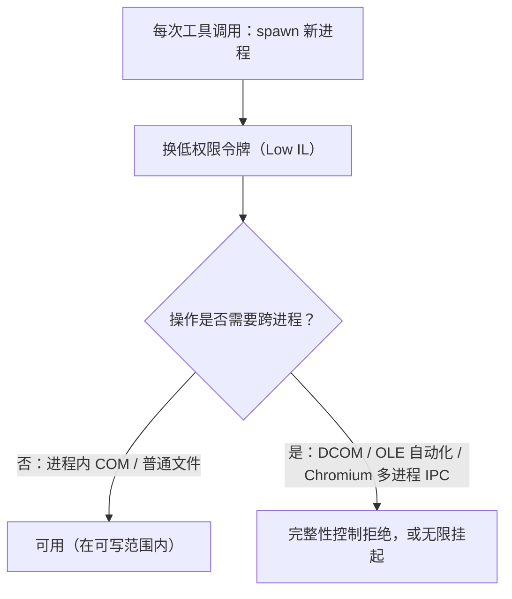

# DSH 权限、Windows 沙箱与提权

> 核对：2026-11-12。依据：2026-11-09～11-11 的会话实测（`whoami`、COM/WMI/Edge 探测、Word 导出对照）；本机 PowerShell 7.6.9 与沙箱行为本轮抽检一致。结论绑定当时的 DSH rc 与 Windows 构建，升级后需重验。

## 三个互相独立的权限维度

| 维度 | 取值 | 影响 |
|---|---|---|
| `preset`（权限预设） | `read-only` / `workspace-write` / `auto` / `danger-full-access` | 决定沙箱 + 审批的组合档 |
| `sandbox`（文件沙箱） | `read-only` / `workspace-write` / `danger-full-access` | 决定可写范围与进程令牌 |
| `approval`（审批策略） | `ask` / `never`（「从不询问」） | 决定需要批准的操作是弹窗还是**自动拒绝** |

会话里用斜杠命令切换：`/permission auto`、`/permission read-only`、`/permission danger-full-access`，日志里对应 `permission/preset` + `sandbox/mode` + `approval/policy` 三类事件。

**关键认知**：`danger-full-access` + `approval: never` 意味着**任何需要审批的操作都会被自动拒绝**，包括插件启停/安装、跨工作区写入等。要装插件或改 `~/.dsh` 时，要么切回 `ask`，要么用工具自带的 `sandbox_permissions` 提权路径。

## Windows 沙箱的真实机制：换一个低权限令牌

`workspace-write` 不是「按程序名拦截」，而是给每个命令**换一个低权限 Windows 令牌**：

```text
whoami /groups  →  Mandatory Label\Low Mandatory Level        (完整性级别 = Low)
                   BUILTIN\Administrators ... Group used for deny only
whoami /priv    →  只剩 SeChangeNotifyPrivilege（遍历目录）
IsInRole(Administrator) → False
写 C:\Windows\Temp       → UnauthorizedAccessException
```

即：**Low 完整性级别（Low IL）+ 受限令牌**；管理员组被设为 deny-only（只用于拒绝），绝大多数特权被剥离，子进程继承该令牌。`%TEMP%` 可写，`C:\Windows\Temp` 不可写（**已验证**）。



## 后果一：Edge 无头打印失败——不是被拉黑，是跨进程 IPC 断了

```text
crashpad_client_win.cc:457] OpenProcess: 拒绝访问。 (0x5)
```

Windows 强制完整性控制规定：**Low IL 进程不能打开 Medium IL 进程的句柄**。Chromium 的 browser/renderer/GPU 多进程靠 IPC 通信，Crashpad 拿不到浏览器主进程句柄 → 进程间通信无法建立 → 页面无法渲染 → `--print-to-pdf` 产不出文件。

⚠️ **假成功陷阱**：命令**退出码是 0**，因为已有一个 Edge 实例在跑，新命令只是把参数转发过去就退出。0 不代表打印成功，必须校验输出文件是否存在、字节数是否合理（**已验证**）。

## 后果二：Word COM「卡死」——out-of-proc 封送拿不到端点

Word 是 **out-of-proc COM 服务器**。`New-Object -ComObject Word.Application` 走 DCOM，由 RPCSS 拉起 `WINWORD.EXE`（PID 确实出现、`Responding=True`），但之后每次方法调用都要**跨进程封送**，客户端需要拿到服务器进程的 ALPC/RPC 端点——Low IL 对 Medium IL 服务器拿不到 → **调用不返回，一直等**。

对照实验（同一进程、同一令牌，最有说服力）：

| 探测 | 技术路径 | workspace-write 下结果 |
|---|---|---|
| `Scripting.FileSystemObject` | **in-proc** COM（`scrrun.dll`） | ✅ 正常（返回 3 个盘） |
| `Get-CimInstance Win32_OperatingSystem` | **out-of-proc** DCOM/RPC | ❌ 拒绝访问 |
| `Documents.Open()` on Word | **out-of-proc** OLE 自动化 | ⏳ 无限挂起 |

结论：**进程内 COM 畅通无阻，一旦跨进程就断**；问题不是「Word 被拉黑」，而是「跨进程」这件事本身被禁止。

**注定无效的对策**（都试过或论证过）：给 Word/Edge 加白名单（拿不到的是对象访问权，与名单无关）、`--single-process`/`--no-zygote`（Crashpad 那关仍过不去）、换 Office 版本、修 COM 注册。

**唯一可行方向：单进程、纯用户态、只写工作区**——这就是 Pillow 能生成 PDF 的全部原因（一个进程，通过 Flate 流写 PDF，不碰 IPC），细节见 [Windows-PDF生成两条路](../document-generation/Windows-PDF生成两条路.md)。

## 切到 `danger-full-access`：令牌升级，但不是给你管理员

| 探测项 | workspace-write | danger-full-access |
|---|---|---|
| 完整性级别 | **Low** | **Medium** |
| 跨进程 RPC（WMI 查询） | ❌ 拒绝访问 | ✅ 成功 |
| 进程内 COM（`scrrun.dll`） | ✅ 正常 | ✅ 正常 |
| Word COM 导出 PDF | ⏳ 无限挂起 | ✅ 26 页一次完成 |

细节：`BUILTIN\Administrators` **仍然是 deny-only**、`IsAdmin` 仍为 `False`。所以这个模式更准确的叫法是**「当个正常用户」**，不是「给你管理员」；需要 UAC 提权的操作仍然不行（**已验证**）。

代价：**风险立即对会话内所有后续命令生效**，不再限制在工作区、不再弹审批。用完应尽快切回。

## 提权的正确姿势

沙箱拒绝时会给出明确提示：

```text
[sandbox: file access denied under workspace-write mode]
[sandbox: escalation available — retry this exact operation once with
 sandbox_permissions (the narrowest wider mode that suffices) + justification;
 the approval prompt asks the user]
```

按提示对**同一个操作**带 `sandbox_permissions`（如 `danger-full-access`）+ 一句理由重试一次即可，审批弹窗会问用户。**不要试图换别的命令绕过**——沙箱拦的是能力，不是命令名。

## 工具进程的环境是「过滤快照」，不是宿主完整环境

- 设置页的「已检测到环境变量」跑在 DSH 后端进程里，用的是**完整启动环境**；
- 模型 shell 拿到的是一套重建的受控环境（源码注释：*"ambient `DSH_*` values are discarded... then the registry's snapshot is injected"*）；
- 于是出现反直觉现象：某个 key 在宿主环境里存在、设置页能看到，但**工具进程里看不到**——这是刻意隔离，不是变量丢了。

推论：**只看工具进程环境会误判「系统里没有这个 key」**。查用户级环境变量要用注册表：`reg query HKCU\Environment /v <NAME>`。

## PowerShell 7 从哪来：不写在任何配置里，是运行时探测

实测：PowerShell **7.6.9**、`Core` 版本线、`C:\Program Files\PowerShell\7\pwsh.exe`、语言模式 `FullLanguage`（受限沙箱下会降为 `ConstrainedLanguage`）。

调用链：`tool-pwsh` → `@deepseek-ai/dsh-tool-pwsh` → `@deepseek-ai/dsh-pwsh-sandbox`（base bundle 在 Windows 上挂的执行器，条目 id `pwsh-sandbox`）→ `@deepseek-ai/dsh-pwsh-local` 的 `resolvePwshPath()`。

探测顺序（**源码级**）：

```text
1. pwshPath 配置值                              ← 没配，跳过
2. %ProgramFiles%\PowerShell\7\pwsh.exe          ← 本机在这里命中
3. PATH 每个目录下的 pwsh.exe                     （Microsoft Store 版走这条）
4. %SystemRoot%\System32\WindowsPowerShell\v1.0\powershell.exe   ← 5.1 兜底
5. 都没有 → 返回字符串 "pwsh" 交给 PATH
```

所以「默认就是 PowerShell 7」的真实原因是：**机器上装了 7，而策略优先最新版**；卸载 7 后下一次 spawn 会自动落到 5.1，不用改配置。

想固定路径（默认探测够用时**不建议**写，换机器/升级路径变了会硬编码失效）：

```yaml
- id: pwsh-sandbox
  name: '@deepseek-ai/dsh-pwsh-sandbox'
  config:
    pwshPath: C:\Program Files\PowerShell\7\pwsh.exe
    # 同层可调：timeoutMs（默认 120000）、maxTimeoutMs（600000）、maxOutputBytes（64000）
```

两条实用事实：命令固定以 `pwsh -NoLogo -NoProfile -NonInteractive -Command <命令>` 启动 → **`$PROFILE` 里的别名/函数不存在**；**每次调用都是全新进程**，变量、函数、`cd` 不跨调用保留（要么一次写完整逻辑，要么显式传 `workdir`）。`DSH_SHELL=1` 是 DSH 注入的标记值，不是 shell 路径。

相关：[配置分层与目录](配置分层与目录.md) · [Windows-PDF生成两条路](../document-generation/Windows-PDF生成两条路.md) · [Windows 沙箱-已有子目录不可写](Windows沙箱-已有子目录不可写.md)
