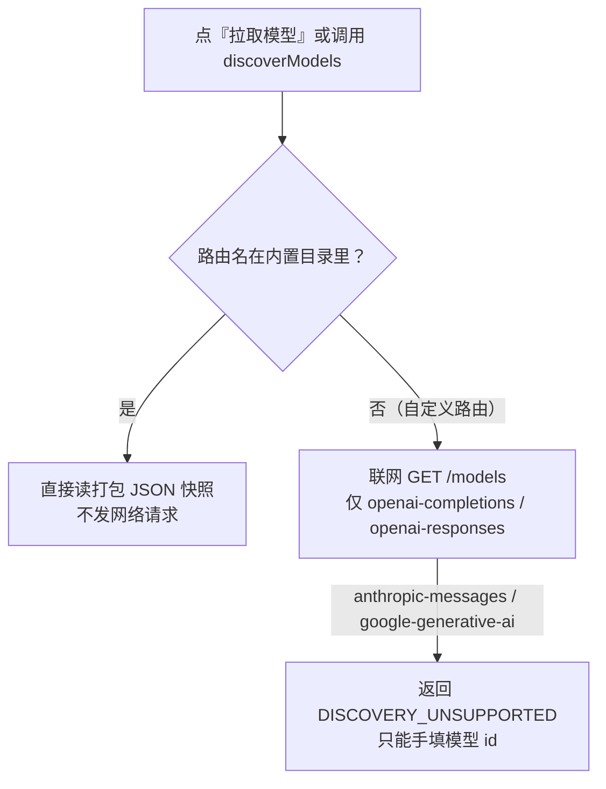

# DSH 模型与 Provider：配置、静态模型目录与子代理白名单

> 核对：2026-11-12。依据：2026-11-09～11-11 的会话实测（商汤 Token Plan 接入、429 联调、模型目录核对）与打包代码/目录阅读；本轮复核了 profile patch 中的 provider 条目与版本。DSH 为 nightly 预发布，模型目录与 pi-ai 版本会漂移。

## 结构：所有外部模型都走 `llm-pi-ai` 适配层

DSH 内置两个 LLM 适配器：`@deepseek-ai/dsh-llm-deepseek`（官方 DeepSeek）与 `@deepseek-ai/dsh-llm-pi-ai`（通用多 Provider）。自定义网关（OpenAI 兼容 / Anthropic 兼容）一律通过 `llm-pi-ai` 的 `providers` 配置登记，**不需要插件**：

```yaml
- id: llm-pi-ai
  name: "@deepseek-ai/dsh-llm-pi-ai"
  config:
    providers:
      <route-id>:                    # 模型选择器里的 provider id
        displayName: <界面显示名>
        apiKeyEnv: <凭据引用名，大写+下划线>
        api: openai-completions      # 另有 openai-responses / anthropic-messages / google-generative-ai
        baseURL: https://<host>/v1
        reasoning: high              # provider 级默认思考强度
        compat:
          supportsDeveloperRole: false
          supportsStore: false
          supportsReasoningEffort: true
          supportsUsageInStreaming: true
          maxTokensField: max_tokens
        defaultContextWindow: 262144 # 未逐模型声明时的兜底
        defaultMaxTokens: 65536
        models:
          - id: <上游模型 id>
            name: <显示名>
            contextWindow: 1048576
            maxTokens: 65536
            input: [text]            # 可加 image
            reasoningEfforts: {off: none, low: low, medium: medium, high: high}
            compat:
              requiresReasoningContentOnAssistantMessages: true
```

字段要点：

- `apiKeyEnv` **只是凭据引用名**，不是要求你 `export` 环境变量（解析顺序见[凭据体系](凭据体系与密钥打码.md)）。
- `reasoningEfforts` 是「档位 → 上游线值」映射；**`off: none` 才是真正关思考**，缺了它「关闭思考」只是不传参数。
- `requiresReasoningContentOnAssistantMessages: true` 针对 DeepSeek/GLM/Kimi 系：多轮带工具调用时历史 assistant 消息要回传 `reasoning_content`，否则上游可能报错。
- 其它可用 compat 键：`thinkingFormat`（`openai` / `deepseek` / `zai` / `qwen` / `openrouter` 等）、`supportsTemperature` 等。

## 实例：商汤 Token Plan（空手起一条自定义路由）

| 项 | 值 |
|---|---|
| provider id | `sensenova-token-plan` |
| 协议 | `openai-completions` |
| Base URL | `https://token.sensenova.cn/v1` |
| 聊天端点 | `POST /v1/chat/completions`；模型目录 `GET /v1/models`；出图 `/v1/images/generations` |
| Key 存放 | 凭据库的 `refs.SENSENOVA_TOKEN_PLAN_API_KEY` |
| 已登记模型（当时） | `deepseek-v4-flash` / `deepseek-flash` / `glm-5.2` / `glm-5.3` / `kimi-k3` / `sensenova-6.8-flash` / `sensenova-6.8-flash-lite` |
| 未登记 | 图像输出模型：聊天协议接不了，选它会 404 |

商汤端点的兼容开关（实测契约）：`supportsDeveloperRole: false`（不认 `developer` 角色，系统提示走 `system`）、`maxTokensField: max_tokens`（不用 `max_completion_tokens`）、`supportsReasoningEffort: true` + 各模型档位映射（GLM 额外支持 `max`）。

**联调时唯一的坑：HTTP 429。** 所有模型返回

```text
HTTP 429 {"error":{"message":"inference exceeds tpm/rpm limit","type":"rate_limit_error",
          "code":"RateLimitExceeded.EndpointTPMExceeded"}}
```

这是 Token Plan 的 5 小时滚动积分窗口用尽，不是 DSH 配置问题（直接 curl 也是 429）。到服务商控制台看额度与重置时间；DSH 遇 `RATE_LIMIT` 会按默认策略自动重试。
**连带坑**：会话模型落在被限流路由时，**工具调用前的 auto-review 也会 429**，工具实体根本不执行，表现为「模型在空转」——先把会话模型切到可用路由再干活。

**四层验证法**（按成本从低到高）：

1. **测 key/端点**：`curl {baseURL}/models -H "Authorization: Bearer <key>"` → 期望 200 且返回目录；不带/伪造 key 期望 401。
2. **测配置装配**：`dsh verify --from-default-profile headless --dump-config`（隔离 profile，不碰正在跑的桌面实例）确认合成配置里有 provider 条目。
3. **隔离端到端**：`dsh verify --patch "<overlay.yml>" "Reply with exactly: OK"` + `DSH_TELEMETRY_DISABLED=1`，确认请求真的发到目标域名。
4. **界面确认**：**设置 → 模型**出现新 provider 与模型；看不到就**完全退出 DSH（含托盘）**再启动。

## 内置 provider 的模型目录是「打包时的静态快照」

这是理解「模型列表总不是最新」的关键（**源码级**：读打包目录与 pi-ai 代码）：

- 所有内置 provider 的模型目录都是打包进客户端的 JSON 文件：`<安装目录>…/pi-ai/dist/providers/data/*.json`，共 **42 个 + `.manifest`**（`openai`、`anthropic`、`opencode-go`、`openrouter`、`amazon-bedrock` 等）。
- 代码里 `getModels: () => input.models` **直接返回内存数组，没有任何刷新路径**。
- 界面的「拉取模型」走 `ctx.llm.discoverModels()`，但 pi-ai 的规则是：**目录里有的路由 → 读目录回答，不发网络请求；只有目录里没有的自定义路由才真的联网 `GET /models`**。
- 官方 README 已知限制原文：**"A route's catalog never refreshes itself"**。
- 本机 pi-ai 1.3.0 的 opencode-go 目录 29 个模型，npm 最新 1.5.2 是 32 个：**缺 8 个**、**多 5 个已下线**（选中大概率报 `MODEL_DEPRECATED` / `MODEL_UNAVAILABLE`）。

补一条容易误解的：`listModels()` 只是选择器的元数据，**不是路由白名单**——官方文档说「适配器可以接受不在 `listModels()` 中的模型 id；调用方不得因为模型未列出就拒绝请求」。手填模型 id 一般能直接发请求，只是没有上下文长度/推理档位元数据。



## opencode-go 的真实结构：2 个 Base URL、4 种协议、逐模型不同

`opencode-go` 是**内置** provider（与 `opencode` 是两个不同条目，`-go` 是 Go 端点）。实测目录：

| 协议（`api` 字段） | 模型数 | Base URL |
|---|---|---|
| `anthropic-messages` | 5 | `https://opencode.ai/inference/go`（**无 `/v1`**） |
| `openai-completions` | 18 | `https://opencode.ai/inference/go/v1` |
| `openai-responses` | 5 | `https://opencode.ai/inference/go/v1` |
| `google-generative-ai` | 1 | `https://opencode.ai/inference/go/v1` |

每个模型条目自带 `api` / `baseUrl` / `contextWindow` / `maxTokens` / `thinkingLevelMap` / `compat`。

**`x-opencode-session` 会话头是内置的、原生实现**（全量扫描 213MB `app.asar` 得到 `const OPENCODE_SESSION_HEADER = "x-opencode-session"`；DSH 自带文档原文 *"...the `x-opencode-session` header that OpenCode requires..."*）。所以同类插件在这个能力上**没有独占价值**。

pi-ai 的两条规则决定了「换路由名 + 拉取模型」方案对它是残缺的：

> **One wire protocol per route** —— `api` 作用于整条路由，混合协议的目录路由无法托管另一协议的模型，解决办法是把提供商拆成多个路由键。
> 只有 `openai-completions` / `openai-responses` 支持联网发现；Anthropic / Gemini 会返回 `DISCOVERY_UNSUPPORTED`，只能手填模型 id。

## 想拿到「最新模型列表」的三条路（从轻到重）

| 方案 | 做法 | 代价 |
|---|---|---|
| A. 升级 DSH | 等下一次 nightly 发布（大概率顺带升 pi-ai） | 当前无可升级版本，只能等 |
| B. Custom model API 绕过静态目录 | 设置 → 模型 → 添加提供商 → 选 **Custom model API**，**路由名不要用目录里已有的名字**，Base URL 填实际地址，点「拉取模型」→ 这时才真的联网 | 对 opencode-go 需**按协议拆成多条路由**；Anthropic/Gemini 不支持自动发现，模型 id 与 `thinkingLevelMap`/`compat` 要手填，配错报 `UNSUPPORTED_REASONING_EFFORT` |
| C. 装对应插件 | 插件自己实现 `GET /models` + 内存/磁盘缓存，支持 3 种协议（无 Gemini） | 多引入一份进程内第三方代码；为刷列表装它性价比低 |

## 模型切换的三条路径 + 默认模型

1. **GUI 输入框模型选择器**（最常用）：选完立即对当前会话生效，日志插一条 `[model changed: assistant turns above this point were generated by <旧路由>; the session continues with <新路由>]`，同时写回 `agent-default-model`。
2. **profile patch 的 `agent-default-model`**：

   ```yaml
   - id: agent-default-model
     name: "@deepseek-ai/dsh-agent-default-model"
     config:
       provider: <route-id>
       model: <model-id>
   ```

3. **给某个组件单独指定**（如标题插件加 `provider` / `model`，见[工作区与会话](工作区-会话与指令链.md)）。

同一会话跨 provider 换模型是正常能力，不要求配置一致；每个模型可单独选思考强度（推理档位）。

## 子代理模型白名单

子代理默认只能走白名单里的路由，否则报：

```text
child LLM route "<provider>/<model>" is not allowed for this Session
```

补法：

```yaml
- id: subagent-model-selection-settings
  name: "@deepseek-ai/dsh-tool-subagent/model-selection-settings"
  config:
    enabled: true
    allowedModels:
      - provider: <route-id>
        model: <model-id>
```

❓ 待确认：会话内实测改完白名单后连续 3 次 `subagent(provider=..., model=...)` 仍报同一句错误，是会话级快照未热加载还是 patch 未生效，当时没有定论——按「改完必须重启/新开会话」预设。

## 自定义 `models` 列表会整体替换内置目录

内置路由（如 `nvidia`）如果在 patch 里写了 `models` 列表，**这份列表整体替换内置目录**，不是追加。本机案例（**已验证**）：

- `nvidia` 路由写了一份 20 个模型的列表，其中没有 MiniMax 系，于是出现「NVIDIA 不提供 MiniMax M3.1 Flash」的观感；
- 实际 `GET https://integrate.api.nvidia.com/v1/models`（**无需 key 即可查**）里就有 `minimaxai/minimax-m3.1-flash`；
- 补一条即可：`- id: minimaxai/minimax-m3.1-flash`、`name: …`、`input: [text]`（未声明容量时按适配器默认 1M 上下文 / 128K 输出）；补后 21 个模型。

相关：[配置分层与目录](配置分层与目录.md) · [凭据体系与密钥打码](凭据体系与密钥打码.md) · [插件体系与安装](插件体系与安装.md)
