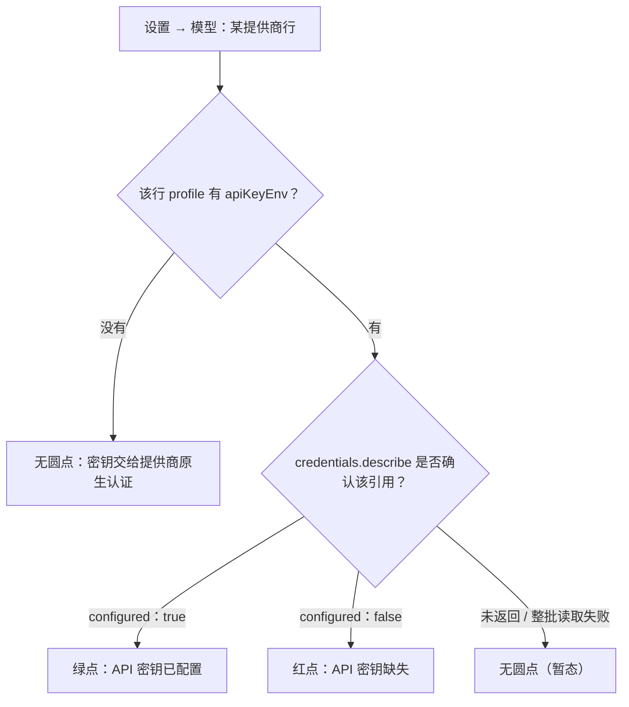

# DSH 设置 → 模型页的状态圆点：绿点、红点、无点

> 核对：2026-11-13。依据：本机打包产物源码（`@deepseek-ai/dsh-client-ui-settings-models` 的 `lib/client.js`、`@deepseek-ai/dsh-llm-deepseek-api-key` 的 `lib/index.js`、pi-ai 的 `dist/env-api-keys.js`）＋同包 `README.zh.md` 口径＋本机 profile 实查（存在只写 `models`、没有 `apiKeyEnv` 的 pi-ai 路由）。**未**在界面上逐项点击复核，故除标注外均为**源码级**。DSH 为 nightly 预发布，判定字段随 bundle 漂移，升级后按新 bundle 复核。

## 一句话结论

| 显示 | 判定（源码条件） | 含义 |
|---|---|---|
| 🟢 绿点 | `row.credential?.configured === true`，而 `row.credential` 只从具名引用 `apiKeyEnv` 的结果里取 | 该行**登记了具名凭据引用**，且凭据服务**确认已配置**；悬停「API 密钥已配置」 |
| 🔴 红点 | `row.apiKeyEnv` 存在，且 `row.credential?.configured === false` | 登记了具名引用，且凭据服务**确认缺失**；悬停「API 密钥缺失」 |
| 无圆点 | 以上都不成立：没有 `apiKeyEnv`，或该引用没拿到确认结果 | **没有可供判断的具名引用**——既不等于缺 key，也不等于不可用 |

圆点只回答「**具名引用有没有值**」，不回答「**这个提供商能不能用**」。

## 判定分流（源码级）



实现上只看两个渲染分支（`client.js` 的 ModelsSection）：

```js
const credentialConfigured = row.credential?.configured === true;
const credentialMissing = !credentialConfigured
  && row.apiKeyEnv !== void 0
  && row.credential?.configured === false;
// 渲染：configured → 绿点；missing → 红点；否则不渲染圆点
```

- `row.apiKeyEnv` 取自该行在 profile 里的 `apiKeyEnv` 字段（空串按「无引用」处理）。
- `row.credential` 只在该字段存在时，按引用名去 `credentials.describe` 的结果里取——所以**没有 `apiKeyEnv` 的行不可能有绿点或红点**。
- 特例：内置 API Key 路由（`deepseek-official`，插件 `@deepseek-ai/dsh-llm-deepseek-api-key`）的配置 schema 默认就带 `apiKeyEnv: DEEPSEEK_API_KEY`，所以它天然是一条「有具名引用」的行，过了首启姿态后没存 key 就显示红点（见下文「坑」里的首启例外）。

## 为什么「无点」很常见

1. **无引用 profile**：pi-ai 路由在 profile 里只写了 `models`、没写 `apiKeyEnv`。此时密钥由 pi-ai 原生认证从环境变量读取（例如 `nvidia` 读 `NVIDIA_API_KEY`，映射表在 pi-ai 的 `dist/env-api-keys.js`）。这种行**永远不会显示绿点**。
2. **添加提供商时密钥留空**：通过「添加提供商」新增 pi-ai 提供商、API Key 输入框留空保存，产生的正是无引用 profile，目的是保留提供商原生认证（Bedrock 凭据链、Vertex ADC 等）——包 README 明确写了这一设计。
3. **派生引用的凭据不算数**：页面会给没有 `apiKeyEnv` 的行算一个 `<ROUTE>_API_KEY` 派生引用并去查询（编辑卡片和插件卡片席位用），但**行首圆点只认具名引用**；即使派生引用下有已保存凭据，行首仍无点。
4. **整批凭据读取失败/未确认**：`credentials.describe` 失败时所有行的 `credential` 都为空，整页暂时没有圆点。页面没有专门的错误提示；这段失败只体现在首启引导判为 `credentials-unavailable`（不再弹补 key 的步骤）。

## 「无点」不等于不可用（源码级）

可用性判定是另一个函数，与圆点无关：

```js
function providerUsable(row) {
  if (!row.entry.active) return false;
  if (row.entry.provider === "deepseek-account") return row.accountAvailable === true;
  if (row.apiKeyEnv === void 0) return true;      // 无具名引用 → 视为可用
  return row.credential?.configured === true;
}
```

即：**没有 `apiKeyEnv` 的行直接算可用**。真正缺 key 时错误出现在发请求那一刻（`MISSING_CREDENTIAL`；格式错为 `INVALID_CREDENTIAL`），红点本身不报错。

## 怎么确认一条「无点」路由到底能不能用

1. **查用量/调用记录**：按 provider 维度看有没有成功调用（最直接）。
2. **查凭据来源**：环境变量（只读：`reg query HKCU\Environment /v <NAME>`）或凭据库里是否有对应变量。
3. **看编辑卡片**：密钥框留空时，卡片会提示「已检测到环境变量 / 已保存凭据 / 未检测到」。注意这是**编辑卡片**的检测态，和行首圆点是两套显示（见[凭据体系与密钥打码](凭据体系与密钥打码.md)）。
4. **实际发一次请求**：缺 key 报 `MISSING_CREDENTIAL`，能通就是能用。

设置页的检测**只看变量/凭据是否存在，不验证密钥有效性，也不测试连通性**（包 README 原文口径）。

## 如何让「无点」变绿

两条路，任选其一：

1. **走界面（会保存密钥）**：该行「编辑」→ 填「API 密钥」→「应用」。页面以只写方式把密钥存进凭据库，并在该行 profile 里补上 `apiKeyEnv: <PROVIDER_ID>_API_KEY`（提供商 id 转大写、非字母数字连续段换成下划线）。之后该行显示绿点。源码：pi-ai 布局的编辑卡片在「草稿和已存 profile 都没有 `apiKeyEnv`、且密钥非空」时，把它写为派生引用。
2. **保留环境变量认证**：在 profile 里给该提供商补一行 `apiKeyEnv: <环境变量名>`。变量已存在时凭据服务能解析到，同样显示绿点；代价是变量丢失后该行直接变红点并在请求时报 `MISSING_CREDENTIAL`（比「静默无点」更显眼）。

两条路的解析路径不同：无引用时完全交给 pi-ai 原生认证；写了 `apiKeyEnv` 后走[凭据体系](凭据体系与密钥打码.md)里的优先级（凭据库 → 继承的启动环境 → `.env`）。

## 容易踩的坑

- **首次运行姿态没有红点行**：页面上还没有任何可用提供商时，整分节注册项（`settingsPath` 为空，如内置 `deepseek-official`）渲染为展开的配置卡片而不是带红点的行；一旦有别的可用路由，同一行才以红点出现（`needsSetup` 逻辑 + 包 README 口径）。所以「内置路由没 key 一定显红点」不成立。
- **账号登录行是特例**：`deepseek-account` 行固定显示绿点 +「已登录」，没有编辑/删除按钮；账号模型目录为空（未登录/退登）时整行隐藏。它不参与上面的 `apiKeyEnv` 判定。
- **环境变量必须在 DSH 启动时就存在**：进程读到的是启动时的环境快照，给系统加完变量要重启 DSH 才可见（同[凭据体系](凭据体系与密钥打码.md)）。
- **删除行只清理页面能证明归属的凭据**：仅当该行引用恰好等于派生 `<ROUTE>_API_KEY`、且已确认配置且可写时才删除；自定义引用、环境变量不会被清理。
- **检测不校验密钥**：绿点只说明「有个值」，不代表 key 仍有效或额度够用。
- **无点不区分成因**：原生认证、留空保存的 profile、凭据读取失败，界面上都是无点，只能靠上一节的方法区分。

## 未核实项

- 圆点的实际视觉与悬停文案未在运行时点击复核（文案取自 bundle 内中文词典：`API 密钥已配置` / `API 密钥缺失`）。
- 各提供商原生认证读哪些环境变量只抽查了 `nvidia`（pi-ai 映射表），未逐项核对全部目录条目。
- 凭据读取失败时界面是否出现任何可见提示，未在运行时复现（源码中未见该提示的渲染分支）。
- 「删除行」的连带清理未实跑，结论来自 `targetOf` 的判定条件。

相关：[凭据体系与密钥打码](凭据体系与密钥打码.md) · [模型与 Provider](模型与provider配置.md) · [配置分层与目录](配置分层与目录.md)
