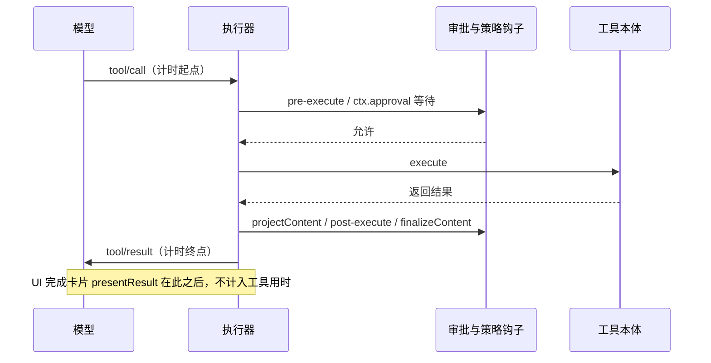

# DSH「统计」页签里的「工具用时」是什么

> 核对：2026-11-27。依据：上游 npm registry 包元数据、上游 `packages/experimental/client-ui-stats/README.zh.md` 与 `src/client/stats-fold.ts`、上游 `docs/tool-execution-pipeline.md`。除包版本与目录口径外均为**上游源码/文档级**结论，本机未拆包复核安装版本、未在 GUI 上重新计时。DSH 是 nightly，UI 口径会漂移；下文按 `0.2.2-rc.5` 附近的形态写。

## 一句话

**「工具用时」= 统计插件把当前步里所有工具调用「从发出到收到结果」的时间加起来**；工具不分来源（内置、插件、MCP 一视同仁），时间含审批等外围开销。

## 它属于谁

| 问题 | 结论 | 证据 |
|---|---|---|
| 谁在显示 | `@deepseek-ai/dsh-experimental-client-ui-stats`，实验性客户端 UI 插件，在「对话 / 轨迹」旁加一个「统计」页签 | 文档级：包 README |
| 它做什么 | 只读会话事件渲染表格，向 `conversation.view` 槽贡献一个条目；**不注册工具、提示词段落或服务，无配置字段** | 文档级：包 README |
| 它是不是被统计的工具 | 不是。它是**显示统计的插件**，不是 Shell，也不是某个插件自带的性能计数器 | 文档级 + 源码级（`stats-fold.ts` 只读事件） |
| 版本 | 题面标注本机 `0.2.2-rc.5`；npm registry 确有该版本（`next` 标签，2026-11-18 发布），描述为按轮次/步骤展示 timing 与 tool-cost 的实验性 conversation View | 文档级；本机安装版本未拆 `app.asar` 复核 |
| 默认挂载 | 默认产品不挂载：Web 包按规则拒绝引用 experimental 包，需「开发者工具」组合包或 profile 显式加行 | 文档级：包 README「已知限制」 |

## 计时口径

一次调用怎么变成一列数字（源码级，来自 `stats-fold.ts`）：

1. `tool/call` 事件把 `callId → event.time` 记进 `pending`，并累计该工具名的次数。
2. `tool/result` 事件按 `callId` 取出起点，把 `event.time - dispatched` 加进该步的 `toolMs`；配对不到起点的结果只记 `toolMissing`，**不产生时长**。
3. 步内 `toolMs > 0` 时输出「工具用时」列；否则该格为空。截图中 `read x12 + pwsh x11 + skill x2 + 其他 4 项` 就是这一列按工具名展开的构成明细，`pwsh` 只是其中一项。

计时边界（文档级，上游 `docs/tool-execution-pipeline.md`）：起点 `tool/call` 记录在该轮调用管线开始**之前**，所以在 `tools/pre-execute` 与 `ctx.approval` 之前；终点 `tool/result` 在 `tools/post-execute`、`finalizeContent` 与 `tools/result` 通知**之后**。因此这段墙钟包含审批等待与策略钩子。注意「结果渲染」指管线内的结果投影/定稿，**不包括**随后 UI 完成卡片的呈现（它在 `tool/result` 之后）。被拒绝或报错的调用也会产出 `tool/result`（错误结果），照样计入；只有压根没拿到结果事件、配不上对的调用才不计。

## 两个最容易误读的地方

| 误读 | 事实 | 证据 |
|---|---|---|
| 工具用时列 = 这段时间的实际占用 | 列是**逐次调用累加**：并行调用会重复计入；「总用时」条里的橙色工具段用配对区间**并集**，重叠只算一次（`toolSpanUnion`） | 文档级 README + 源码级 `stats-fold.ts` |
| 合计行的总用时是整段墙钟实测 | 没有整段墙钟 projection，合计行用「模型用时 + 工具用时」替代；这是上游明写的**已知限制**，插件不改宿主逻辑 | 文档级 README「已知限制」 |

两个补充边界：

- **Code-Mode**：`run_code` 内部子调用走 `tool/ptc-dispatch-start` / `tool/ptc-dispatch`，各自记自己的派发耗时（`ms`），源码注释明写**不并入外层调用的工具用时**；但子调用的工具名仍进该步的次数明细。且总用时条的并集取该步全部已配对调用（含内层派发），所以它与工具列的口径并不完全同源。
- **窗口被截断**时（某步的 `step/start` 不在已加载窗口），起点相关的列显示 `—` 并标「起止未知」，不估算数值。

## 验证记录

- 只读拉取 npm registry 的包元数据：包名、`next` = `0.2.2-rc.5`、发布时间、用途描述均对得上。
- 只读拉取上游包 README 中文版：「对话/轨迹旁的统计页签」「工具列逐次求和、总用时条区间并集」「合计总用时 = 模型 + 工具」「Code-Mode 内层调用独立归属」逐条对上。
- 只读拉取上游 `stats-fold.ts`：`pending` 起点、`toolMs` 累加、`toolSpanUnion` 并集、PTC 子调用独立 `ms` 均在源码里。
- 只读拉取上游 `docs/tool-execution-pipeline.md`：`tool/call` → pre-execute/审批 → execute → post-execute/finalize → `tool/result` → UI 卡片，事件顺序确认。

**未核实项**：本机安装版本是否就是 `0.2.2-rc.5`（未拆 `app.asar`，只看到包元数据里有该版本）；GUI 上的实际数值与列宽未重新截屏计时；上游 `master` 可能已领先本机 rc 版本，后续升级需重核。

相关：[轨迹视图与 `run_code` 渲染](轨迹视图与run_code渲染.md) · [工作区-会话与指令链](工作区-会话与指令链.md) · [`run_code` 双通道](run_code-双通道-工具化编排.md)
