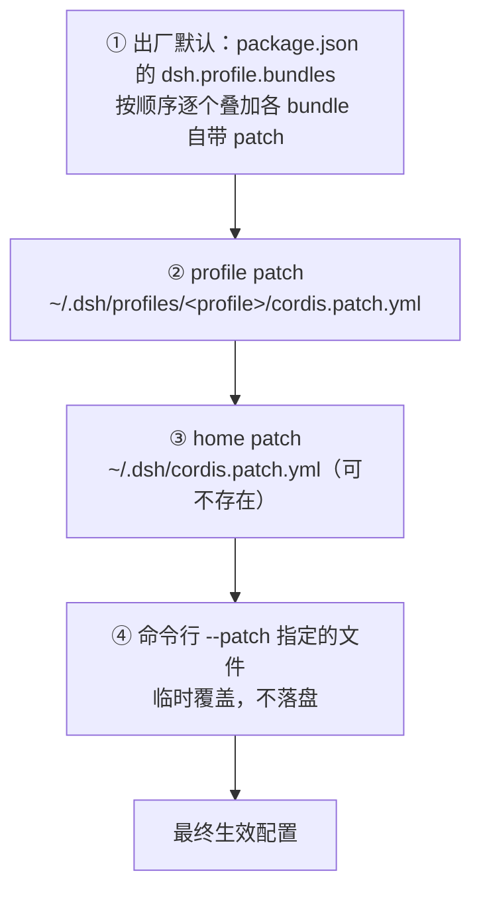

# DSH 配置：三层目录、patch 层叠与「整段替换」语义

> 核对：2026-11-12。依据：本机 2026-11-09～11-11 的 13 个会话日志复盘；`version`、`app.asar` 体积、profile patch 行数、目录存在性等静态事实本轮实读复核。DSH 走 nightly 预发布通道，版本、bundle 组合与目录会漂移，本篇有效窗口约一个 rc 周期。

## 一句话

DSH 的配置不是某个单一文件，而是 **bundle 默认层 → profile patch → home patch → 命令行 overlay** 逐层叠加；而覆盖某个条目时是**整段替换它的 `config`**，不是字段级合并。改错这一条，轻则配置一半回默认，重则整条插件行为被重置。

## 三层目录

| 层 | 位置 | 放什么 | 能不能手改 |
|---|---|---|---|
| 用户层 | `~/.dsh`（= `$DSH_HOME`） | 凭据、profile、会话、工作区索引、运行时 | 可以，但 `sessions/` 等运行数据只读理解、别乱删 |
| 安装层 | `<安装目录>` | 程序主体 `app.asar`、更新源、内置 runtime、CLI | 基本不要改（升级整包替换） |
| 工作区层 | `<工作目录>` | 项目级 `AGENTS.md`、`.env`、`.dsh/` | 按需创建；本机这几项目前都不存在 |

### 用户层 `~/.dsh`

```text
~/.dsh/
├── .credentials.yaml          【凭据库】明文 YAML；refs=env 式引用，records=OAuth 授权
├── cordis.patch.yml           【home patch】存在时对所有 profile 生效（本机不存在）
├── .env                       【凭据 fallback】最低优先级，DSH 从不写它（本机不存在）
├── .anonymous-user-id         遥测匿名 ID（勿删勿改）
├── profiles/<profile>/        【当前唯一 profile】由 Electron 独占管理
│   ├── cordis.patch.yml       ★ 主战场：模型/provider/插件/UI 设置落盘处
│   ├── cordis.yml             根文件，内容为 `[]`
│   ├── package.json           dsh.profile.bundles + dependencies
│   ├── pnpm-workspace.yaml / pnpm-lock.yaml
│   ├── node_modules/          插件实体（删了就没了）
│   └── .plugin-manager/logs/  插件市场操作日志
├── storages/workspace.json    工作区/会话索引（UI 状态，不是配置）
├── sessions/ logs/ attachments/ cache/   运行时数据
├── dsh-runtimes/              内置 node / pnpm / python
└── <插件私有状态目录>/         各插件自己的状态
```

### 安装层 `<安装目录>`

| 路径 | 内容 |
|---|---|
| `<安装目录>\version` | Electron 应用版本号（本机 44.7.0，**已验证**） |
| `resources\app.asar` | 打包归档：全部 bundle 的代码与默认配置（本机 213,202,918 B ≈ 213 MB，**已验证**） |
| `resources\app.asar.unpacked\` | 需要落在包外的依赖：原生模块，**以及个别纯 JS 包**（如 `fflate`、`libreoffice-kit`）。不是「只放原生模块」（2026-11-12 实测 1583 个文件） |
| `resources\app-update.yml` | 自动更新源（provider/channel/url，**已验证**） |
| `resources\runtime\versions.json` | 内置 runtime 版本清单（本机 node 24.21.0 / pnpm 11.28.5，**已验证**） |
| `resources\runtime\cli\bin\dsh.cmd` | CLI 入口（**已验证存在**） |
| `resources\runtime\primary-runtime\` | 自带 node / pnpm / python 实体（本机 node v24.21.0，**已验证**） |
| `%APPDATA%\@deepseek-ai\dsh-desktop\` | 桌面端状态：`plugin-operations\operations.jsonl` 记安装/启用操作，`logs\` 是日志（**已验证存在**） |

### 工作区层

`<工作目录>\AGENTS.md`（项目指令）、`<工作目录>\.env`（项目级凭据 fallback）、`<工作目录>\.dsh\`。三者都是按需创建，不存在不代表安装坏了。

## 加载顺序：后层覆盖前层



- UI 里改设置也写回第 ② 层；home patch 与命令行 overlay 只读（**源码级**：`config-editor` 的行为）。
- `profile.bundles` 的**先后顺序**决定 patch 覆盖顺序：只有排在后面的 bundle，其 `- id:` 覆盖才能命中前面的行。
- 每个 bundle 自带的默认层在 `node_modules/<bundle>/cordis.patch.yml`（本地 link 插件看源目录）——排查配置时最容易漏的一层。

## 最重要的一条语义：patch 是「整段替换 config」

覆盖一个已存在条目时，不是字段级合并，而是**整块替换那个 id 的 `config`**；没写的字段回到默认值。

两条直接证据：

1. 改会话标题插件的 `maxOutputTokens` 时，必须把 `targetWords / targetCjkCharacters / maxInputBytes / timeoutMs` 一起照抄，否则这些字段被重置（**会话实测**）。
2. 本地侧栏搜索插件的 patch 注释原文是 "A patch replaces the targeted row's whole `config`"：它把 `session-query-sqlite` 的 `config` 整块换成 `path: ':memory:'` + `openAt: first-search`，而不是只追加一个字段（**源码级**，读该插件包）。

操作规则：**改一个条目 = 先抄下它当前完整的 `config`，再改目标字段**；同一个 id 不要在同一个 patch 文件里出现两次。patch 条目除 `config` 外还支持 `disabled: true`（禁用）与 `insert` 列表（插入新行）。

## 「我想改 X」对照表

| 想做的事 | 改哪里 |
|---|---|
| 加模型 / Provider / API 地址 | profile patch 的 `llm-pi-ai`（99% 的情况） |
| 换默认模型 | 同文件 `agent-default-model` 的 `provider` / `model` |
| 装 / 删插件 | profile 的 `package.json` 的 `dsh.profile.bundles` 或 `dependencies`，再装依赖 |
| 存 API key | 设置 → 模型（写进 `.credentials.yaml`），或设环境变量 |
| 改自动更新渠道 | `resources\app-update.yml`（升级会被覆盖） |
| 调 node / pnpm 版本 | `resources\runtime\versions.json`（危险，不建议） |
| 给 agent 写长期规则 | `~/.dsh/AGENTS.md` 或 `~/.agents/AGENTS.md`（见[工作区与会话](工作区-会话与指令链.md)） |
| 改工具 shell 路径 | patch 里 `pwsh-sandbox` 的 `pwshPath`（通常不必写，见[沙箱与提权](权限-沙箱与提权.md)） |

## 三个坑

1. **`cordis.yml` 里是 `[]`，不要往里加东西。** 它是 patch 的根，不是配置本体；文件头就写着 "Edit cordis.patch.yml, not this file"。
2. **`$DSH_HOME/cordis.patch.yml` 与 `.env` 是「可创建」而非「必须有」。** 本机两者都不存在（**已验证**）。
3. **`~/.dsh` 在会话工作区之外。** `workspace-write` 策略下直接 `edit` 会报：

   ```text
   [sandbox: file access denied under workspace-write mode]
   [sandbox: escalation available — retry this exact operation once with sandbox_permissions ...]
   ```

   按提示对**同一个操作**带 `sandbox_permissions` + 一句理由重试一次即可（审批弹窗会问用户）；改完通常由 `dsh-hmr` 热重载，必要时重启客户端。

## 排查「这条配置到底被谁设的」四步法

1. 先读 profile patch：搜目标 id，有 `- id: xxx` 就是你的覆盖，最后应用、优先级最高。
2. **再逐个 bundle 翻自带 `cordis.patch.yml`**（`node_modules/<bundle>/cordis.patch.yml`，本地 link 插件直接看源目录）——最容易漏的一步。
3. 看顺序：只有排在 `dsh-base`/`dsh-web-app` 之后的 bundle，其覆盖才能命中基础层的行。
4. **不要用「有没有产物文件」判断开关**：`:memory:` 类配置不落盘，没有 `.db` 文件 ≠ 没开启；要看行为证据（能不能搜到、报什么错）。

反例：曾因漏查第 2 步、又拿「没有 `.db` 文件」当证据，断言「配置没改」，被当场推翻。

## 版本与更新通道（2026-11-11 快照）

| 项 | 值 | 证据 |
|---|---|---|
| 桌面版本 | 0.2.2-rc.1（desktop 与 runtime 同版本） | **已验证**：`version` 文件为 44.7.0（Electron 应用版本线） |
| 更新通道 | `provider: generic`、`channel: nightly`，源 `https://download.deepseek.com/dsh-desk/feeds/win-x64/` | **已验证**（`app-update.yml`） |
| 可用渠道 | 只有 nightly；`stable.yml` / `latest.yml` / `beta.yml` / `next.yml` 均 404 | **已验证**（会话内 curl） |
| 最新 nightly | 2026-11-04T09:31:49Z | **会话实测** |
| 内置 pi-ai | 1.3.0（npm 已 1.5.2） | **源码级** |

两条反直觉结论：①「最新」指最新 rc，没有 stable 通道；②点「检查更新」只会得到同一版本。所以**「模型列表旧」不能靠升级解决**（见[模型与 provider](模型与provider配置.md)）。

## 复核命令

```powershell
Get-Content '<安装目录>\version'
Get-Content '<安装目录>\resources\app-update.yml'
(Get-Item '<安装目录>\resources\app.asar').Length
(Get-Content "$env:USERPROFILE\.dsh\profiles\desktop\cordis.patch.yml" | Measure-Object -Line).Lines
Test-Path "$env:USERPROFILE\.dsh\cordis.patch.yml"   # False = home patch 不存在
```

2026-11-12 本机实读：`version`=44.7.0、`app.asar`=213202918 B、profile patch=361 行、home patch/.env/全局 `AGENTS.md` 均不存在。

相关：[工作区、会话与指令链](工作区-会话与指令链.md) · [权限、沙箱与提权](权限-沙箱与提权.md) · [插件体系与安装](插件体系与安装.md) · [运行环境-Desktop 还是浏览器 Web](运行环境-Desktop还是浏览器Web.md)
