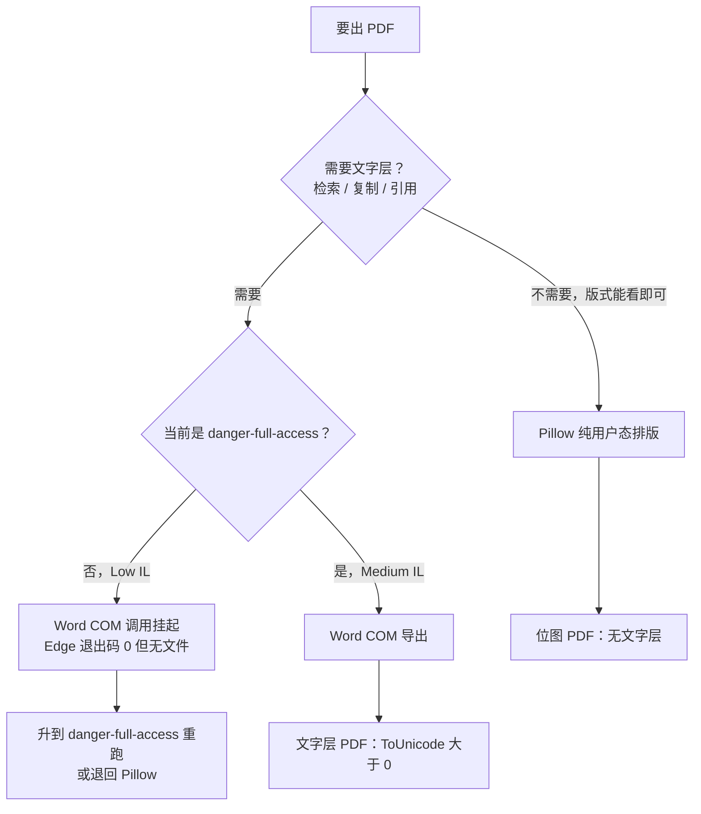

# Windows 上生成中文 PDF：Pillow 位图 vs Word 文字层

> 核对：2026-11-12。依据：2026-11-09～11-11 的一次真实交付（下称「会话实测」，本轮未重跑）与实际产物字节核对；跨进程机制引自 [权限、沙箱与提权](../deepseek-harness/权限-沙箱与提权.md)。有效窗口：沙箱档位相关结论绑定当时的 DSH 与 Windows 构建，Office/Chromium 升级后需重验；排版常量只对当次版式成立。

## 一句话

先问产物要不要文字层：不要就用 Pillow 单进程写位图 PDF，代价是排版全手写、只能看图验收；要就给会话升到 `danger-full-access` 用 Word COM 导出，Low IL 下这条路会挂起或假成功。

## 选型：前提、产物、代价

| 路线 | 前提 | 产物 | 代价 | 证据 |
|---|---|---|---|---|
| Pillow 纯用户态排版 | 无额外权限。单进程用 Flate 流写 PDF，不碰 IPC | 位图 PDF：不能选中、搜索、复制 | 版式要自己写，排版 bug 多 | **已验证**（会话实测） |
| Word COM 导出 | `danger-full-access`（Medium IL）。`workspace-write`（Low IL）下调用不返回 | 文字层 PDF：可检索、可打印 | 要提权，风险对整个会话后续命令生效 | **已验证**（会话实测 + 机制核对） |



当次走的是「Pillow 先出稿 → 发现没有文字层 → 切权限用 Word 重导 26 页文字版」；两条路都留下产物，不是二选一的重做。

## Pillow 排版：5 类 bug 的现象与修法

| 现象 | 原因 | 修法 |
|---|---|---|
| 多出空白页 | 分页函数无条件 `doc.new_page()`，正文刚好填满一页时再翻一页 | `doc.new_page() if doc.y > MT + 1 else None` |
| 粗体溢出边界、封面行距异常 | 字号与行距常量不匹配该行长度 | 调字号/行距常量；当次只记到「调常量」，没留具体数值 |
| 行首出现收尾标点 | 逐字符断行，不认避头点 | 避头点集合 `NO_START = set("，。、；：？！）》”』%…·,.;:?!)]}」")`，行首标点悬回上一行行尾 |
| 题号全部显示「1.」 | numbered 列表只存文本，渲染时重新编号 | 改成 `(num, text)` 元组保留原题号，前缀 `"%d. " % num` |
| 数字被拆行（如「9 0日」） | 按字符宽度断行，把连续数字拆开 | ASCII 字母数字连续串当单一 token，不逐字符断行 |

全部 **已验证**（会话实测，改完重建并逐页看图）。第 2 条的修法是经验性调参，换版式要重新调，不是通用公式。

## 版式常量与中文字体

- A4 @ 200 dpi：`W, H = 1654, 2339`；页边距 `ML, MR, MT, MB = 118, 112, 108, 104`（像素）。**已验证**（会话实测）
- 26 页比 17 页松，原因是 docx 设了 **1.5 倍行距**（**已验证**，会话实测）；改成 1.25 可再压页数，18 页是按比例估的（**推测**，未重导验证）。
- 中文字体按以下候选路径探测：`%WINDIR%\Fonts\msyh.ttc`、`msyhbd.ttc`、`simhei.ttf`、`simsun.ttc`、`Deng.ttf`。**已验证**（会话实测探测顺序）

字体取自系统自带文件，不随包分发；换机器先确认候选里至少命中一个。

## 生成命令

Python 用 DSH 自带运行时，不依赖系统 PATH：

```powershell
$py = "<DSH_HOME>\dsh-runtimes\dsh-primary-runtime\dependencies\python\python.exe"
& $py "山东省考-行政执法专业科目\build_docx.py"
& $py "山东省考-行政执法专业科目\build_pdf_pillow.py"
```

两条命令都 **已验证**（会话实测）。`build_docx.py` 用 python-docx 出 Word 再导出，`build_pdf_pillow.py` 直接排版 A4 位图。

## 验收：页码与文字层

不装任何 PDF 库，直接读字节：

```powershell
$f = "山东省考-行政执法专业科目\山东省考-行政执法专业科目_备考资料包（文字版）.pdf"
$bytes = [System.IO.File]::ReadAllBytes((Resolve-Path $f).Path)
$head  = [System.Text.Encoding]::ASCII.GetString($bytes[0..7])
$txt   = [System.Text.Encoding]::Latin1.GetString($bytes)
$head                                              # PDF-1.7
([regex]::Matches($txt, '/Type\s*/Page[^s]')).Count # 页数
([regex]::Matches($txt, '/ToUnicode')).Count        # >0 才有文字层
```

**已验证**（会话实测，当次文字版读到 `PDF-1.7`、26 页、8 个 `/ToUnicode`）。`/ToUnicode` 是字体级映射，计数与页数不是一对一，判据只看是否大于 0；位图版这一项为 0。

## 失败处置：两种「看起来跑完了」

**Word COM 挂起。** `New-Object -ComObject Word.Application` 之后方法调用不返回，`WINWORD.EXE` 的 PID 出现、`Responding=True` 也不代表可用。两轮 `job_output` 等不到返回时不要再等：`job_kill` 结束任务，再 `Get-Process WINWORD | Stop-Process -Force` 清场。真正的解法不是改命令或加白名单，而是识别「Low IL 跨进程被封」，升到 `danger-full-access` 重跑（机制见 [权限篇](../deepseek-harness/权限-沙箱与提权.md)）。**已验证**（会话实测）

**Edge 无头打印假成功。** 已有 Edge 实例在跑时，新的 `--print-to-pdf` 命令只把参数转发给现有实例就退出，**退出码 0 但没有文件**。一律用 `Test-Path` + 文件字节数校验，不信退出码。**已验证**（会话实测）

## 位图 PDF 的验收含义

- 位图版只能「看图」验收：导出 `preview_*.png` 逐页 `read_image`，改完重建、删临时 png。**已验证**（会话实测）
- 文字抽取、关键词搜索、复制段落、按文本自动核对页数，这些验收只对文字层版成立；位图版的 `/ToUnicode` 为 0，检查「文字对不对」必须换文字层产物。**已验证**（当次两版产物对照）
- 反过来，打印效果与版式核对可以用位图版，不必为看排版去提权。

## 未闭环

依赖探测那轮输出被截断：`reportlab` / `fpdf` / `weasyprint` / `docx2pdf` / `pypandoc` / `markdown` 以及 LibreOffice/Word/Edge 路径哪些真的可用 ❓ 未确认；从后续行为看最终落在 Pillow（**推测**）。

相关：[DSH 权限、Windows 沙箱与提权](../deepseek-harness/权限-沙箱与提权.md)
