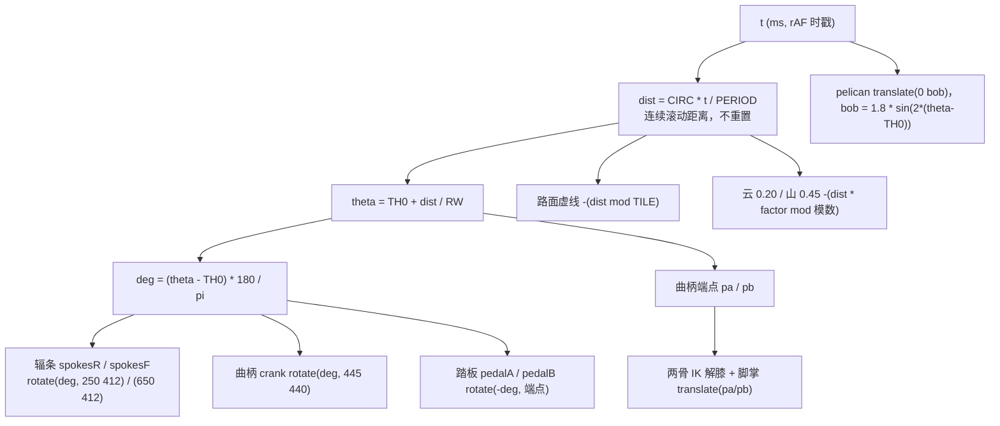
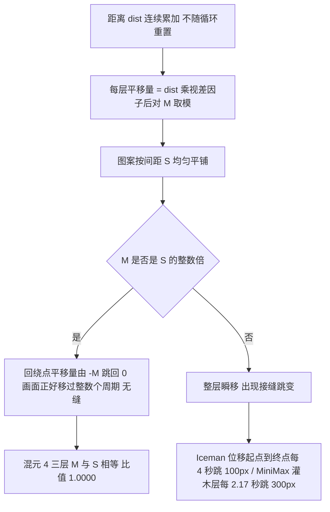

# 鹈鹕骑自行车：混元 4 版运动学自洽性实测与四版对比

## 对比对象

| 产物 | 模型 | 相对路径 |
|---|---|---|
| 混元 4 版（本文件评测对象） | 混元 4（Hunyuan 4） | [`../../evals/pelican-bike-basic-prompt/hunyuan-4.html`](../../evals/pelican-bike-basic-prompt/hunyuan-4.html) |
| Iceman 版（同一句提示词） | Iceman Contributor Free | [`../../evals/pelican-bike-basic-prompt/iceman-contributor-free.html`](../../evals/pelican-bike-basic-prompt/iceman-contributor-free.html) |
| DeepSeek 版 | DeepSeek V4.1 flash 1017 | [`../../evals/pelican-bike/deepseek-v4.1-flash-1017.html`](../../evals/pelican-bike/deepseek-v4.1-flash-1017.html) |
| MiniMax 版 | MiniMax M3.1 Flash Free | [`../../evals/pelican-bike/minimax-m3.1-flash-free.html`](../../evals/pelican-bike/minimax-m3.1-flash-free.html) |

提示词原文（登记表有存档）：`Generate an HTML file that renders an SVG of a pelican riding a bicycle`，与 Iceman 版完全相同，可直接对比；混元 4 版首版就自带循环动画，没有追加要求（已验证，见 [`../../evals/README.md`](../../evals/README.md) 登记表）。产出会话 id 未记录（`—`）。
DeepSeek / MiniMax 两版提示词原文未存档，横向对比只对成品、不对提示词 —— 沿用 [`./鹈鹕骑自行车-两版实现与性能对比.md`](./鹈鹕骑自行车-两版实现与性能对比.md) 的前提。
`pelican-bike/` 与 `pelican-bike-basic-prompt/` 是两套不同提示词的产物，别混着比。

## 一句话结论

**运动学自洽度是四版里最高的一版**：单一时钟驱动全部图层，脚-踏板偏差 0px、两膝同向、踏板保持水平，曲柄/车轮周期比与地面/轮面速度比都是 **1.000**，三层视差回绕无缝，前三版记录过的硬伤被系统性规避（已验证）。
代价是鹈鹕本体几乎没有任何次级动作，观感「精准但呆板」；16 辐条的 22.5° 对称周期还会让常规截图采样误判「轮子没转」（已验证）。

## 一、四版横向对比

| 维度 | DeepSeek | MiniMax | Iceman | 混元 4 |
|---|---|---|---|---|
| 提示词 | 未存档 | 未存档 | 一句话 + 后补动画 | 同一句话，首版自带动画 |
| 脚-踏板偏差 | 0px | 46px（画在膝盖上） | 无腿无踏板 | **0px** |
| 脚掌水平 | 是 | 否 | — | **是** |
| 两膝折向 | 同向 | **反向** | — | **同向** |
| 踏板保持水平 | 是（反向抵消） | 否（跟曲柄转） | — | **是（反向抵消）** |
| 曲柄 / 车轮周期比 | **1.855** | 1.000 | 车身 25px/s、轮面 314px/s | **1.000** |
| 地面滚动 / 轮面速度比 | **0.354** | 1.000 | **0.08** | **1.000** |
| 轮子转轴 | 轮心 | 轮心 | **画布中心** | 轮心（显式 rotate 中心） |
| 循环接缝 | 云/路面无缝 | 灌木每 2.17s 跳 300px | 每 4s 跳 100px | **三层均无缝** |
| 辐条 | — | — | 4 重（两条直径） | 16 重（22.5° 间隔） |
| 地面 / 纵深 | 有路面，无纵深 | 六层视差 | 无地面 | 三层视差（0.20 / 0.45 / 1.0） |
| 腿 / 曲柄 / 踏板 | 有 | 有 | **都没有** | 有 |
| 鹈鹕次级动作 | 拍翅、嗉囊 | 围巾、尾羽、眨眼、冠羽、侧倾、飞鸟、草丛 | 无 | **几乎无**（仅 ≤1.8px 起伏） |
| 文件良构 | — | — | 否（`<g>` 未闭合） | **是** |
| 悬空引用 | 有 `#soft` 废 filter | — | — | **0** |
| 主线程每帧耗时 | 1.83 ms | 1.72 ms | — | 未测（见第六节） |

混元 4 列除「性能」行标推测外全部为本次实测（已验证）；其余三列取自既有两篇笔记，未重测。

## 二、这一版怎么驱动动画（结构，已验证）



单一时钟是这一版最关键的设计（已验证，源码）：`dist` 连续增长、从不重置，每个图层各自 `dist * factor % 模数` 取模；图案按模数均匀平铺，所以取模跳变时画面正好移过整数个图案周期，接缝无缝。这正是 MiniMax 灌木层「固定 300 步长配不均匀间距、每 2.17s 横跳」的反面。

`prefers-reduced-motion: reduce` 时只 `draw(0)`、不启动 rAF（已验证，源码）。

## 三、静态与结构校验（已验证）

命令（只读；`<repo>` 为仓库根，`<tmp>` 为系统临时目录）：

```python
import re, xml.etree.ElementTree as ET
html = open("<repo>/evals/pelican-bike-basic-prompt/hunyuan-4.html", encoding="utf-8").read()
svg  = re.search(r"<svg\b[\s\S]*?</svg>", html).group(0)
ET.fromstring(svg)                                  # 良构性（含 <g> 闭合）
ids  = re.findall(r'\bid="([^"]+)"', svg)           # 重复 id
refs = re.findall(r'href="#([^"]+)"', svg) + re.findall(r'url\(#([^)]+)\)', svg)
set(refs) - set(ids)                                # 未解析引用
open("<tmp>/eval_script.js", "w").write(re.search(r"<script>([\s\S]*?)</script>", html).group(1))
```

```bash
node --check "<tmp>/eval_script.js"
```

真实输出（路径已替换为占位符）：

```
SVG block bytes: 13797
[1] SVG well-formed XML: YES (all tags incl. <g> properly closed)
[2] id count: 31 unique: 31 duplicates: NONE
[3] href=# count: 28 url(#) count: 9
    unresolved href targets : NONE
    unresolved url(#) targets: NONE
    aria-labelledby tokens  : ['ttl dsc'] -> resolved: True
    href targets (distinct) : ['cloudUnit', 'dashUnit', 'hillTile', 'spokeStar']
    url(#) targets (distinct): ['bill', 'birdShadow', 'glow', 'ground', 'plumage', 'pouch', 'sky']
[4] <g> open: 25  close: 25
[5] node --check exit: 0
    stdout: ''
    stderr: ''
    script bytes: 4113
```

- SVG 是良构 XML、25 个 `<g>` 全部闭合、31 个 id 无重复、28 处 `href="#..."` 与 9 处 `url(#...)` 全部能解析、`aria-labelledby` 两个 token 都有落点、内联脚本 4113 bytes 通过 `node --check`（exit 0，stdout/stderr 均空）（已验证）。
- 对照：规避 Iceman 版「`<g>` 未闭合、不是良构 XML」与 MiniMax 版「`<filter id="soft">` 定义后全文无引用」（已验证）。

## 四、运动学数值复刻（已验证）

方法：读源码取出常量，把 `draw(t)` 与两骨 IK `setLeg()` 复刻成脚本，在 t=0..2700ms 上取 360 个采样点（只读命令，`<repo>` 为仓库根）。真实输出：

```
=== constants (from source) ===
RW=88.0  CIRC=2*pi*RW=552.92031  TILE=CIRC/6=92.15338  CRANK=46.0  PERIOD=2700 ms=2.7 s
PA=[482.681,466.385]  PB=[407.319,413.615]  TH0=35deg
rim / rolling speed = CIRC/PERIOD = 204.785 viewBox units/s
tyre outer radius = r82 + stroke12/2 = 88 == RW: True
hub y=412 + outer 88 = 500 ; road top y=500 -> exact contact: True

=== static first frame vs draw(0) ===
draw(0): deg=0.000 bob=0.000 pa=[482.68,466.38] pb=[407.32,413.62]
draw(0) knees: near=[509.08,344.20] far=[480.46,312.25]
hardcoded : near nKnee 509.05,344.25 / far fKnee 480.46,312.24 / nFoot 482.68 466.38 / fFoot 407.32 413.62
max diff (knees): 0.045 px

=== 360 samples over one crank revolution (t=0..2.7s) ===
[A] unreachable samples (hip->pedal > L1+L2=250): near=0 far=0 total=0
    hip->pedal distance: 127.766 .. 239.333 (limit 250)
[B] knee bend sign (cross of hip->pedal x hip->knee): near={-1} far={-1} -> same fold: True
    knee included angle: 61.47 .. 146.41 deg (180 = fully straight); travel 84.94 deg
[C] foot anchor = pedal pin (pa/pb) by construction: offset 0.000 px
    crank arm endpoint (PA rotated by deg) vs computed pa: max diff 8.039e-14 px
[D] foot transform = translate only (outside crank group): 0.000 deg rotation -> stays level
[E] crank / wheel period: deg(0)=0.0 deg(PERIOD)=360.0 -> both one rev per 2.7s, ratio 1.000
[F] ground / rim speed: dashes translate=-(dist mod TILE), d(dist)/dt=204.785 ; rim=204.785 -> ratio 1.000

=== parallax wrap modulus vs pattern spacing ===
clouds  factor=0.20 speed=  40.957 u/s wrap_modulus= 300.0000 spacing=300.0000..300.0000 uniform=True modulus/spacing=1.0000 wrap_period=7.325 s
hills   factor=0.45 speed=  92.153 u/s wrap_modulus= 450.0000 spacing=450.0000..450.0000 uniform=True modulus/spacing=1.0000 wrap_period=4.883 s
dashes  factor=1.00 speed= 204.785 u/s wrap_modulus=  92.1534 spacing=92.1530..92.1540 uniform=True modulus/spacing=1.0000 wrap_period=0.450 s
```

逐项读数（全部已验证）：

| 项 | 数字 |
|---|---|
| 腿长够得着踏板（不可达点） | **0 / 360**；髋→踏板距离 127.766..239.333，上限 250 |
| 两膝折向 | 一致（叉积符号 near={-1}、far={-1}）；膝夹角 61.47..146.41°，行程 84.94° |
| 脚掌落在踏板端点 | 偏差 **0.000 px**；曲柄臂端点旋转后与 pa 最大差 8.039e-14 px |
| 脚掌保持水平 | 脚掌在 `crank` 组外、只做 `translate`，净旋转 **0°** |
| 曲柄 / 车轮周期比 | **1.000**（deg(0)=0、deg(2700)=360，两者共用同一 deg） |
| 地面滚动 / 轮面速度比 | **1.000**（都是 204.785 viewBox 单位/s） |
| 视差层回绕 | 云 0.20 / 40.957 u/s / 模数 300 / 间距 300；山 0.45 / 92.153 u/s / 450 / 450；虚线 1.0 / 204.785 u/s / 92.1534 / 92.153。三层模数都等于图案间距、`modulus/spacing=1.0000`、图案均匀 → 无缝 |
| 静态首帧 vs 动画 t=0 | 膝盖差 **0.045 px**，脚掌静态坐标与 pa0/pb0 完全相同 → 禁用 JS 时首帧也是正确画面 |
| 轮胎贴地 | 轮心 412 + 外半径 88 = 500 = 路面顶 y=500 |

路面虚线的 x 值在源码里保留 3 位小数（间距 92.1530..92.1540），与精确 `TILE=92.15338` 差 <0.001，均匀性与无缝性不受影响（已验证）。

### 视差无缝的判定分流



`dist` 连续、每层各自取模、模数等于图案间距，三者合起来才是无缝的充分条件；只数「有几层视差」不够（已验证）。

## 五、渲染取证：t=0 与多个 t>0 帧（已验证）

`--virtual-time-budget` 不会推进 requestAnimationFrame、截出来仍近似首帧（前提，本次未复测，标**推测**）；因此取确定性 t>0 帧不用它。做法：在系统临时目录（`<tmp>`）做一份 HTML 副本，把脚本末尾的 `matchMedia` / rAF 派发块整段替换成 `window.__draw = draw;`，再在 `</body>` 前注入同步调用 `window.__draw(T)` —— 没有 rAF 循环，截图时刻就固定在该 T。

```bash
# $URL = 该临时副本的本地地址；<chrome> 为浏览器可执行文件，<tmp> 为系统临时目录
"<chrome>" --headless=new --disable-gpu --hide-scrollbars --no-sandbox \
  --force-device-scale-factor=1 --window-size=1000,760 \
  --screenshot="<tmp>/frame_t<T>.png" "$URL"
"<chrome>" --headless=new --disable-gpu --no-sandbox --dump-dom "$URL"
```

`<chrome>` 为本机无头 Chrome 可执行文件；副本与截图只落在 `<tmp>`，仓库内文件不动。

DOM 探针（把关键 `transform`/`d` 写进一个 `display:none` 的 `<pre>`，再用 `--dump-dom` 抓）真实输出：

```
t=0    : spokesR rotate(0.000 250 412) | crank rotate(0.000 445 440) | dashes translate(0.000 0)
t=200  : spokesR rotate(26.667 250 412) | crank rotate(26.667 445 440) | dashes translate(-40.957 0)
t=675  : spokesR rotate(90.000 250 412) | crank rotate(90.000 445 440) | pedalA rotate(-90.000 482.68 466.38) | clouds -27.646 | hills -62.204 | dashes -46.077 | nFoot translate(418.62 477.68)
t=1350 : spokesR rotate(180.000 250 412) | crank rotate(180.000 445 440) | pedalA rotate(-180.000 482.68 466.38) | clouds -55.292 | hills -124.407 | dashes -92.153 | nFoot translate(407.32 413.62)
```

四帧 1000×760 截图像素差异（标准库 PNG 解码逐像素比较，真实输出）：

```
t0    vs t200  : diff_px= 83788  bbox=(x 48..951, y 94..616)
t0    vs t675  : diff_px= 48670  bbox=(x 48..951, y 136..616)
t0    vs t1350 : diff_px= 46173  bbox=(x 48..951, y 136..613)
t200  vs t675  : diff_px= 72416  bbox=(x 48..951, y 94..616)
```

- 动画确实动起来：辐条、曲柄、踏板、两条腿、脚掌、云、山、路面虚线的 transform/坐标逐帧变化，DOM 探针与每对帧 4.6 万~8.4 万像素差异都证实（已验证）。
- 踏板反向抵消（`pedalA rotate(-deg)`）与父级 `crank rotate(deg)` 叠加后净旋转为 0，脚掌始终水平（已验证，探针 + 数值）。
- `t=1350` 的 `dashes` 落在 `translate(-92.153 0)` 而非 0：半周期 `dist` 恰好是 3 个 `TILE`，浮点取模停在模数边界；图案按 `TILE` 均匀平铺，`-TILE` 与 `0` 画面等价，接缝无缝（已验证）。判定接缝别只比 transform 字符串是否相等。

### 逐项对照既有笔记的考点

| 考点 | 既有记录里最差的一版 | 混元 4 版 | 判定 |
|---|---|---|---|
| 轮子绕画布中心公转 | Iceman（`transform-origin: center` 按 viewBox 解析） | 全部用 SVG `rotate(deg 250 412)` / `(650 412)` 显式轮心，无 CSS transform-origin | **规避**（已验证） |
| 循环接缝跳变 | Iceman 每 4s 跳 100px；MiniMax 灌木每 2.17s 跳 300px | `dist` 连续不重置 + 均匀平铺 + 取模 | **规避**（已验证） |
| `<g>` 未闭合 | Iceman | 25/25 闭合，XML 良构 | **规避**（已验证） |
| 辐条退化成低重对称 | Iceman 4 重（两条直径） | 16 条、22.5° 间隔（16 重） | **不退化，但有采样陷阱**（已验证，见第六节） |
| 没有腿 / 曲柄 / 踏板 | Iceman | 全有，且脚-踏板 0px、两膝同向、踏板水平 | **规避**（已验证） |
| 地面 / 纵深 | Iceman 无地面 | 路面 + 三层视差 + 太阳/速度线/尘土 | **规避**（已验证） |
| 动画「写了但坏」 | Iceman | rAF 驱动，四帧 DOM/像素均证实在动 | **规避**（已验证） |
| 传动比不自洽 | DeepSeek 1.855 / 0.354；Iceman 0.08 | 1.000 / 1.000 | **规避**（已验证） |
| 脚掌错位 / 膝盖反向 / 踏板跟转 | MiniMax | 0px / 同向 / 水平 | **规避**（已验证） |
| 悬空引用 | MiniMax `#soft` | 0 | **规避**（已验证） |

## 六、仍有的不足（如实记录）

1. **鹈鹕本体几乎无次级动作**（已验证）：每帧作用到 `pelican` 的只有 `translate(0 bob)`，`bob = 1.8*sin(2*(theta-TH0))`，幅度 ≤1.8px，且在 t=0 / 675 / 1350 / 2700 恰好为 0；头、眼、喙、嗉囊、翅膀、围巾、尾羽全程不动，四帧截图里上半身完全一致。对照 DeepSeek 的拍翅/嗉囊、MiniMax 的眨眼/冠羽/侧倾/飞鸟/草丛，这一版「精准但呆板」。
2. **16 辐条的 22.5° 自重合会让截图误判**（已验证）：`#spokeStar` 是 16 条从圆心出发、间隔 22.5° 的线（源码数出 16 条 `M0,0 L` 命令），具 16 重旋转对称；`90° = 4×22.5°`、`180° = 8×22.5°` 都是整数倍。在避开远山的左轮辐条扇区（4000 px，纯标准库 PNG 解码逐像素比较）里，`t0 vs t675` 与 `t0 vs t1350` 的像素差都是 **0**，`t0 vs t200`（26.667°）为 **802 px** —— 整数倍角度下辐条画面与首帧逐像素完全相同。t=200 时才明显倾斜，看得出轮子转过。这不是「轮子没转」—— DOM 探针的 `rotate()` 值逐帧在变。
3. **推测**：连续播放时每帧约 2.22°（360° / 2.7s / 60fps），远小于 22.5°，肉眼应能看到连续转动；但在低帧率或录屏抽帧时可能出现轻微频闪或车轮倒转错觉。未做录屏/帧率实验，不写成事实。
4. **两条腿在中轴前方交叉重叠**（已验证，四帧截图）：两腿髋点接近（near 410,268 / far 366,262）且共用同一套 IK，橙色近腿与棕色远腿在牙盘前交叠，观感略拥挤；远腿用 `opacity=".85"` 与近腿区分前后，交叉仍在。
5. **腿与车架上管相交**（已验证，截图）：大腿从髋 (410,268) 斜向下跨过上管 (385,292)-(598,282)，绘制顺序让腿盖在车架前面。属前景遮挡而非位置错误，但观感像「腿穿过车架」。
6. **链条仍是两条静态虚线直段**（已验证，源码/截图）：`stroke-dasharray="6 4"` 的两条平行虚线连接后轴与牙盘，未绕牙盘/飞轮，与 MiniMax 的「两条平行直灰线」是同类简化。速度线是 3 条静态横线；尘土只用 SMIL 改 `opacity`，不移动。
7. **`<desc>` 文案与实现不符**（已验证，源码）：文案写 "Wheels, crank, legs, road markings and clouds all move at one consistent speed"，但云 0.20、山 0.45、虚线 1.0 是三层不同速度；成立的只有「同一时钟」，不是「同一速度」。
8. **视差只有三层**（已验证），少于 MiniMax 的六层。
9. **嗉囊/喙比例偏大**（已验证，截图）：属风格化夸张，不是结构错误。
10. **性能未实测**（推测）：未跑 CDP trace，不把既有两版的 1.83 / 1.72 ms 套到这一版。源码数出每帧 **19 次** `setAttribute`（辐条 2 + 曲柄 1 + 踏板 2 + 两条腿各 5 + pelican 1 + 三层 3），高于两版的 10 / 15 次；推测仍远低于 16.7ms 预算，但未验证，耗时与掉帧不写结论。
11. **推测**：不同 DPI / 浏览器下 `translate(-0.00)` 与浮点取模边界是否产生 1px 抖动：只在单一 headless Chrome、1000×760 下验证，跨环境未测，不写成事实。

## 七、给后续评测的提醒

1. 取确定性 t>0 帧用「临时副本 + 暴露 `draw(T)` + 禁用 rAF」，别指望 `--virtual-time-budget` 推进 rAF。
2. **截图采样点要避开旋转对称周期的整数倍**：16 辐条 = 22.5°，取 0°/90°/180° 会自重合；选 t=200（26.667°）这类非整数倍，或同时用 `--dump-dom` 读 `rotate()` 值。「截图里辐条没变」不等于「轮子没转」。
3. **探针元素必须 `display:none`**（已验证）：不隐藏时 append 到 `body` 会撑坏 `display:grid; place-items:center` 的居中布局，把主体挤到视口外，截图只剩右侧一条。
4. 回绕无缝性要同时查「回绕模数 == 图案间距」和「图案是否均匀平铺」；这版三层都满足、MiniMax 灌木层不满足，区别就在这里。
5. 浮点取模会停在模数边界（t=1350 的 `-92.153`），均匀平铺下与 0 等价；判定接缝别只比 transform 字符串。
6. 「有没有动」要同时看 DOM 探针与像素 diff；还要单独确认「哪些部分没动」（本例鹈鹕本体），别因为画面整体在变就以为全都在动。
7. 临时副本与截图只放系统临时目录（`<tmp>`），评测结束清理。**破坏性命令**：`rm -rf "<tmp>"/pelican_eval_*` —— 风险是误删同前缀的其他临时文件；前置检查先跑 `ls -d "<tmp>"/pelican_eval_*` 核对只匹配本次新建的副本/截图，确认后再执行，仓库内文件一律不动。其余校验（XML 解析、`node --check`、`--dump-dom`、截图）都是只读版，优先使用。
8. 四个模型的产物只做对比取证，不互相「修好」（见仓库根 `AGENTS.md` 的 evals 约定）。
