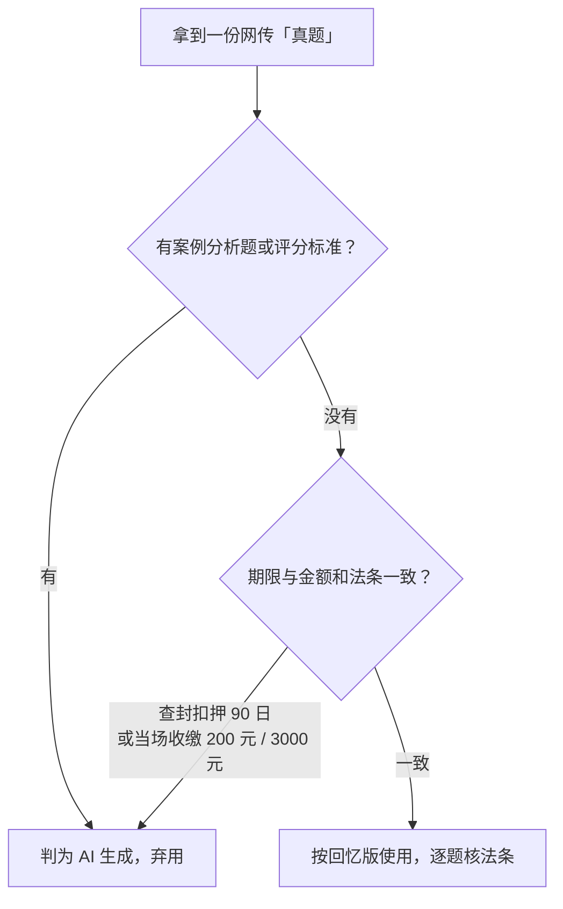

# 山东省考行政执法专业科目：考情、回忆版真题入口与真伪校验

> 核对：2026-11-12。依据：2026-11-09～11-11 的检索与资料交付（下称「会话实测」，本轮未重跑），考情部分按官方大纲口径（文档级）。**快照性质**：考情与日期是 2026 年度（2025-12-06 笔试）前后的观察；适用窗口为相邻年度备考的方法与入口，日期、题量、渠道以当年度公告为准，入口可用性随平台规则变化。

## 一句话

这门课官方只发大纲、不公开试卷，市面上的「真题」全是回忆版；入口就那么几个，网传卷先按三条硬特征排假，再逐题核法条。

## 考情事实

| 项 | 事实 | 证据 |
|---|---|---|
| 科目全称 | 《行政执法类职位专业科目笔试》 | **文档级**（大纲） |
| 沿革 | 2021-11 随 2022 年度山东省考公告首次发布大纲，此后每年延续 | **文档级**（公告口径，未逐年复核） |
| 形式 | 闭卷笔试，全部客观题 | **文档级** |
| 时长与分值 | 90 分钟，满分 100 分 | **文档级** |
| 题型题量 | 判断 30 + 单选 50 + 多选 30 = 110 题 | **文档级** |
| 官方发布 | 只发大纲，从不公开试卷与答案；渠道为灯塔-党建在线、山东省人事考试信息网 | **文档级** |
| 2026 年度笔试 | 2025-12-06 | **推测**（由多条考后帖的笔记 ID 时间戳反推，未见公告原文） |

**不要把某一年写成永久事实**：从 2022 年度到 2026 年度沿用同一套形式，不等于下一年度不变；题量、时长、科目名都以当年度大纲为准。

## 真题只有「回忆版」：发布节奏

没有官方原卷，流传的都是考生回忆 + 机构整理，选项补全程度不一。典型节奏（**已验证**，会话实测检索所见，非官方日程）：

| 时间 | 出现什么 | 在哪 |
|---|---|---|
| 笔试当晚 19:00 起 | 考生自发「对答案」图文 | 小红书，爆发式 |
| 次日 | 机构「真题+答案+解析」长文 | 微信公众号，各地机构号 |
| 3–7 天后 | 补全选项的「考生回忆版」套卷 | 粉笔、中公、华图 App 题库 |
| 寒假前后 | 网盘合集 | 豆瓣小组、贴吧、夸克/百度网盘 |

## 入口清单

- **粉笔 App**（首选）：题库 → 山东省考 → 行政执法专业课 → 历年真题。当次见到的唯一把回忆版做成结构化题目并带解析的入口，部分免费。**已验证**（会话实测）
- **深考部落**（山东本土品牌，公众号/小程序/淘宝店同名）：搜狗微信搜索能查到《2023年…真题（精选版）上线了》一类文章，正文自述「考试真题（**考试回忆版**）」；其说明称模拟题「以历年行政执法真题（**已收录的回忆或网络版题目**）作为主要依据」。**已验证**（读到原文）
- **小红书**：搜「山东 行政执法 对答案」，按最新排序；2026 场次的帖子 ID 形如 `6933e6bb000000001f00b850`。**已验证**
- **公众号**：搜「山东 行政执法 专业科目 真题」，找地方机构号。**已验证**
- **其它**：中公/华图「历年试题」栏目；人人文库/原创力/道客巴巴，这类平台大量 AI 生成且需积分。**已验证**（当次检索所见）

## 校验：笔记 ID 前 8 位是十六进制时间戳

小红书笔记 ID 的前 8 位按十六进制解析就是 Unix 秒，再按 UTC+8 换算成本地时间。例：`0x6933e6bb` → **2025-12-06**，正是笔试当天，可证「对答案」帖是考后第一时间发的，不是事后编的。**已验证**（会话实测反推）

```powershell
$id = "6933e6bb000000001f00b850"
[DateTimeOffset]::FromUnixTimeSeconds(
  [Convert]::ToInt64($id.Substring(0, 8), 16)
).ToLocalTime()
```

换算命令本轮未重跑，算的是同一个「hex → Unix 秒 → 本地时间」。用途只作旁证：能反推发帖时间与考试日期，不能证明帖子内容正确。

## AI 生成「假真题」的三处识别特征

| 特征 | 反例写法 | 为什么一眼假 | 证据 |
|---|---|---|---|
| 出现案例分析题、评分标准 | 《2025年…试题卷（含答案）》 | 全客观题，不可能有主观题与评分标准 | **已验证**（反例核对；题型为文档级） |
| 查封、扣押最长期限写成 90 日 | 90 日 | 实际 30+30=60 日 | **文档级**（法条） |
| 把 200/3000 元当当场收缴标准 | 简易程序 200/3000 元 | 200/3000 元是简易程序当场处罚限额；当场收缴是 100 元以下 | **文档级**（法条） |



结论：网传卷必须逐题核法条；**「回忆版错记」比题目本身更值得校**，因为错记会被当成考频依据。**已验证**（当次比对）

## 当次交付物：资料包，不是真题

```text
山东省考-行政执法专业科目\
├── 01_考情分析与官方大纲.md
├── 02_高频考点速记.md            （设定权→主体→程序→期限→救济→赔偿 六线）
├── 03_精编模拟卷（含解析）.md     （60 题缩编，非真题，页脚带声明）
├── build_docx.py                 （python-docx 生成 Word）
└── build_pdf_pillow.py           （Pillow 纯用户态排版 A4 PDF）
山东省考-行政执法专业科目_备考资料包.docx
山东省考-行政执法专业科目_备考资料包.pdf            （Pillow 版：17 页，位图，无文字层）
山东省考-行政执法专业科目_备考资料包（文字版）.pdf   （Word 导出：26 页 / 719 KB，PDF-1.7，8 个 ToUnicode）
```

文件与字节数 **已验证**（当次产物核对）。

**诚实边界**：目标是真题，交付的是自编资料 + 入口清单。文件页脚与回复都写明「它是资料，不是真题」。自编模拟卷能练题型和法条，不能当考频依据，也不能从它反推「某年考过什么」。**已验证**（当次交付口径）

涉及法条：《行政处罚法》（2021-07-15 施行）、《行政许可法》、《行政强制法》、《行政复议法》（2023 修订，2024-01-01 施行）、《行政诉讼法》、《国家赔偿法》、《公务员法》（2018 修订）、《政府信息公开条例》（2019 修订）。**文档级**

## 抓取边界

小红书 404 占位（`error_code 300031`）、知乎 403、贴吧「百度安全验证」、公众号「环境异常」、夸克网盘 JS 空壳 + 提取码、文库需登录或付费——通常只拿得到标题与摘要；`web_fetch` 的通用坑与绕法见 [Web 搜索与抓取](../deepseek-harness/Web搜索与抓取.md)。**已验证**（会话实测）

## 时效性与未核实

- 真题本体始终没下载成功（登录墙），所有「真题」判断都基于入口页、标题摘要与别人整理的回忆版；**❓ 未取得官方或机构原卷**。
- 2026 年度笔试日期是旁证反推，未见公告原文；换年度必须重新核。**推测**
- 题量与时长以当年度大纲为准；「每年延续」只观察到 2026 年度为止。**文档级**
- 入口的可用性、收费与是否需要登录随平台变；粉笔的「首选」是当次比较结论，不是长期排名。**已验证**（当次）
- 60 日与 100 元两处按当时法条口径，修法后需重核。**文档级**
