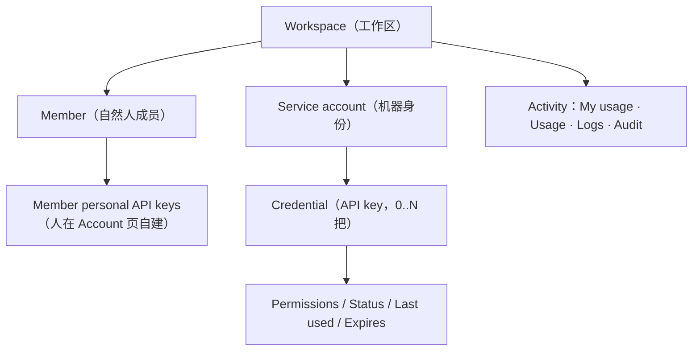
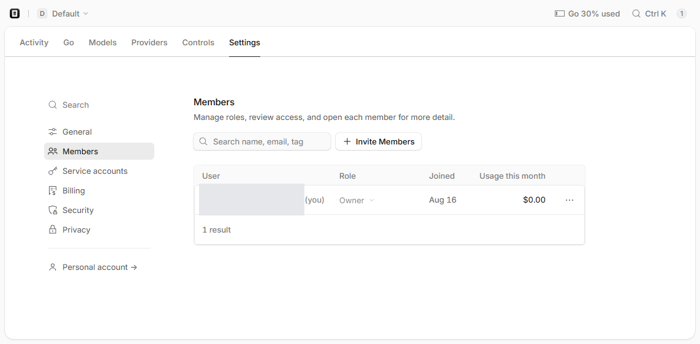
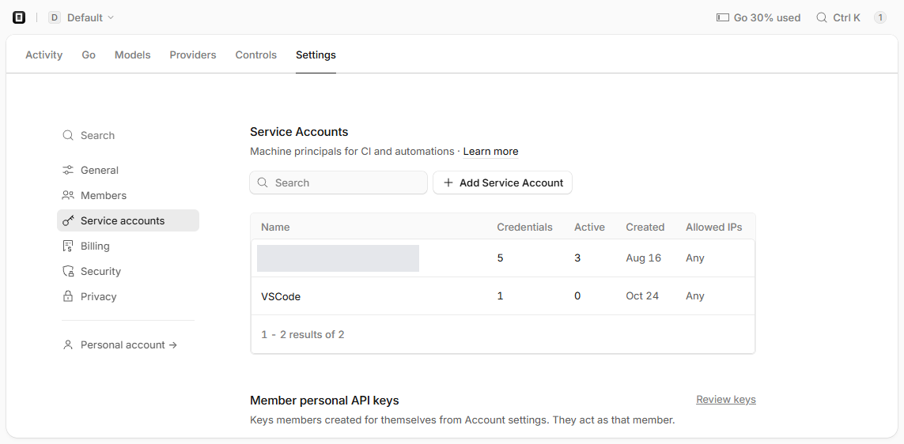
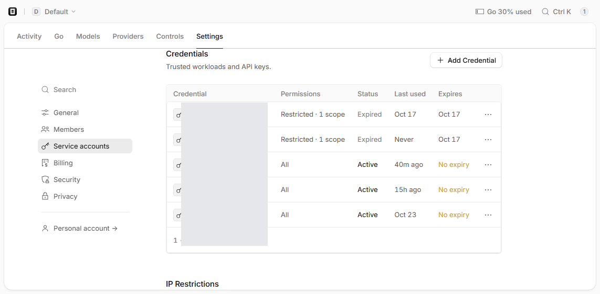
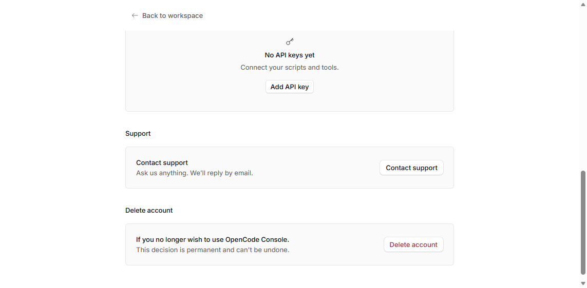
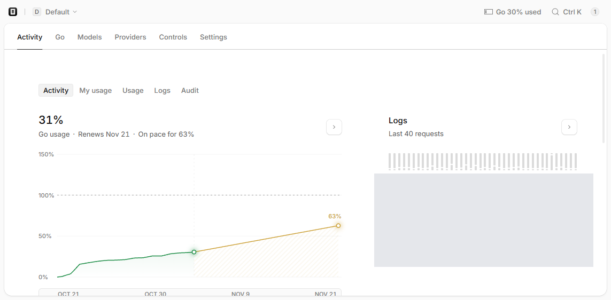

# OpenCode Console 对象模型：成员 · 服务账号 · 凭据 · Activity

## 一句话

Console 里让新人看晕的地方，几乎都是同一个问题：**"人"和"机器身份"是两套体系**。Members 里的是自然人，Service accounts 里的是给程序用的分身，API key 只挂在后者（或人自己名下），请求以它们的名义发出，所以「成员只有 1 个」和「有 5 把 key 在跑」并不矛盾。

## 核对口径

- 环境：`opencode.ai/console`，2026-11-05 截图（GMT+8），停留在 Default 工作区。
- **已验证（截图）**：以下页面结构、列名、表头、页面文案均来自实际截图；截图存于同目录 `shots/`。
- **推测**：Console 未公开对象模型文档，下面所有"为什么"层面的解释（Legacy 的由来、$0.00 与 $0.71 的差异原因）是从页面事实反推的，不是官方口径。Console UI 会变，列名以截图当时为准。
- 截图已按隐私要求打码：邮箱、key 前缀、服务账号别名、日志里的账号标识均以灰块遮盖；打码不影响对结构的判读。

## 对象层级

一条可操作的推论：**吊销 key 只影响用它的客户端，不影响人登录 Console** —— 因为 key 属于机器身份，登录靠的是成员账号。

## 0. 名词 → 页面速查

| 名词 | 含义 | 位置 | 截图 |
|---|---|---|---|
| Member | 成员（自然人） | Settings › Members | `01-members.png` |
| Owner / Admin / Member | 角色（所有者 / 管理员 / 普通成员） | 同上，Role 列 | `01-members.png` |
| Service account | 服务账号（机器身份） | Settings › Service accounts | `02-service-accounts.png` |
| Credentials | 累计建过几把 key | 同上，表格第 2 列 | `02-service-accounts.png` |
| Active | 其中还有几把能用 | 同上，第 3 列 | `02-service-accounts.png` |
| Member personal API keys | 成员个人名下 key（页面底部独立一段） | 同上页面底部 | `02-service-accounts.png` |
| 单把 key 明细 | 前缀 / 权限 / 状态 / 最后使用 / 到期 | 点进某个服务账号后的 Credentials 表 | `03-legacy-keys.png` |
| Personal API keys | 本人名下的 key（账号级页面） | 左栏 `Personal account →` | `04-personal-keys.png` |
| My usage / Usage / Logs / Audit | 个人用量 / 工作区用量 / 请求日志 / 审计 | Activity 页顶部二级标签 | `05-activity-tabs.png` |
| 工作区切换 | 一个账号下多个工作区 | 左上角 `⌄` 工作区选择器 | — |

## 1. 成员列表（`01-members.png`）

**路径**：左侧 `Settings` → 左列 `Members`。

**结构**：顶部主导航 `Activity / Go / Models / Providers / Controls / Settings`；左侧设置侧栏 `General / Members / Service accounts / Billing / Security / Privacy`，最底 `Personal account →`。主体是成员表，列头 **User / Role / Joined / Usage this month**，表尾 `N result`，右上 `Invite Members`。

**判读**：

- 成员表只有自然人，**服务账号不会出现在这里**。
- `Usage this month` 显示 `$0.00` 不代表没用量：Go 套餐内的消耗走**配额**而不是按量计费，不计入美元花费。真实消耗看 Activity 的百分比与请求数。

## 2. 服务账号列表（`02-service-accounts.png`）

**路径**：`Settings` → `Service accounts`。

**结构**：副标题 `Machine principals for CI and automations`；表格列头 **Name / Credentials / Active / Created / Allowed IPs**；页面底部独立一段 **Member personal API keys**（`Keys members created for themselves from Account settings. They act as that member.`）。

**判读**：

- **Credentials = 累计建过几把；Active = 其中还有几把能用。** `Active = 0` 的服务账号只剩空壳，那把 key 已失效，不产生费用。
- 系统迁移生成的账号会带 `Legacy:` 前缀 + 成员邮箱，用来标明来源。
- 底部那段说的是「人」自建的 key，与上面的服务账号是**两套体系**：前者跟人走，后者跟机器身份走。

## 3. 服务账号详情与凭据表（`03-legacy-keys.png`）

**路径**：`Settings` → `Service accounts` → 点某一行。

**结构**：面包屑 `Service Accounts › <name>`；标题区给 `Service account · N credentials · Created <date>`、`Models: All 49 models available`、`Spend: No budget policy`；统计卡 Cost / Requests / Tokens，带时间范围选择器（如 `Today`）。

主体是 **Credentials** 表，列头 **Credential / Permissions / Status / Last used / Expires**，每行右侧 `…` 可单独吊销；表格下方是 **IP Restrictions**。

**凭据的几种形态**（实测到的组合，不是穷举）：

| 形态 | Permissions | 典型 Status | 风险判断 |
|---|---|---|---|
| 旧版一次性 key | `Restricted · 1 scope`（仅 Models: Request） | Expired | 权限已被限死，即便复活也只能请求模型 |
| Console 期长期 key | `All` | Active + `No expiry` | 权限全开、无到期，实际主力，也是最该轮换的 |

前缀能看出时代：旧 key 形如 `sk-…`，Console 期形如 `oc_sk_…`（此处不复述任何真实前缀字符）。

**判读要点**：

- `Active` 计数与表里 `Status = Active` 的行数必须对得上，对不上说明有 key 被单独禁用。
- `Last used` 是判断「是否还有人用」的唯一低成本依据；长期无请求的 `All` 权限 key 是首选清理对象。
- 吊销不可逆 —— key 只能重建不能恢复，动手前确认没有脚本/CI 在用它。

## 4. 账号级个人 key 页（`04-personal-keys.png`）

**路径**：`Settings` → 左下 `Personal account →`，向下滚到 **Personal API keys**。

**结构**：顶部 `← Back to workspace`（说明已离开工作区，进入账号级页面）；中间是空态卡 `No API keys yet` / `Connect your scripts and tools.` / `Add API key`；下方还有 `Support` 与 `Delete account` 两个区。

**判读**：这一页为空，说明所有 key 都挂在服务账号下。于是两件事同时成立：吊销服务账号 key **不影响** Console 登录；但会让使用那把 key 的客户端**立刻 401**。

## 5. Activity 与四个二级标签（`05-activity-tabs.png`）

**路径**：顶部导航 `Activity`。

**结构**：二级标签 **Activity / My usage / Usage / Logs / Audit**；左侧卡片是 Go 套餐用量（大号百分比 + `Renews <date>` + `On pace for N%` + 实测/预测折线图，含 50% / 100% 参考线）；右侧是 `Last 40 requests` 日志列表，行格式 `状态码 · 模型 · 服务账号 · 时间`。

**判读**：

- 日志里的账号名是**服务账号**，不是成员 —— 请求以机器身份发出，所以成员页的花费与它自己的花费是两行数据。
- 四个标签分工：`My usage` 个人配额与花费；`Usage` 工作区维度拆分（按天/模型/人，可导 CSV）；`Logs` 每次请求的结果与时延；`Audit` 操作审计。

## 6. Service account 是概念，`Legacy:` 那个是实例

| 维度 | Service account（概念） | `Legacy: <member email>`（实例） |
|---|---|---|
| 是什么 | Console 的功能：给程序用的机器身份 | 已存在的某一个机器身份 |
| 数量 | 一个工作区可以有多个 | 视迁移情况，可能只有 1 个 |
| 谁建的 | 手动 `Add Service Account` | 系统迁移旧版 Zen 账户时生成 |
| 命名 | 自己起（如 `VSCode`） | 固定带 `Legacy:` + 成员邮箱 |
| 算不算成员 | 不算，不进 Members | 不算 |
| 归属 | 属于某个工作区 | 属于迁移时落入的工作区 |
| 持有 | 0..N 把凭据 | 通常是旧 key 的落点，可能多把 |

**为什么会存在**：旧版 Zen 时期账号近似「一把 key + 一个余额」，Console 引入工作区 / 成员 / 服务账号结构后，旧身份必须有落点，于是被包装成一个服务账号并加 `Legacy:` 前缀 —— 好处是**原有 key 继续有效，客户端不用改配置**。（机制解释，推测）

**与手工建的账号的区别**：手工建的是干净起点（1 把 key、按需授权）；`Legacy:` 那个往往攒着历史 key，`All` 权限 + 无到期的居多，是权限收敛的重点。

## 7. 一页结论（可迁移的判读顺序）

1. 先看 **Members** 有几个人 —— 它只统计自然人。
2. 再看 **Service accounts** 的 `Credentials` vs `Active`，算出「有几把还能用」。
3. 点进每个账号看 **Permissions + Expires + Last used**：`All` + `No expiry` + 久未使用 = 优先轮换/吊销。
4. 看 **Personal account → Personal API keys** 是否为空，判断 key 到底挂在人还是机器下。
5. 用 **Activity › Usage / Logs** 交叉验证：请求到底是谁发出的、花了多少。

## 相关

- 凭据在 provider 侧只有一份、`opencode-go` 与 `opencode` 同身份：见 `../opencode-provider/凭据只有一份-opencode-go与opencode同身份.md`。
