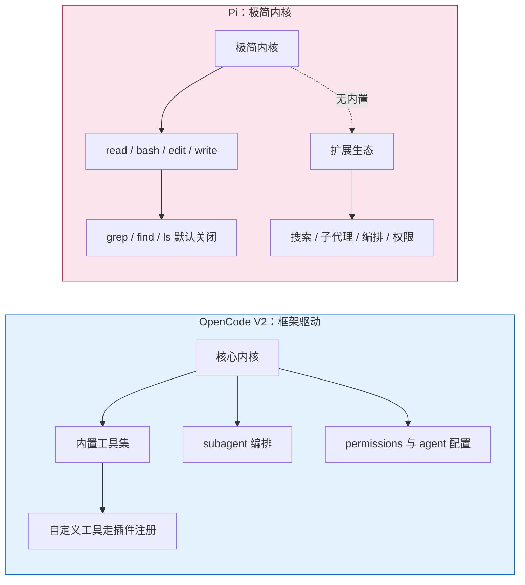

# OpenCode V2 内置工具清单，与 Pi 的对照

> 核对范围：上游 `anomalyco/opencode` 的 `dev` 分支，`packages/core/src/tool/plugin/` 目录（2026-11-05 取）。
> 工具名取自各文件顶层 `export const name`，**已验证**。Pi 侧取自官方站点与包文档，**部分已验证**（见文末）。
> 插件注册机制（自定义工具怎么加）见 `插件与工具注册.md`，本篇不重复。

## 一句话

V2 的内置工具是"**一堆内置插件**"，不是散在代码里的硬编码分支；名字也和流传的清单有出入——**是 `shell` 不是 `bash`，是 `patch` 不是 `apply_patch`，没有独立 `lsp`/`find`/`ls`**。

## 1. 目录里实际有什么（已验证）

`packages/core/src/tool/plugin/` 下 19 个文件：

```
artifact.ts       edit.ts        file-diff.ts     glob.ts
grep.ts           image-generate.ts  mcp-resource.ts  opencode.ts
patch.ts          question.ts    read.ts          schedule.ts
shell.ts          skill.ts       subagent.ts      todo.ts
webfetch.ts       websearch.ts   write.ts
```

能取到顶层注册名的：

| 文件 | 注册名 |
|---|---|
| `shell.ts` | `shell` |
| `read.ts` / `write.ts` / `edit.ts` | `read` / `write` / `edit` |
| `patch.ts` | `patch` |
| `grep.ts` / `glob.ts` | `grep` / `glob` |
| `todo.ts` | `todowrite` |
| `question.ts` | `question` |
| `skill.ts` / `subagent.ts` | `skill` / `subagent` |
| `webfetch.ts` / `websearch.ts` | `webfetch` / `websearch` |
| `image-generate.ts` | `experimental_image_generate` |

其余（`artifact`、`file-diff`、`mcp-resource`、`opencode`、`schedule`）没有顶层 `name` 导出，可能一个文件注册多个工具或走别的注册路径——**未逐个确认注册名**。

## 2. 四处纠错

| 流传说法 | 源码事实 | 影响 |
|---|---|---|
| 内置 `bash` | 注册名是 **`shell`** | 按名字写 agent 的 `tools` 白名单/禁用列表会失效（写 `bash: false` 不会关掉它） |
| 内置 `apply_patch` | 注册名是 **`patch`**，入参是 `patchText` | 提示词里要求"用 apply_patch"可能对不上工具名 |
| 内置实验性 `lsp` 工具 | 目录里**没有** lsp 工具；`lsp` 只出现在 `edit.ts`/`write.ts` 的诊断相关代码里 | 以为有独立 lsp 工具会白找 |
| 内置 `find` / `ls` | 没有这两个独立工具；文件发现靠 `glob`，读取靠 `read` | 从 Claude Code 迁过来的习惯要改 |

另外 `todowrite` 这个名字是对的，`question` 也确实是**内置工具**（`packages/core/src/tool/plugin/question.ts`），不是某个前端加的——前端只是给它做了交互界面（**未核实**：OpenChamber 从哪个版本开始做富交互）。

## 3. `websearch` 的边界

源码可确认的：

- 工具存在，注册名 `websearch`。
- 配置层 `packages/schema/src/config/websearch.ts` 支持 `provider: <id> | "random" | false`；`false` 直接关掉。
- 运行时先 `ctx.websearch.providers()` 取可用 provider，若列表为空则**把工具从模型可见列表里删掉**（`if (...providers).length === 0) delete event.tools[name]`）。
- 首次使用会弹权限确认："Allow search via <provider 名>"。

不能确认的：**具体内置哪些 provider、是否需要 API key**。`providers()` 是插件式注册，本次没有定位到内置 provider 实现，所以"Exa 免费无需密钥"这条**标未核实**，别当既定事实。

## 4. 与 Pi 对照

Pi 的定位是极简内核 + 扩展生态（官方站点与包文档，**已验证**）：

| 维度 | OpenCode V2 | Pi |
|---|---|---|
| 默认工具 | 上面那张表，开箱即用 | `read` / `bash` / `edit` / `write` 四个 |
| 额外内置 | 无（都算默认） | `powershell`、`grep`、`find`、`ls`，**默认关闭**，靠 `--tools` 开 |
| 工具白名单 | 配置里按 agent 声明 | `--tools a,b,c`（白名单，会覆盖默认集）；`--exclude-tools`；`--no-tools` |
| 联网搜索 | 内置 `websearch` | 无内置，靠扩展或外部 CLI |
| 子代理 | 内置 `subagent` | 无内置，靠扩展（如 `pi-subagents`） |
| Skill | 内置 `skill` 工具 | 有 skill 机制（`SKILL.md` 按需注入），但**不是**一个可调用的工具 |
| 编排 | 内置 subagent/task + 权限层 | 靠扩展提供工作流/角色 |
| 哲学 | 框架给能力，你用配置选用与约束 | 内核极简，能力由扩展装出来 |



一句话解释差异：**OpenCode 的"角色与权限"是配置项，Pi 的"角色与权限"是扩展加 `--tools` 白名单**。前者开箱就有边界，后者要自己装。

## 5. 怎么复核（只读）

```bash
# 列工具目录
gh api repos/<owner>/<repo>/contents/packages/core/src/tool/plugin?ref=dev --jq '.[].name'

# 取单个工具的注册名
gh api repos/<owner>/<repo>/contents/packages/core/src/tool/plugin/shell.ts?ref=dev \
  -H "Accept: application/vnd.github.raw" | grep -m1 '^export const name'

# Pi 侧确认默认工具与白名单
pi --help | grep -A2 -- '--tools'
```

工具名会随版本改，**写死名字的配置升级后要重查**。
