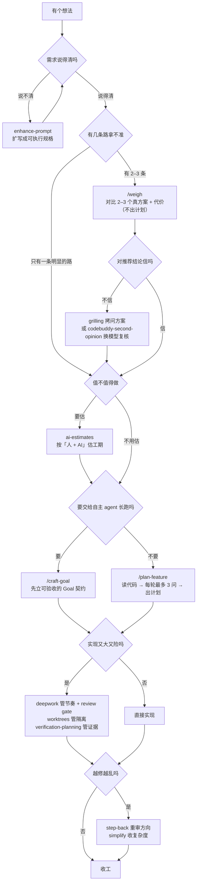

# 从想法到计划：生成方案 / 出计划 / 改进功能的能力全表

## 一句话

这套环境里"把一个模糊想法推到可执行"的能力分散在三处：OpenChamber 的 3 个 magic prompt 命令、`~/.config/opencode` 里自装的 skill、OMO slim 挂给 orchestrator 的 skill。**别按熟练度选，按你在哪一步卡住选**。

## 全表

| 名称 | 类型 | 来源 | 解决什么 | 什么时候用 |
|---|---|---|---|---|
| `/weigh` | 命令 | OpenChamber | 对比 2–3 个真方案 + 代价 + 推荐，**不出计划** | 想加功能但不确定走哪条路 |
| `/plan-feature` | 命令 | OpenChamber | 读代码 → 每轮最多 3 问 → 出实现计划 | 确定要做，需要具体计划 |
| `/craft-goal` | 命令 | OpenChamber | 把想法炼成可验收的 Goal 契约 | 要交给自主 agent 长跑 |
| `grilling` | skill | config | 设计树逐轮拷问，每问带推荐答案 | 想压测方案本身（`grill-me` 是它的隐藏别名） |
| `verification-planning` | skill | OMO | 改动前先定可执行的验证/证据路径 | 非平凡改动前，orchestrator 自动触发 |
| `ai-estimates` | skill | OMO | 按「人 + AI」估工期 | 判断这个功能值不值得做 |
| `deepwork` | skill | OMO | 分阶段执行 + 每阶段 review gate | 大且高风险的实现 |
| `step-back` | skill | OMO | 补丁越堆越多时退回重审方向 | 方案开始失控 |
| `simplify` | skill | OMO | 行为不变前提下降复杂度 | 计划或实现过于笨重 |
| `codebuddy-second-opinion` | skill | config | 换模型做独立复核 | 对结论没底 |
| `codemap` | skill | OMO | 陌生仓库的分层结构图 | 还不了解现有代码 |
| `enhance-prompt` | skill | config | 模糊需求扩写成可执行规格 | 需求本身说不清 |
| `worktrees` | skill | OMO | 隔离的并行/试做工作道 | 高风险改动想先隔离 |
| `reflect` | skill | OMO | 从历史会话提炼可复用流程 | 想沉淀成套路 |

## 按卡点分流

横着走不通就退回上一格；图只回答"下一步该用谁"，不回答"这个方案好不好"。

## 三个使用边界

1. **三个命令任何会话都能用**，提示词在 OpenChamber 的 Settings → Magic Prompts 改，所以它们的行为跟着本机配置走，不同机器可能不一样。
2. **OMO 那批 skill 挂在 orchestrator 上**，靠 `description` 匹配自动触发，不用点名；`/deepwork` 是这批里唯一带命令入口的。
3. `simplify` 的 `allowedAgents` 只有 oracle，主 agent 直接加载不了（细节见 [OMO 随包 skill 全表](../oh-my-opencode-slim/OMO-slim-随包skill全表.md)）。

## 上游一步：`enhance-prompt` 到底是哪种东西

比 `/craft-goal` 更上游的问题是"需求还没说清"。叫 `enhance-prompt` 的东西**不止一个项目**，形态至少三种：

| 形态 | 表现 | 怎么认 |
|---|---|---|
| 命令型 Skill | 输入 `/enhance-prompt`，会先扫代码库再重写你的提示词 | 命令列表里能搜到；磁盘上有带 `SKILL.md` 的目录 |
| 可安装 Skill 包 | `npx skills add <pkg>` 装进宿主 | 安装后出现在 skill 目录，靠 `description` 自动触发 |
| 插件型 | 作为第三个主代理模式，或对每条会话注入模板 | 出现在配置的 `plugins` 里，或改了会话默认指令 |

**判据**：先看它是命令、skill 还是插件——三者的生效位置完全不同，装错了不会报错，只会"没反应"。
命令型去命令列表找；skill 型看 `~/.config/<app>/skill/`；插件型看配置的 `plugins` 数组。

这一步的产出是"一份更清楚的提示词"，交给后面的 `/plan-feature` 或 `/craft-goal` 继续。顺序反了（先出计划再澄清需求）通常要返工。

**未核实**：上表各项目的具体行为未在本机实跑；安装方式与触发方式以各自 README 为准。

## 故意没收进来的

创建/改良 skill 本身的那几个 —— `opencode-skill-creator`、`darwin-skill`、`skill-vetter`、`find-skills` —— 跟"生成方案 / 出计划 / 改进功能"这条线无关，只在自己造能力时才用。

## 已验证 / 推测

- **已验证**：`weigh` / `plan-feature` / `craft-goal` 在 `~/.config/openchamber/settings.json` 的 `draftStarters` 里注册为 `type: "command"`；上表 11 个 skill 在本机 skill 目录里都存在（`grilling` 与 `grill-me` 并存）。
- **未逐条核对**：三个命令的提示词正文（存在 OpenChamber 内部，不在 `~/.config/opencode/command`），"每轮最多 3 问"之类的细节来自实际使用观察，换版本可能变。
- 相关：[OMO slim 随包 skill 全表](../oh-my-opencode-slim/OMO-slim-随包skill全表.md)、[三个行为约束 skill](../oh-my-opencode-slim/OMO-slim-三个行为约束skill-估工防照抄与收手.md)。
