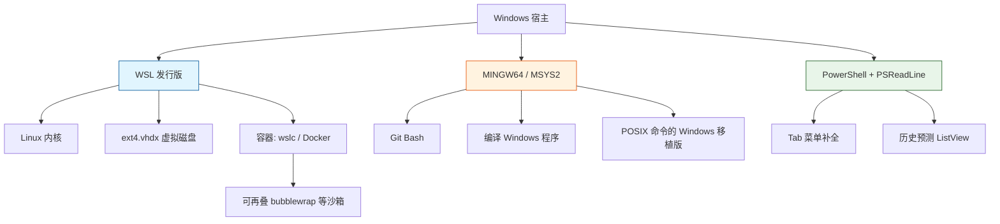

# WSL：虚拟磁盘、迁移，以及 `wslc` 到底是什么

> 核对时间：2026-11-05。
> **验证限制**：本机 `wsl.exe` 被执行策略阻断（Program Blacklist），无法实跑 `wsl --version` / `wsl -l -v`；本机也未发现发行版目录（`%LOCALAPPDATA%\Packages\WSL*` 不存在）。
> 因此本篇中 **磁盘布局与迁移命令标注为"文档结论"**，`wslc` 部分按微软官方文档核对（**已验证于官方文档**），Unc 路径与 Desktop 连接方式标注为 **推测/未实测**。

## 一句话

WSL 2 的一个发行版 = 一个 `ext4.vhdx` 虚拟硬盘；它**只会长不会自己缩**。想换盘只能"导出 → 注销 → 导入"；想省事就在 WSL 内部开发，别把项目放 `/mnt/c`。

## 1. 数据放在哪（文档结论）

```
%LOCALAPPDATA%\Packages\<发行版包名>\LocalState\ext4.vhdx
```

- 这是 WSL 2 发行版的根文件系统，大小随写入增长，**删除文件不会自动回收宿主磁盘空间**。
- 想缩容：发行版内 `fstrim` / `discard` 只能回收一部分；彻底回收需要 `wsl --manage <distro> --set-sparse true`（新版）或导出重导入、`diskpart compact vdisk`。**都属于高风险操作，先备份**。
- Windows 侧访问 WSL 文件系统走 **UNC 路径** `\\wsl$\<distro>\...`（新版本也接受 `\\wsl.localhost\<distro>\...`），不是真实盘符；把它当网络共享，IDE 索引与文件监听行为会和本地盘不同。

## 2. 迁到其他盘（破坏性，按顺序做）

```powershell
# 0. 先确认发行版名，并关闭 WSL
wsl -l -v
wsl --shutdown

# 1. 导出（目标路径要在新盘上，留足空间）
wsl --export <distro> D:\wsl\<distro>.tar

# 2. 注销（⚠️ 会删除原发行版及其 ext4.vhdx）
wsl --unregister <distro>

# 3. 导入到新位置（<newdir> 必须事先存在）
wsl --import <distro> D:\wsl\<distro> D:\wsl\<distro>.tar --version 2
```

风险与前置检查：

- `--unregister` **不可撤销**。导出完成后先验证 tar 大小与 `tar -tf` 能列出目录，再执行注销。
- 导入后默认用户会变成 root，需要进发行版改 `/etc/wsl.conf` 的 `[user] default=<name>`。
- 导入不会自动恢复默认终端配置与 Docker Desktop 集成，需要重新勾选。
- 确认 tar 能正常启动后再删旧 tar。

## 3. 为什么项目要放 WSL 内部

官方文档明确建议：代码放 **WSL 自己的文件系统**（如 `~/code`），不要放 `/mnt/c/...`。

- `/mnt/c` 走 9P/DrvFs 跨系统桥，`git status`、`npm install` 这类大量小文件 I/O 会慢一个量级。
- 反过来，Windows 侧工具访问 `\\wsl$` 也慢；跨系统访问总有一边付代价。
- 判据：**工具链在哪边跑，代码就放哪边**。

## 4. `wslc` / WSL container：不是 "WSL 3"

来源：微软官方 WSL 文档与 Windows Command Line 博客（2026 Build 公布，公开预览）。

- 名称是 **WSL container**，随 WSL 附带一个 CLI：`wslc.exe`（也提供 `container` 别名）。
- 要求 **WSL 2.9.3 及以上**，通过 `wsl --update --pre-release` 获取；`wslc version` 可自检。
- 能力：`wslc run` / `wslc image list` / `wslc container list` / `wslc exec` / `wslc stats`，语法接近 docker，不需要 Docker Desktop。
- 另有一套 NuGet API（`Microsoft.WSL.Containers`），供 Windows 应用以 C/C++/C# 调用 Linux 容器。
- 底层改进：virtiofs 文件系统、consomme 网络模式、更积极的内存回收。

**命名纠错**：公开材料里微软把它定位为 WSL 的功能增强，没有把它叫 "WSL 3"。看到"WSL 3 已发布"的说法，先按 WSL container 理解，并要求给出官方链接。**推测**："WSLS" 这类口口相传的叫法，大概率就是指 `wslc`。

对 agent 工具的意义：多了一个**比 Docker Desktop 更轻**的隔离选项；但它是容器，不是完整 VM，内核共享，隔离强度低于独立 WSL 发行版。

## 5. 沙箱与 WSL 的关系

- WSL 本身是**一层隔离**（轻量 VM），但不等于"沙箱"：默认仍可读写 `/mnt/c`、可访问网络。
- 真正的沙箱要在里面再叠一层：容器（`wslc` / Docker）、`bubblewrap`、`seccomp` 等。
- 反面：Windows 原生跑 agent 时没有同等隔离；某些工具（如带原生沙箱的插件）在 Windows 上直接不支持，只能进 WSL 用。

## 6. 在 WSL 里跑 OpenCode（推测，未实测）

两条路：

1. Desktop 设置里切 **WSL 后端**；
2. WSL 内起服务，Desktop 连本机端口：
   ```bash
   opencode serve --hostname 0.0.0.0 --port 4096
   ```
   然后连 `http://localhost:4096`。

注意：CLI 与服务端版本要匹配；`--hostname 0.0.0.0` 会把端口暴露到局域网，公共网络下不要这么开，或用 `127.0.0.1` + SSH 隧道。

## 7. 环境分层（本机相关）



## 8. 验证方式

```powershell
wsl --version          # 需 2.9.3+ 才有 wslc
wsl -l -v
wslc version
```

```bash
# 发行版内：确认根文件系统类型与挂载
df -hT /
mount | head
```

若 `wsl --version` 报"命令不存在"，说明只装了旧版或根本没装。
