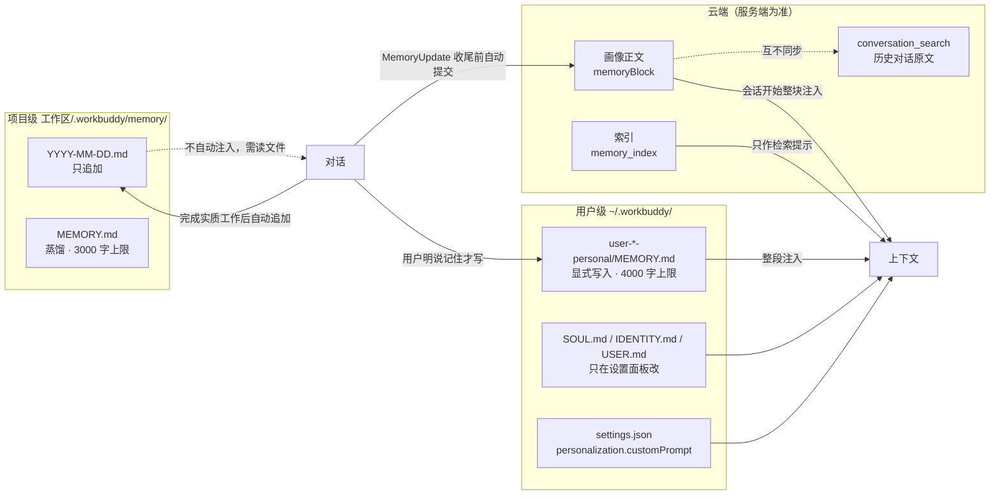

# WorkBuddy 记忆机制：三条链路、各自落点、注入优先级

> 核对：2026-11-08，WorkBuddy Desktop（genie 5.9.3，Windows）。依据三路：打包产物的字符串检索、本机文件实证、当前会话实际注入的内容。路径用 `~` 和 `<install>` 代替，账号目录写成 `user-<uid>-personal`。标 **推测** 的没有本地可观测证据。

## 一句话

记忆是**三条互不同步的链路**：云端画像（服务端库）、用户级本地文件（`~/.workbuddy/`，跨工作区）、项目级工作区文件（`<repo>/.workbuddy/memory/`）。不存在「云画像会自动复制成本地 `MEMORY.md`」这回事，清空云端不影响本地，本地写入也不上传。



三条链路之间**没有同步箭头**，这是最容易误判的地方。

## 三层落点

| 层 | 数据在哪 | 谁写 | 注入形态 |
|---|---|---|---|
| 云端长期记忆 | 服务端数据库 | 助手自动提交，或服务端从历史归纳 | 画像正文 + 索引 |
| 用户级（全局） | `~/.workbuddy/user-<uid>-personal/` | 助手显式写入 / 设置面板 | 整段注入 |
| 项目级（当前工作区） | `<workspace>/.workbuddy/memory/` | 助手按规则追加 | 不自动注入，靠读文件 |

**术语对齐**：`user-<uid>-personal/` 不是项目级，它只是全局目录下按账号隔离的**实际生效目录**，仍属用户级。项目级指工作区里的 `.workbuddy/memory/`。

## 哪些文件会被「自动」改

用户级目录里唯一会被记忆机制写入的 `.md` 只有 `MEMORY.md`：

| 文件 | 谁写 | 说明 |
|---|---|---|
| `MEMORY.md` | 助手，**显式** | 仅当用户明确要求长期记住且不限项目；就地编辑；注入上限 4,000 字符/会话 |
| `SOUL.md` | 设置面板 | 人设，不自动改；改它应告知用户 |
| `IDENTITY.md` | 设置面板 | AI 名字 |
| `USER.md` | 设置面板 | 用户称呼与档案 |
| `settings.json` 的 `personalization.customPrompt` | 设置面板 | 自定义指令，是**配置字段**不是 `.md` |
| `memory/` | 服务端同步 | 只放同步状态，不放正文 |

真正「不用开口就写」的只有两条：**云端画像**、**项目级日志与项目笔记**。

项目级两个文件的分工：`YYYY-MM-DD.md` 完成实质工作后立即追加、只追加不覆盖；`MEMORY.md` 放项目长期约定，上限 3,000 字符/会话，超过 30 天的日志蒸馏进来后删原文件。

## 设置面板三项 → 各自的落点

| 界面项 | 落点 | 运行时注入 |
|---|---|---|
| 给 WorkBuddy 的指令 | `settings.json` 的 `personalization.customPrompt` | 自定义指令段 |
| 人设设定 | `user-<uid>-personal/SOUL.md` | 全文 |
| 长期记忆 | `user-<uid>-personal/MEMORY.md` | 整段；云端模式开启时另注入画像 |

三者回答的不是同一件事：**指令管「怎么做」（规则）、人设管「我是谁」（人格）、长期记忆管「我知道你什么」（事实）**。同一条别写三处。

云端记忆有独立设置分区：`generateMemoryEnabled` / `localMemoryEnabled` 开关，以及 `memoryBlock` 的查看、导入、清空。

## 注入优先级

按注入措辞定，从高到低：**当前这次请求 > 系统与安全规则 > 指令（硬约束）> 人设（风格）> 长期记忆（背景参考）**。

依据是原文措辞差异（**已验证**，字符串在打包产物里可检索）：

- 指令段写 `Apply ... unless the user's current request specifies otherwise` —— 要求。
- 记忆段写 `Use it to understand user preferences` —— 只是背景。

**易混点**：云端记忆开启时，`MEMORY.md` 会被包进带 `standing instructions` 字样的标签，看着像「给 WorkBuddy 的指令」，但仍是同一份记忆数据，只是注入标签变了，跟 `customPrompt` 不是一回事。

## 云端链路的读写

写入有新旧两条：新版由模型在每轮收尾前评估有无持久偏好并用 `MemoryUpdate` 自动提交（原文含 `At wrap-up: before the final reply`、`Do not ask the user`、`Skip if nothing remains`，即不弹确认）；旧版是服务端直接从历史对话归纳，本地全程不参与。

读取时服务端返回三样：`user_profile`（画像正文）、`memory_index`（索引）、`storage_version`（版本号）。正文整块注入，索引只作检索提示；缺细节时调 `MemoryRecall`。

本地只存**同步状态**：`~/.workbuddy/memory/.pending-mutation-<uid>.json` 是并发/版本锁，`source` 只允许 `submit | import | clear`；画像正文的本地缓存按版本与服务端比对，服务端为准——这就是「手改缓存下次会话会被覆盖」的原因。

## 坑

- **两套同名文件**：`~/.workbuddy/` 根目录有一份迁移前的旧副本，`user-<uid>-personal/` 才是被注入的那份。本机两份都存在且内容不同（根副本 1,208 字节 / personal 970 字节），编辑时认准注入路径，别按「哪个新」猜。
- 云端清空不影响本地 `MEMORY.md`，反之亦然；同一偏好可能两处各存一份，**不会自动去重**。
- `MEMORY.md` 超 4,000 字符会被截断注入，项目级上限 3,000。
- 项目级记忆目录在新工作区默认不存在，首次写入时才创建。
- `~/.workbuddy/projects/<encoded>/` 名字带 projects，但存的是会话索引等客户端数据，不是项目级记忆。
- 项目专属规则走工作区的 `AGENTS.md` / `CODEBUDDY.md`，与上面三项不混用。

## 验证记录

```bash
# 1) 打包产物里这些标识确实存在（每条命中 1 次以上即成立）
cd "<install>/resources"
for s in MemoryUpdate MemoryRecall "standing instructions" "personalization.customPrompt" \
         "unless the user's current request specifies otherwise" "Use it to understand user preferences"; do
  printf '%s => ' "$s"; grep -a -o -m1 -F -- "$s" app.asar | wc -l
done
# 本机结果：全部 >= 1（MemoryUpdate=1, MemoryRecall=1, standing instructions=1, customPrompt=5, 两句原文各 1）

# 2) 两套同名文件同时存在，且被注入的是 personal 那份
ls -la ~/.workbuddy/MEMORY.md ~/.workbuddy/user-*-personal/MEMORY.md
# 本机：根 1208B（11-05）、personal 970B（10-27）；当前会话注入头写的路径就是 personal/MEMORY.md

# 3) 同步锁的结构与字段
python3 -c "import json,glob;d=json.load(open(glob.glob('$HOME/.workbuddy/memory/.pending-mutation-*.json')[0]));print(sorted(d))"
# 本机：['baselineVersion','lastVersion','mutationStartedAt','source','uid','updatedAt']

# 4) 设置里记忆相关字段（本机从未改过设置时不存在该字段）
python3 -c "import json,os;d=json.load(open(os.path.expanduser('~/.workbuddy/settings.json')));print(list(d.get('personalization',{})))"
# 本机：[] —— 默认不落盘，别把「没有 personalization 字段」当成机制失效
```

没验证的：云端归纳模型、去重策略、保留期限；设置页部分中文文案由服务端下发，本地包内不可见（**推测**）。

另见：[宿主与 CLI 的能力边界](WorkBuddy-宿主与CLI-能力边界.md)（`MEMORY.md` 只存在于宿主侧，CLI 目录没有）；跨工具的指令注入时机见 [指令注入的四种时机](../agent-config-layers/指令注入的四种时机-跨工具对照.md)。
